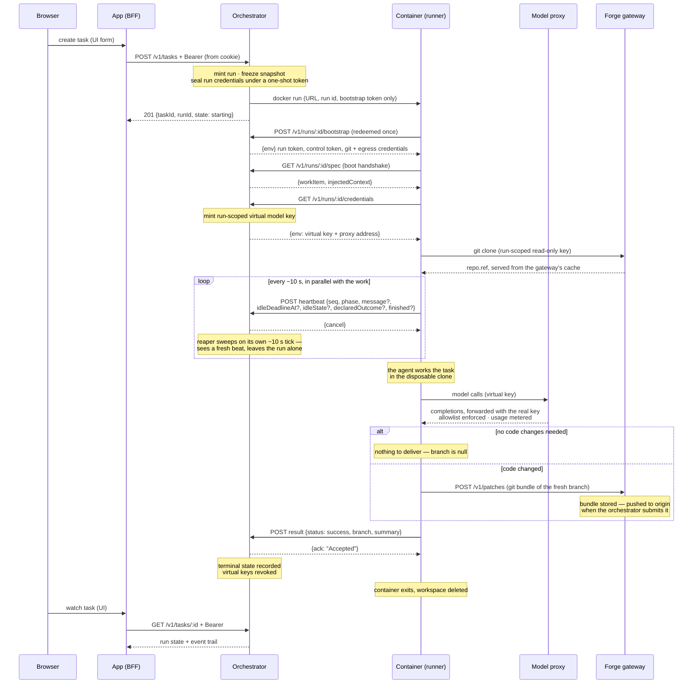

# 🗺️ The System, End to End

How the whole thing works together, told as one story: a user assigns a task in the UI, an agent
works it in a container, and a branch lands on the repo — with everything that happens in between.
This is the **happy path**; each step links to the doc that owns its details and its failure modes.

[The cast](#the-cast) below is the players and the happy path in one picture; the numbered sections
then walk that picture step by step.

Two deployment shapes serve this same story. Locally, [`@ryph/host`](../packages/host/README.md)
runs everything in **one process** (`bun run up`): the orchestrator's control plane with auth, the
model-proxy key CRUD and the mcp-gateway server CRUD mounted into its router, plus the model-proxy
and mcp-gateway data planes each on a port of their own. Networked, each service runs standalone
from its own `main.ts` and the seams become HTTP and a shared database — the story below reads the
same either way, because the runner and the agent container always talk to the control plane, the
model proxy and the MCP gateway over the network.

## The cast

A user assigns a task in the UI, an agent works it in a container, and a branch lands on the repo.
Seven players, each its own package or image:

| Player              | Package / image                                            | Role                                                                                                                                 |
| ------------------- | ---------------------------------------------------------- | ------------------------------------------------------------------------------------------------------------------------------------ |
| **App**             | [`@ryph/app`](../packages/app/README.md)                   | The web UI — a thin BFF; the browser never holds a token and never dials the orchestrator directly                                   |
| **Orchestrator**    | [`@ryph/orchestrator`](../packages/orchestrator/README.md) | The control plane — holds the agent roster, mints runs, launches containers, tracks liveness, records outcomes                       |
| **Agent container** | [`images/`](../images/README.md)                           | A pre-baked image packaging one harness with the runner; one container is one run                                                    |
| **Runner**          | [`@ryph/runner`](../packages/runner/README.md)             | The process inside the container — clones the repo, drives the coding agent, delivers its work as a fresh branch, reports the result |
| **Model proxy**     | [`@ryph/model-proxy`](../packages/model-proxy/README.md)   | The model-access data plane — the "provider" the container actually dials; real keys never enter the container                       |
| **MCP gateway**     | [`@ryph/mcp-gateway`](../packages/mcp-gateway/README.md)   | The tool-access data plane — the "MCP server" the container actually dials; real credentials never enter the container               |
| **Memory**          | [`@ryph/memory`](../packages/memory/README.md)             | What agents remember across runs — a curated canon, a brief per run, and memory tools behind the gateway                             |

Seven supporting members:

- [`@ryph/host`](../packages/host/README.md) — the single-process local deployment. It serves the
  control plane with auth, key CRUD, MCP server CRUD, the memory manager and the historian mounted
  into it, and — in the same process, each on its own port — the model-proxy and mcp-gateway data
  planes.
- [`@ryph/auth`](../packages/auth/README.md) — mints the tokens the user surface checks.
- [`@ryph/historian`](../packages/historian/README.md) — the permanent record of each run: every
  transcript chunk and diagnostics event, streamed live and stored.
- [`@ryph/logger`](../packages/logger/README.md) — the logger every service shares.
- [`@ryph/sealed`](../packages/sealed/README.md) — the shared credential kit: sealing, id and token
  minting, hash-and-compare.
- [`@ryph/tunnel`](../packages/tunnel/README.md) — many connections over one WebSocket, the wire a
  dev-server preview travels.
- [`@ryph/pi-mcp`](../packages/pi-mcp/README.md) — the pi extension, baked into the agent image,
  through which a run's tools reach the MCP gateway.

The target **repo** is where the work starts from (`repo.ref`) and where it ends up (a fresh branch
on `origin`).

## 1. 🧑‍💻 The UI: from a form to an authenticated API call

A user signs in and works entirely against the app's own origin. The app is a
[BFF](../packages/app/docs/auth-flow.md): login proxies to the control plane's
[@ryph/auth](../packages/auth/README.md) routes, the returned access and refresh tokens land in two
**httpOnly cookies**, and client-side JavaScript never sees either. Every data call goes to the
app's same-origin `/api/v1/*` proxy, which attaches the bearer from the cookie and forwards to the
orchestrator — no CORS, no token in the browser.

First the user creates an **agent** (`POST /v1/agents`) — an editable blueprint: a name, an email
identity, an optional system prompt, and a `harnessKind` naming which coding agent runs it. Then
they assign it a **task**: `POST /v1/tasks` with the agent id, a spec (title + instructions), and
the repo to work on (`{url, ref}`).

## 2. 🏗️ The orchestrator: mint a run, freeze a snapshot, launch a container

`POST /v1/tasks` is where the control plane springs into action
([run lifecycle](../packages/orchestrator/docs/run-lifecycle.md)). In one `createTask` it:

- **Mints a run** — one attempt at the task, the orchestrator's unit of tracking. It starts in state
  `starting` with heartbeat `seq = -1`.
- **Freezes a
  [snapshot](../packages/orchestrator/docs/architecture.md#-snapshots-agents-are-editable)**: the
  full `workItem` the runner will receive, plus the agent's system prompt as `injectedContext`.
  Agents are editable blueprints, so a run must capture what it meant at start — editing the agent
  mid-run changes nothing for the in-flight run.
- **Mints two credentials**: the **run token** (a per-run bearer, stored only as a SHA-256 digest)
  that lets this container speak for this run and nothing else, and the **control token** the
  orchestrator will later use to authenticate against the runner's inbound cancel endpoint.
- **Launches one container** through the `Provisioner`, on the deployment's one agent image
  (`RYPH_AGENT_IMAGE`, which carries every harness kind) at the run's size class — the repo's or the
  workspace's, else the deployment default (`RYPH_RUN_SIZES`).

The launch passes **no payload** — only the
[container contract](../images/README.md#-the-container-contract) as environment:
`RYPH_ORCHESTRATOR_URL`, `RYPH_RUN_ID`, and a single-use `RYPH_BOOTSTRAP_TOKEN` (plus the non-secret
proxy address when configured). Long-lived credentials never enter the launch env or work item. The
user gets `201 {taskId, runId, state}` back immediately — the run proceeds on its own from here.

## 3. 🥾 Boot: the runner fetches its own spec

The container's entrypoint is the runner, started with no argv. Its composition root
(`packages/runner/src/main.ts`) first redeems the bootstrap bearer at `POST /v1/runs/:id/bootstrap`.
The atomic, single-use exchange returns credentials held only in runner memory, then the runner
performs **fetch-on-boot**: `GET /v1/runs/:id/spec` with the run token, returning the frozen
`{workItem, injectedContext}` (with `services`, `environment`, `checks` and `skills` beside them),
validated through the same ingest schema as file inputs.

The fetch doubles as the **boot handshake**: a container that cannot reach or authenticate against
the orchestrator dies right here, before doing work it could never report — and since the
credentials are already in hand, it reports that death upstream as an error result with
`during: "booting"` rather than leaving the orchestrator to wait out the liveness window.

The handshake has a second half: `GET /v1/runs/:id/credentials`. The orchestrator mints a
**run-scoped virtual model key** from the run's frozen scope
([@ryph/model-proxy](../packages/model-proxy/README.md)) and answers with env the harness will
inherit — the virtual key plus the model proxy's address, so no real provider key ever enters the
container. Which variables carry them is the provider's business. A built-in borrows its own
conventional pair (`ANTHROPIC_API_KEY`, `ANTHROPIC_BASE_URL`) and the harness's SDK needs no
telling. An OpenAI-compatible endpoint an admin registered has no convention to borrow and no
harness has a catalogue for it, so it gets three of the platform's own instead:
`RYPH_MODEL_API_KEY`, `RYPH_MODEL_BASE_URL`, and `RYPH_MODEL_PROVIDER_CONFIG`, a JSON blob naming
the endpoint's slug, its wire dialect and every model it declares. The blob rides as one more env
var precisely so that this wire shape does not change — the env map flows through the orchestrator
to the runner untouched, and the harness adapter is the only thing that reads it. `{env: {}}` is the
normal answer for a run that calls no models; a fetch that fails is a boot failure, reported
upstream like a spec that would not fetch.

The same answer carries an `mcp` half when the agent has a **tool policy**: one run-scoped virtual
token for the [MCP gateway](../packages/mcp-gateway/README.md) and, per server in the run's frozen
scope, the gateway URL to dial in place of the real server. The runner writes a throwaway `mcp.json`
pointing at those URLs and puts the token in pi's spawn environment only — never in a file, never
where a repo's `setup.yml` steps could read it — and loads the
[`@ryph/pi-mcp`](../packages/pi-mcp/README.md) extension baked into the image. The real MCP
credential stays sealed in the gateway, which substitutes it at the edge on every call.

On the happy path the spec validates, and the runner wires itself up: the HTTP orchestrator gateway
for reporting, the inbound control API (a small HTTP server whose one authenticated route is
`POST /cancel`), and a disposable temp workspace.

## 4. 🔧 The run pipeline: clone, prepare, set up, run, finalize

The runner executes one work item through five phases
([architecture](../packages/runner/docs/architecture.md#-the-run-pipeline)):

1. **Cloning** — for every repo of the task (one entry per repository; a single-repo task is a list
   of one, a workspace's several), clone it into its own directory under the checkout root, check
   out its `ref` (the starting point), create the run's work branch in it (`<branchNamespace>/work`,
   the default line), and capture the base SHA ([git flow](../packages/runner/docs/git-flow.md)).
   `ref` is where the run reads from; the branches under `branchNamespace` — one per line of work —
   are where it writes to. Work never lands back on the branch it started from.
2. **Preparing** — set the agent as the author of its commits and load the agent's memory snapshot.
3. **Setting-up** — for each repo that carries a `.ryph/` dir
   ([environment setup](../packages/runner/docs/environment-setup.md)), run its `setup.yml` steps in
   its clone like CI (a failing step skips the rest of that repo's steps, discards what it changed
   in the tree, and the run goes on, with a warning on the run page and in the agent's prompt; an
   invalid `setup.yml` warns the same way) and inject its `environment.md` into the agent's system
   prompt under the repo's heading — beside the checkout's layout block, which names every repo, its
   directory and its context file.
4. **Running** — the [harness](../packages/runner/docs/harnesses.md) — the actual coding agent, e.g.
   pi — works the task inside the clone, streaming a live transcript and committing locally as it
   goes. Its model calls dial "the provider" as configured — actually the
   [model proxy](../packages/model-proxy/README.md), which authenticates the virtual key, enforces
   the model allowlist server-side, forwards the request with the real sealed key, and meters usage
   per run. Its tool calls dial "the MCP server" the same way — actually the
   [MCP gateway](../packages/mcp-gateway/README.md), which authenticates the run's virtual token,
   refuses any server or tool outside the frozen scope, forwards with the real sealed credential,
   and records every call in the run's tool-call trail. Some of those servers are the platform's
   own: [memory](../packages/memory/README.md) (what earlier runs recorded),
   [chat](../packages/chat/README.md) (the room a response is bound to), the
   [forge](../packages/forge/README.md)'s issues and pull requests, and
   [web](../packages/web/README.md) — `web__search` and `web__fetch`, the only way a run reads
   something nobody here wrote, returned as markdown inside a fence that says so.
5. **Finalizing** — per repo: commit any leftovers, collect the commits since its base SHA, **push
   the fresh branch to `origin`** (a repo with no commits ships nothing), and build the `Result`
   with one outcome per repo that shipped.

The checkout is deleted on exit; the pushed branches are the only thing that survives.

## 5. 💓 Meanwhile: heartbeats, the liveness gauge

The pipeline narrates progress only at phase boundaries, so a run parked in `running` for twenty
minutes would look dead. The runner's HTTP gateway closes that gap: on a timer
(`RUNNER_HEARTBEAT_INTERVAL_MS`, default 10 s) it POSTs `{seq, phase, message?, …}` to
`POST /v1/runs/:id/heartbeat`
([heartbeats](../packages/orchestrator/docs/run-lifecycle.md#-heartbeats-are-a-gauge-not-history)).

- Heartbeats are a **gauge, not history**: each beat updates the run row in place (phase,
  `heartbeatSeq`, `lastHeartbeatAt`). Only a phase _change_ becomes an event, so the append-only
  trail stays ~10 rows per run instead of one per beat.
- `seq` is a **monotonic guard**: a stale or reordered beat is answered but never applied, so the
  orchestrator's view can never roll backwards. The **first beat flips the run
  `starting → running`**.
- Beats **never say where the run lives**: the cancel push goes to the address the provisioner
  placed the run at, so nothing a run reports picks a target the control plane dials.
- Liveness is judged on the **orchestrator's receive time**, never a runner clock, so clock skew
  stays the runner's problem. Beats are best-effort — a failed one is warned and swallowed, never
  allowed to slow the run.

## 6. 🧹 Meanwhile: the reaper's sweep

Heartbeats only help if someone is watching them. The **reaper**
([lifecycle](../packages/orchestrator/docs/run-lifecycle.md#-the-reaper)) sweeps every
`RYPH_REAPER_INTERVAL_MS` (default 10 s), walking every non-terminal run:

- A run **silent past `RYPH_HEARTBEAT_TIMEOUT_MS`** (default 60 s; 10 min under the `ryph` binary)
  is marked `lost`, and any container still attached is hard-killed — a wedged runner cannot keep
  burning resources after the control plane gave up on it. `lost` is a guess, though: a late result
  is strictly better information and is allowed to upgrade it to the real terminal state.
- A run **asked to cancel but still running past `RYPH_CANCEL_GRACE_MS`** gets a graceful
  provisioner kill — the last of
  [cancellation's three backstops](../packages/orchestrator/docs/cancellation.md).
- A run **past its wall clock or at its spend cap** (`RYPH_RUN_MAX_WALL_CLOCK_MS`,
  `RYPH_RUN_MAX_SPEND_USD`, lowered per agent and per task) is asked to cancel exactly as an idle
  run is, with a `limit-reached` event naming the limit. The model-proxy refuses the run's calls
  thirty seconds later if the cancel never lands, and Kubernetes ends the Job at its deadline.

On the happy path the sweep finds every run freshly beating and does nothing. It is the safety net,
not the engine — the sweep never throws, and every enforcement is best-effort because the next tick
sees the same evidence and tries again.

## 7. 🏁 The result: authoritative, exactly once

When the pipeline finishes, the runner POSTs its `Result` to `POST /v1/runs/:id/result` — the
**authoritative outcome**, reported exactly once, last. On the happy path that is
`{status: "success", branches, summary}`: each branch is on `origin`, and `branches` is the receipt
— one per repo that shipped, with its repo, directory, name, head SHA, and the commit list on top of
that repo's `ref`
([`BranchOutcome`](../packages/runner/docs/git-flow.md#-what-survives-reported-back-branchoutcome)).
A non-empty `branches` _is_ the "work reached `origin`" signal, and the orchestrator opens one patch
per outcome, all in one set.

The orchestrator's `applyResult` maps the status to a terminal state (`success → succeeded`) and
acks `{ack: "Accepted"}`. It is **idempotent**: a re-POST of a result that already landed is
re-acked, never errored, which is what lets the runner retry its report safely. A terminal verdict
also **revokes the run's virtual keys** — a key exfiltrated from the workspace is dead the moment
the run concludes, with a TTL as the backstop. The runner then prints the same `Result` as JSON on
stdout, cleans up its workspace, and exits normally. The container is gone; the branch survives.

The other statuses map the same way — `cancelled → cancelled`, `failure → failed` (the agent ran to
the end and delivered nothing), `error → errored` (the machinery broke) — the
[full catalogue](../packages/runner/docs/architecture.md#-every-possible-result) has each shape.

## 8. 👀 Back to the UI

The run's whole life is visible on the user surface: `GET /v1/tasks/:id` returns the task, its
agent, and every run with its current state and event trail (created, first-heartbeat,
phase-changed, result) — credentials redacted. The app's Tasks view reads this through the same
authenticated proxy, so the user watches the run move `starting → running →` through its phases
`→ succeeded`, and picks up the branch name to inspect, PR, or discard.

The list beside it is paged and live: `GET /v1/tasks` answers one keyset page (filtered by status,
agent, origin, repo, requester, a date window or a search of the title) and `GET /v1/tasks/stream`
holds an SSE tail open that pushes each row as it moves. The state each row shows is a column on the
task, kept in step by the store whenever a run is written — which is what lets a filtered page of a
table with a hundred thousand tasks in it cost one indexed scan.

## 🪂 Off the happy path

Two flows deliberately not covered here, each with its own doc:

- **Cancellation** — recording an intent and delivering it two ways (an immediate push to the
  runner's inbound cancel endpoint, backstopped by the reaper's graceful kill), so a healthy runner
  and a wedged one both still stop; the runner side is graceful, and whatever the agent already
  committed still ships. Orchestrator side:
  [cancellation.md](../packages/orchestrator/docs/cancellation.md); runner side:
  [cancellation-flow.md](../packages/runner/docs/cancellation-flow.md).
- **Silence and loss** — a run that stops beating is reaped to `lost`, upgradeable by a late result:
  [run-lifecycle.md](../packages/orchestrator/docs/run-lifecycle.md#-the-reaper).
