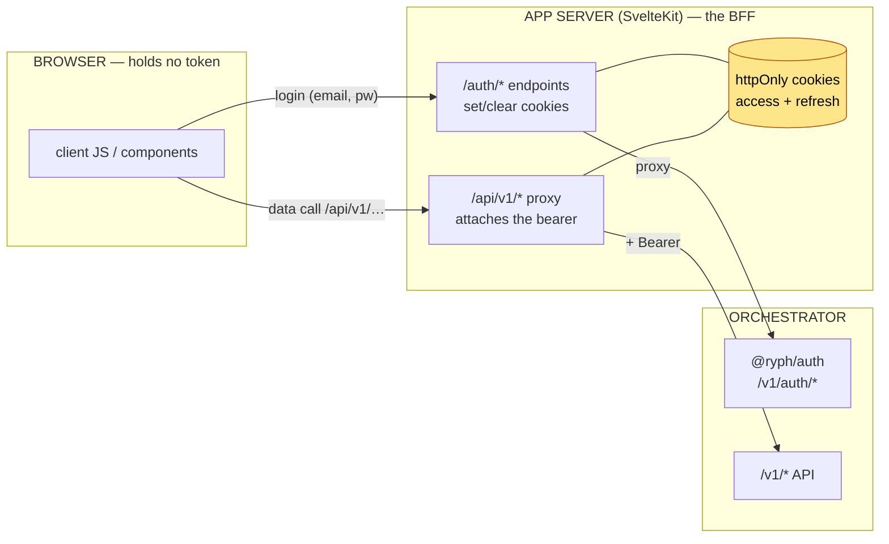
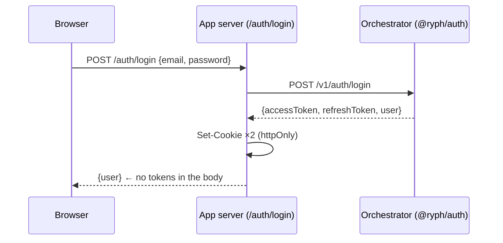
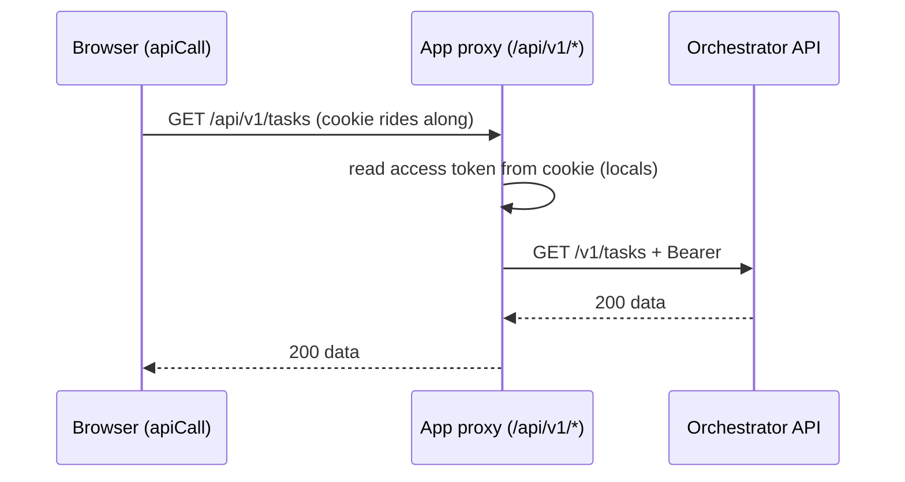
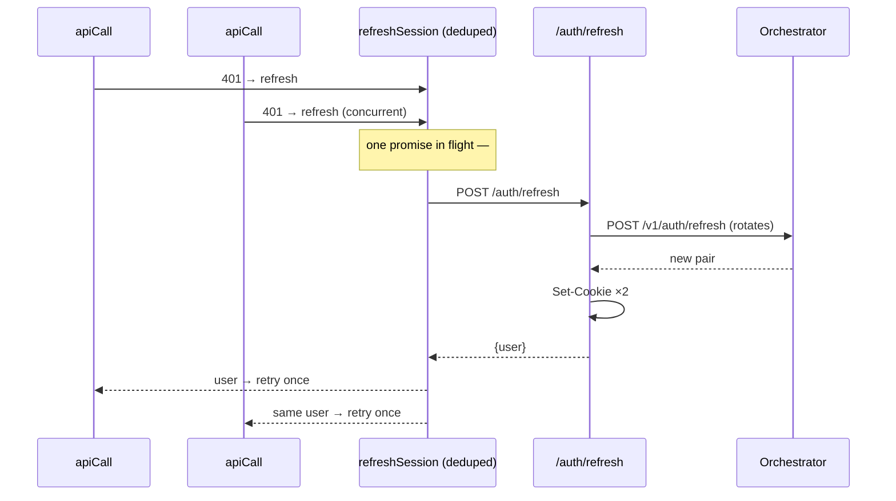

# 🔐 Auth Flow

The app is a **BFF** (backend-for-frontend): it holds the session so the browser never has to. This
is how a token gets from [@ryph/auth](../../auth/README.md) into an httpOnly cookie, how an API call
carries it without JavaScript ever seeing it, and how an expired access token is refreshed without
logging the user out. (What the app _is_ — the UI — is the [README](../README.md)'s opening.)

## 🎯 The core idea: the browser holds nothing

[@ryph/auth](../../auth/docs/token-flows.md) mints two tokens: a 10-minute access token and a 30-day
rotating refresh token. The naive SPA approach is to keep both in JavaScript — which means any XSS
reads them. The app does the opposite: **both tokens live only in `httpOnly` cookies**, so
client-side script can't read them, and the app server is the only thing that ever attaches a bearer
to a request.

Two cookies, both `httpOnly`, `sameSite=lax`, `secure` outside dev
([`lib/server/auth.ts`](../src/lib/server/auth.ts)): the access token (max-age = the token's
`expiresIn`) and the refresh token (max-age 30 days, matching the auth service's refresh TTL). Over
HTTPS they are `__Host-ryph_access_token` and `__Host-ryph_refresh_token`, which a browser only
takes Secure, for `Path=/` and with no `Domain`, so no sibling subdomain can plant or shadow them. A
plain-HTTP origin (the local binary on `http://localhost` or a LAN address) cannot hold a Secure
cookie and keeps the plain names `ryph_access_token` and `ryph_refresh_token`.

## 🚪 Login

The response body carries only the public user; the tokens go straight into `Set-Cookie` and are
never exposed to the page. Every other way in has the same shape — a BFF route under `/auth/*` that
talks to the control plane and sets the cookies: `/register` (the first account, with the setup
token from the control plane's log; under open registration it only answers "check your inbox"),
`/auth/login-link/[token]` (a single-user instance's one-time link, from `ryph up` or `ryph login`),
`/auth/invite/[token]/accept` (a session for a bound invite, "check your inbox" for an open one),
`/auth/verify/[token]` (the mailed link's password step), `/auth/passkey/login/{options,verify}`
(the browser's WebAuthn call sits between the two), and the OAuth round trip —
`/auth/oauth/[provider]/start` pins a CSRF state and the intent (`login` or `link`) in an httpOnly
cookie and sends the browser to the provider, whose registered callback lands on
`/[provider]/callback`, where the code is exchanged upstream and either the cookies are set or the
link is confirmed. Logout POSTs the refresh token to `/v1/auth/logout` to kill the session, then
clears the cookies.

Signed-in account management (passkeys, sessions, linked accounts, the password) goes through the
`/api` proxy like any other data call; only the anonymous flows need the BFF.

## 📡 Every data call: the same-origin proxy

The browser never dials the orchestrator. `src/lib/api/*` calls the app's own `/api/v1/*`, and
[`routes/api/[...path]/+server.ts`](../src/routes/api/[...path]/+server.ts) forwards it to
`RYPH_API_URL`, attaching `Authorization: Bearer <access token from cookie>`:

Because it's same-origin there's no CORS and no token in browser-reachable storage. The proxy only
forwards `/api/v1/*`; anything else is `404`.

`sameSite=lax` keeps the cookies off a write from another _site_, but not from another _origin_ on
the same site: a sibling subdomain, or any other port on `localhost`. So every write that reaches
the app (the proxy, `/auth/*`, form actions) must show it comes from the app's own pages
([`lib/server/csrf.ts`](../src/lib/server/csrf.ts), run first in the hook): its `Origin` is the
app's, or `Sec-Fetch-Site` says `same-origin`, and a body sent to the proxy or `/auth/*` is
`application/json`, which no other origin can send without a preflight. A run's image upload goes as
its image type. The `ryph` CLI sends neither header and no cookie, and its calls carry an
`Authorization` header, which passes untouched.

## 🔄 Refresh: the tricky part

An access token lives 10 minutes; a session lives 30 days. So the app has to **silently refresh** —
and it does it in two places, for two different moments.

**On a full page load (SSR),** [`hooks.server.ts`](../src/hooks.server.ts) checks the access token
before rendering. If it's missing or expired but a refresh token is present, it refreshes _first_,
sets the new cookies, and only then renders — so server-side `load` functions and their internal
`/api` fetches all see fresh cookies. If the refresh fails, the request continues as anonymous. (API
and `/auth/*` paths are passed through untouched — refreshing there too would double-rotate.)

**On client-side navigation and API calls,** the refresh happens lazily on a `401`.
[`apiCall`](../src/lib/api/call.ts) sees the orchestrator answer `401`, calls `refreshSession()`,
and retries the request **once**; if the refresh itself fails, the session is dropped and the guards
kick in.

The subtlety that makes this correct is **refresh-token rotation**. Because each refresh
[invalidates the old token and issues a new one](../../auth/docs/token-flows.md#-refresh-rotation),
two refreshes racing in parallel would have one win and the other present a now-dead token — logging
the user out for no reason. So [`refreshSession`](../src/lib/utils/auth/auth.ts) **dedupes**: a
single in-flight refresh promise is shared by every concurrent caller, and only cleared once it
settles.

## 🛡️ The session and the guard

The signed-in user is derived from the access-token JWT, not a round-trip:
[`+layout.server.ts`](../src/routes/+layout.server.ts) decodes `locals.accessToken` into a
`SessionUser` and exposes it as `data.user`, tracked under `depends("app:user")` so an
`invalidate("app:user")` re-derives it after a login or refresh. The authed shell's guard
([`(app)/+layout.ts`](../src/routes/(app)/+layout.ts)) redirects to `/login?backTo=…` when there's
no user — and on client-side navigation it first attempts a cookie refresh, so a merely-expired
access token doesn't bounce a still-valid session to the login page. No session exists for an
address that is not yet verified: open registration and open invites take only an address, and the
mailed link lands on `/verify-email/[token]`, where the person gives a name and password and
`/auth/verify/[token]` turns that into the first session. `(app)/admin/` is one layout deeper and
sends non-admins home.
