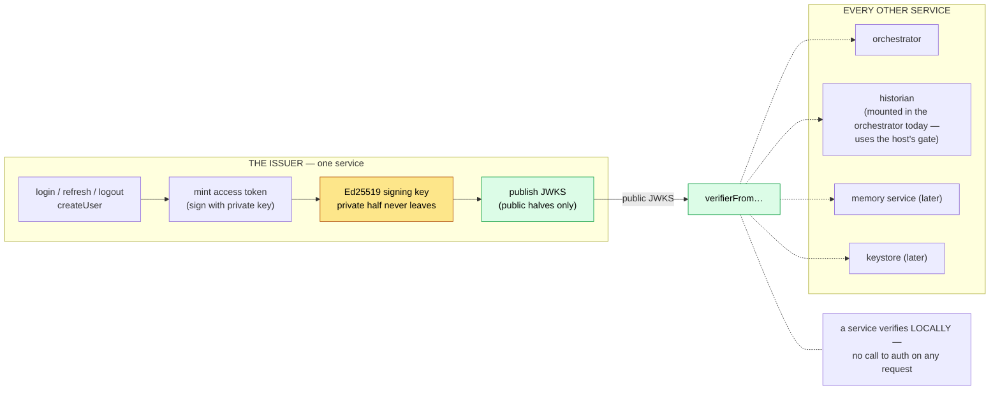
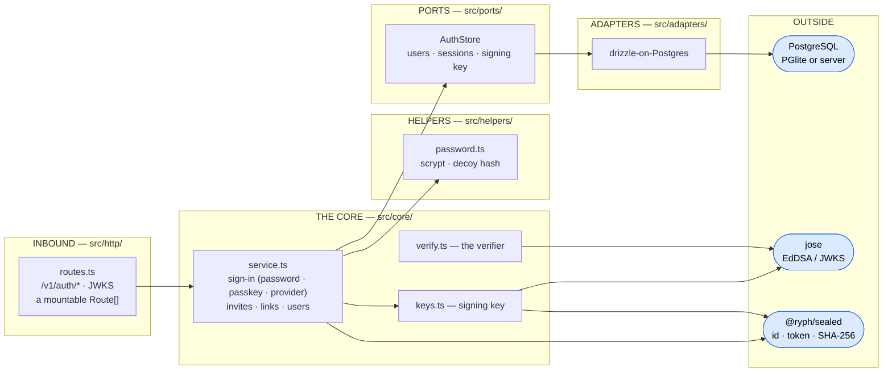
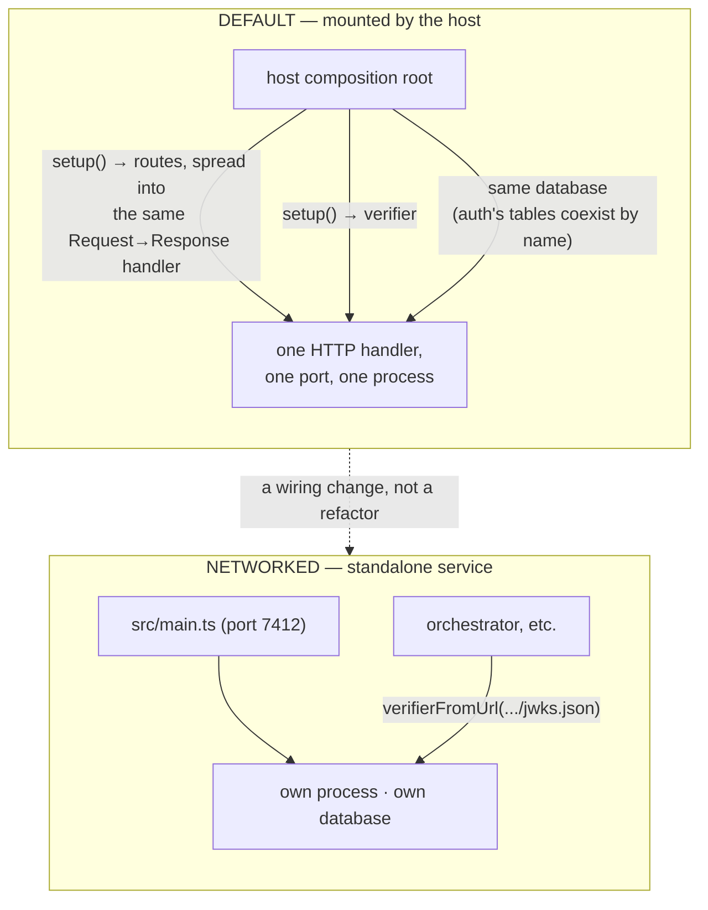

# 🏛️ Architecture

How auth is put together: the issuer/verifier split that is the whole point of the package, the two
deployments it supports from one codebase, the signing key behind the JWKS, and why SSO is an
additive change. (What auth _is_ — the token contract — is the [README](../README.md)'s opening.)

## 🪞 Issuer and verifier

The package has two halves with very different reach. The **issuer** is one service; the
**verifier** is a tiny stateless helper that _every_ ryph service imports. This asymmetry is the
design:

**Why stateless verification matters:** an access token is a signed EdDSA JWT pinning `iss`, `aud`,
`exp`, and carrying `{sub, email, name, role, email_verified, sid}`. A verifier checks the signature
against the public JWKS and the standard claims — no database, no network to the issuer. So the
moment there are four services, they do not all funnel every request through auth; each verifies on
its own. The issuer can be down and already-issued tokens still verify until they expire. This is
exactly why the short-lived access token exists: revocation is "wait ≤10 minutes for it to expire,"
and the long-lived refresh token — the thing that _can_ be revoked — never leaves the auth service.

`verify` returns typed `Claims` or `null` for _anything_ wrong (bad signature, expired, wrong
`iss`/`aud`, missing a required claim). There is no throwing path a caller has to catch.

## 🔌 Ports & adapters

The issuer is a hexagonal architecture like the runner and orchestrator: a pure `src/core/` behind
its ports, bound to adapters at a composition root. Four ports: the store, an identity provider (a
forge, which the control plane implements over its own forge client), a challenge provider (a forge
with no authorization server to redirect to — Radicle, where an account IS a key), and a mailer.

One port, `AuthStore` (users, sessions, linked identities, the registration gates, the signing key),
with drizzle-on-Postgres and in-memory adapters. Everything cryptographic goes through
[jose](https://github.com/panva/jose); ids, refresh tokens, and their hashes come from the shared
[`@ryph/sealed`](../../sealed/README.md) kit. The same `bun run guard` fence as the other packages
holds the layering: core → core/ports/helpers, helpers → helpers/core, ports → ports/core.

> The lint rule `no-slow-types` is disabled for this package only: drizzle's inferred table types
> leak into the public API via the db handle and can't be explicitly annotated. It only matters for
> JSR publishing, which these internal packages don't do.

## 🏗️ Two deployments, one boundary

The package is **service-shaped** — own storage, own routes, own composition root
([`src/main.ts`](../src/main.ts)) — but its **default deployment is mounted in-process** by the
[`@ryph/host`](../../host/README.md) composition root:

Because `routes.ts` exposes a `Route[]` whose shape is structurally identical to the control plane's
router, the mounted case is a spread; the standalone case serves the same list alone. The only
difference a consumer sees is which verifier constructor it calls: `verifierFromJwks` (the mounted
composition root already holds the JWKS document) versus `verifierFromUrl` (fetch and cache from
`/.well-known/jwks.json`, which is also what makes key rotation invisible).

## 🔑 The signing key

`ensureSigningKey` generates an **Ed25519** keypair on first boot, persists it through the store,
and hands back the same one forever after. `/.well-known/jwks.json` serves the **public halves
only** — the private scalar never leaves the process. The shapes already model a _list_ of keys, so
rotation later is "insert a new key, serve both in the JWKS until the old one's tokens expire" — no
consumer change, because a `verifierFromUrl` re-fetches the JWKS and finds both.

## 🚪 Every way in ends in `mintPair`

Password, passkey, a forge account, an accepted invite: each authenticates the person its own way
and then ends in the _same_ `mintPair` call. The tokens are identical, so every verifying service is
unaffected — it still just checks a signature — and refresh rotation, the JWKS, and the claims shape
all stay put. A new provider is a new arm of the `IdentityProvider` port and nothing else.

The forge is that provider today: the code exchange and the org-membership check go through the port
to whichever process holds the App's client secret (the forge service, reached through the control
plane's own forge client). Nothing in this package names GitHub.

A forge with no OAuth at all takes the second port instead. `ChallengeProvider` is the same shape
turned inside out: this package mints a single-use nonce, hands out the line that signs it, and
spends the one outstanding challenge the pasted proof verifies against; the port answers only "who
made this signature". A linked identity is the same `external_identities` row either way, so the
control plane resolves an inbound trigger's actor by `login` without caring which door it came
through. These providers are deliberately absent from `GET /v1/auth/providers`: they attach an
identity to an account that already exists, and there is nothing on the other side to sign in to.
Nothing in this package names Radicle either.

That is the payoff of routing every identity through one issuer: the expensive, evolving part (how
you prove who you are) is isolated behind a token contract that never has to change.
