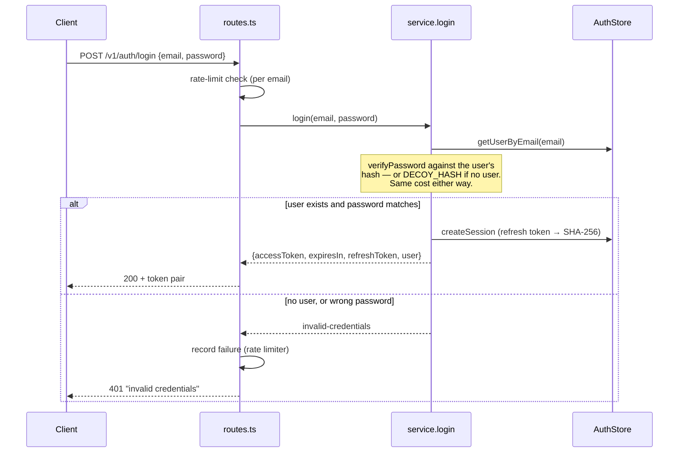
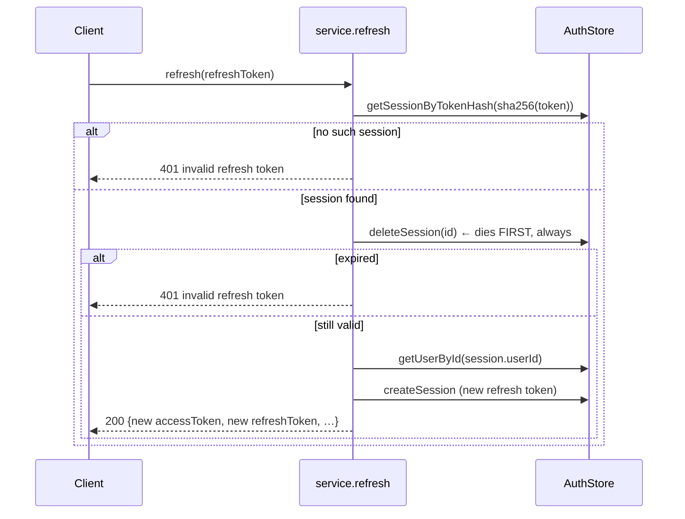
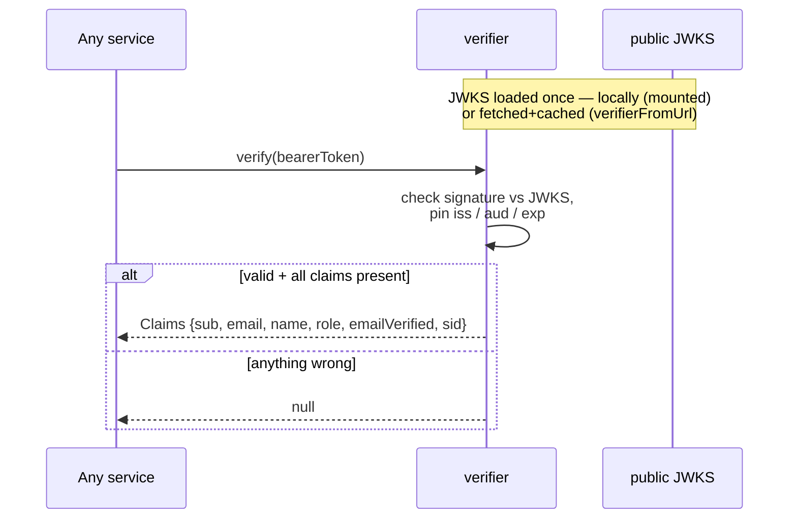
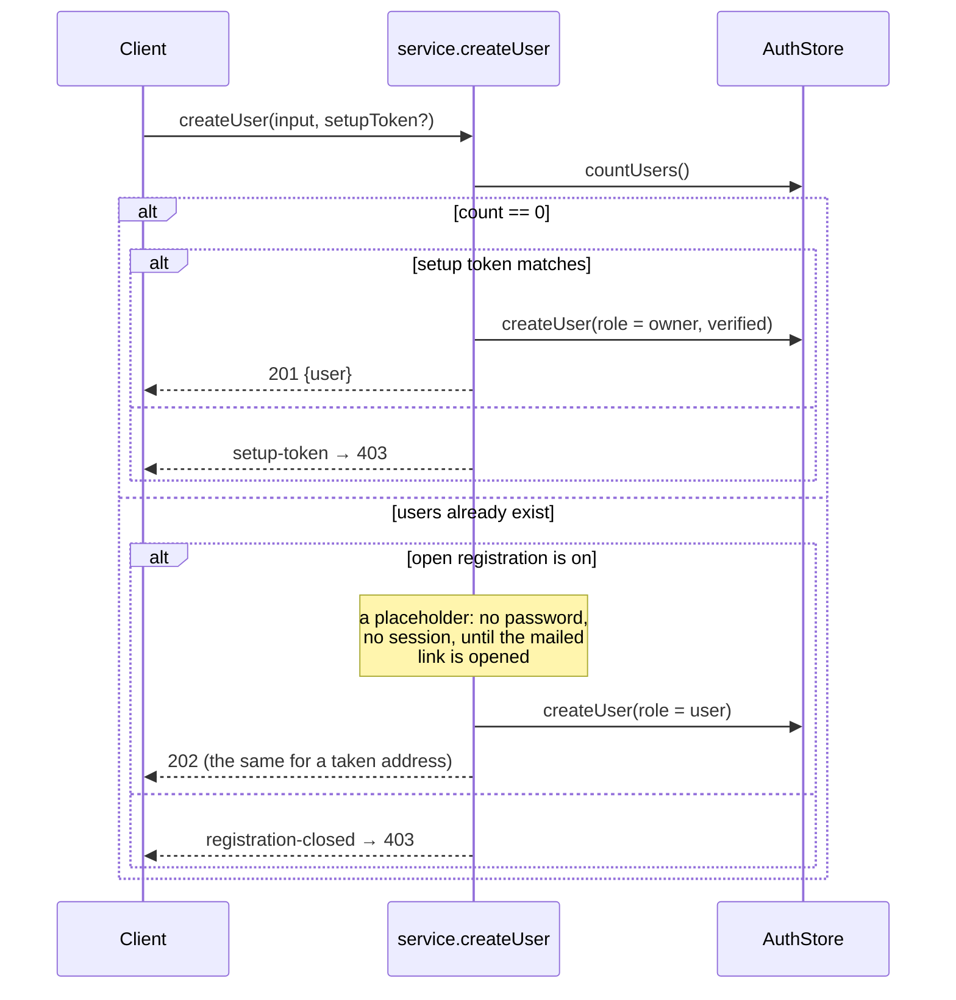

# 🎟️ Token Flows

The four flows a caller drives, each as a sequence diagram: login, refresh rotation, stateless
verification, and how a fresh deployment gets its owner without seeding secrets. The logic lives in
[`core/service.ts`](../src/core/service.ts) (issuing) and [`core/verify.ts`](../src/core/verify.ts)
(checking).

## 🔐 Login

`POST /v1/auth/login` with `{email, password}` returns a **token pair** — a short access token and a
long refresh token — plus the public user.

Two anti-enumeration properties are load-bearing here:

- **Flat timing.** If the email is unknown, login still runs `verifyPassword` against a built-in
  `DECOY_HASH`, so a request for a nonexistent user costs the same time as a wrong password for a
  real one. An attacker can't tell "no such user" from "wrong password" by the clock.
- **One error, both halves.** The `401` says only "invalid credentials" — never which half was
  wrong.

The access token is a signed EdDSA JWT carrying `{sub, email, name, role, email_verified, sid}` with
`iss`/`aud`/`exp`; the refresh token is 32 bytes of randomness the server keeps **only as a SHA-256
digest** (the raw value exists only in the response and, thereafter, wherever the client stores it).

## 🔄 Refresh rotation

`POST /v1/auth/refresh` with `{refreshToken}` trades a live refresh token for a **fresh pair** — and
the presented token dies in the process.

**Rotation is the security property.** The presented session is deleted _before_ anything else —
success or failure — so a refresh token is single-use. If one is ever replayed (stolen and used
after the legitimate client already refreshed), the second use finds no session and fails. Delete
happening before the expiry check means even a redeemed-but-expired token can't be retried.

The app wires exactly one wrinkle around this: because a refresh both invalidates the old token and
issues a new one, two concurrent refreshes would clobber each other — so the app
[dedupes concurrent refreshes](../../app/docs/auth-flow.md#-refresh-the-tricky-part).

## ✅ Verification (the common path)

Every _other_ ryph service — and auth's own `GET /v1/auth/me` — turns a bearer token into claims
without touching the issuer:

No arrow crosses to the issuer. That is the entire point of the JWKS: the signature math needs only
the public key, so verification is a local, synchronous-ish check. `verify` collapses every failure
mode — bad signature, expired, wrong audience, a claim of the wrong type — into a single `null`, so
consumers branch once.

## 🥾 Bootstrap: the first user

A fresh deployment has no users and no way to log in. How it gets its owner depends on the mode.

**Single-user** (`RYPH_MULTIUSER` off, the default for the binary and the host): the owner is made
at boot, verified and without a password, and signs in by a one-time login link. `ryph up` prints
one, and `ryph login` mints a new one through `POST /v1/auth/local/login-link`, which only the
secret `ryph up` wrote for this user unlocks. The browser spends it at `POST /v1/auth/login-link`. A
link lasts ten minutes, works once, voids the one before it, and signs in only an owner of a
single-user instance; a multi-user one answers 409 `multi_user`, since no fresh link would work
either. Registration, invites and user management are refused.

**Multi-user** (`RYPH_MULTIUSER=on`, the default for the networked control plane): the first
registration has to present the **setup token**, which the control plane prints in its log at boot
while there are no users. Nobody who cannot read that log can claim the instance.

The token is derived from the signing key, so every replica accepts the one any replica printed, and
once an owner exists no registration asks for it again. A multi-user control plane also needs
`RYPH_PROXY_SECRET`, with the same value on the app, or it will not start. (In ryph the first
registration is the app's `/register` page, which asks for the token.)

## ✅ Proving an address

An account made by open registration or an open invite is a placeholder for the address alone: **no
name, no password and no session** until the address is proven. The mailed link
(`POST /v1/auth/verify/:token` with the name and password chosen on that page) proves the address,
names the account, sets its password, and signs the person in, all at once — so nothing a registrant
chose reaches the mailbox or outlives the proof. Whatever was attached to the account before that
moment goes the way a provider claim's leftovers go — sessions, unspent links, passkeys, linked
identities. Registering a taken, unproven address again re-sends the link and answers the same as a
new sign-up; a verified address gets nothing. Without a mailer an admin mints the link and hands it
over, and "forgot password" from an unproven address lands on the same admin list, settled by that
same link.

## 🔗 Sign-in through a forge

`POST /v1/auth/oauth/:provider/callback` with `{code}` — the BFF's callback page posts the code the
provider sent back. Without a bearer it is a sign-in; with one it links the account to the caller.
The order a sign-in resolves in:

1. **Already linked** — the provider's stable account id matches a row: sign in. The row's login
   follows a rename.
2. **A verified account carries one of the provider-verified addresses** — link and sign in. An
   owner's account is the exception: its address may never have been proven (single-user takes it
   from git config), so the match answers `409 link_required` and the owner links from settings.
3. **An unverified account carries one** — the provider proved the address, whoever registered it
   never did: the account is claimed. Its passkeys and linked identities are removed, its sessions
   end and unspent links die (the placeholder holds no password to begin with), the identity links,
   the address is marked verified.
4. **Nothing matches** — create, if a gate admits: an invite token riding along (a bound one only
   for the address it names), else org membership through the provider when that gate is on, else
   open registration. Membership the provider could not answer is `503`, never "no".

No verified address on the provider side refuses steps 2–4. Linking refuses a caller whose address
is unverified, and an account already linked to someone else.

## 🔑 Passkeys

`POST /v1/auth/passkeys/login/options` pins a challenge (its digest, five minutes, in a row so any
replica can finish it) and answers a discoverable request — no account named, the authenticator
picks one. `POST /v1/auth/passkeys/login/verify` spends the challenge, finds the credential by id,
verifies the signature against the app's origin, and refuses a counter that did not move forward (a
cloned authenticator). Registration is the same shape behind a bearer, and a passkey — like a
password or a linked account — cannot be removed when it is the last way in.

## ✉️ Links: invites, verification, reset

Every link carries a 32-byte secret stored only as its digest. Invites live seven days by default; a
bound one is single-use, proves the address on acceptance, and takes the password there; an open one
admits up to `maxUses` and makes placeholders that wait for their verification link. Verification
links live a day, reset links an hour; minting one voids the user's older links of that kind, and
using it spends it. Both set a password; a reset ends every session. Registration and "forgot
password" answer the same whether or not the address exists, and mail the owner instead of telling
the caller; "forgot" on an unproven address re-sends its verification link, which names nobody, so
no stranger's words reach the mailbox before the address is proven. Without a mailer an admin mints
the same links and sees them once. A proven owner gets no reset link at all, mailed or minted, and
one minted before they became an owner does not redeem: their address may never have been proven, so
a reset would hand the instance to whoever holds that mailbox. Owners change their password signed
in. A verification link is only for an unproven address, owner or not: none is minted for a proven
one, and one minted earlier does not redeem once the address is proven, since it would set a new
password and sign in.
