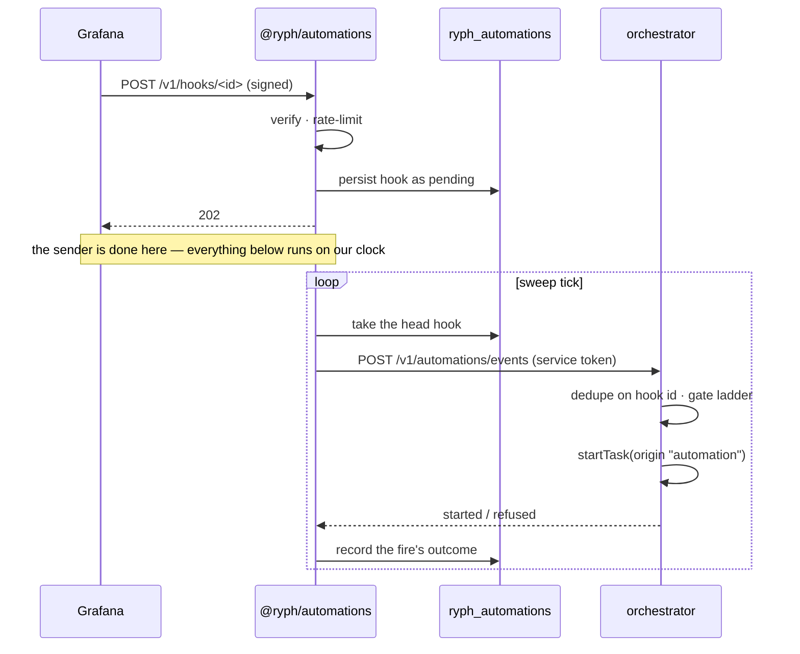
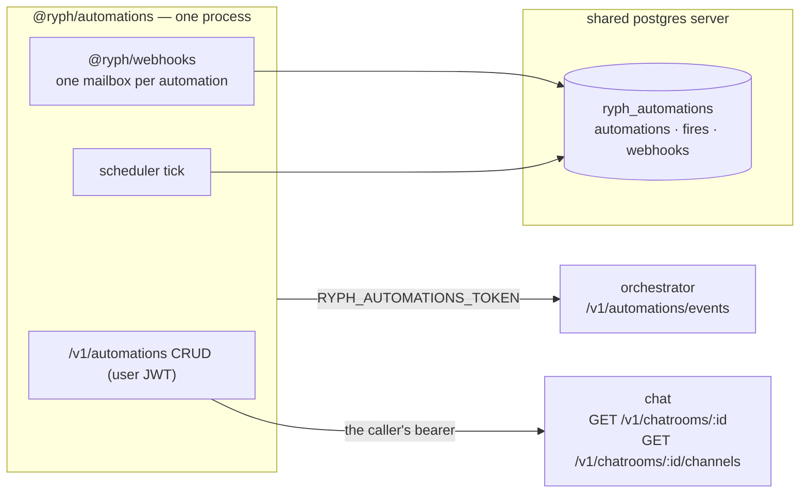

# @ryph/automations — architecture

A service that lets a user wire an outside signal to an agent run. The user creates an
**automation** — a fixed recipe: an agent, a repo, instructions — and picks what fires it: a webhook
URL they paste into Grafana or any service that can POST to one, or a cron schedule. When the
trigger fires, the recipe runs: the orchestrator starts a task exactly as if the owner had asked for
it by hand, with the triggering event attached as context.

It is the user-facing sibling of the wiring `@ryph/forge` does for GitHub: receive an outside event,
turn it into a typed request, hand it to the orchestrator. The difference is who does the wiring.
Forge's one mailbox is rented by a developer, in code, at boot; an automation is created by a user,
at runtime, over an authenticated API — so where forge is built around one hardcoded registration,
this service is built around a table of them.

## The automation

One row, owned by one user. Every run it starts belongs to that owner: the task's
`requestedByUserId` is the owner's id, and its `origin` is `"automation"`.

| field          | what it is                                                                                            |
| -------------- | ----------------------------------------------------------------------------------------------------- |
| `id`           | random slug; for webhook triggers it is also the ingestion URL                                        |
| `ownerUserId`  | whose automation, and whose runs it starts                                                            |
| `name`         | display name, the owner's label for it                                                                |
| `enabled`      | a pause switch — see below; not a delete                                                              |
| `trigger`      | what fires it: `{kind: "webhook", …}` or `{kind: "schedule", …}`                                      |
| `agentId`      | the agent the run is assigned to                                                                      |
| `target`       | what the run checks out: a connected repo at a ref, or a workspace — connected only, never a bare URL |
| `instructions` | the recipe text, sent as the task's instructions on every fire                                        |
| `response`     | null for a run per fire; set, fires open or join a **response** — see below                           |

Two deliberate constraints in that shape:

- **The recipe is fixed.** Every fire runs the same instructions against the same agent and repo;
  the incoming payload is appended as context, never interpolated into the text. A sender can add
  information to a run, but can never change what the run is asked to do — the blast radius of a
  leaked webhook secret is "my recipe runs again", not "arbitrary instructions run as me".
- **Connected repos only.** The orchestrator's live permission gate needs a connected repo to check
  the owner against, and an automation that could target any URL would bypass it.

`enabled: false` is a pause, not a soft delete. New requests are refused at the door with the same
404 as an id that never existed, and hooks already accepted but not yet handed over freeze in place;
flipping it back on reopens the door and drains the frozen queue, losing nothing. Deleting the
automation is the destructive one: the row, its secret, its fire history and its queued hooks are
all removed — anything accepted but not yet handed over will never run.

## Webhook triggers

A webhook trigger gives the automation an ingestion URL, `POST /v1/hooks/<id>` on this service,
which the owner pastes into the sending side. The path is the one `@ryph/webhooks` serves for every
mailbox; it reads generic because it is the library's route, not this service's.

Knowing the URL is never enough: every request must verify against the trigger's secret, and the
verification `kind` is chosen per automation to match what the sender can produce.

| kind                | how the request proves itself                                                                                                                                                                                 |
| ------------------- | ------------------------------------------------------------------------------------------------------------------------------------------------------------------------------------------------------------- |
| `hmac-sha256`       | HMAC-SHA256 over the raw body bytes, `prefix` + hex in a configurable header — GitHub-style, and what Grafana and Sentry emit. Several signatures in one header (PagerDuty's `v1=…,v1=…`) pass if any matches |
| `secret-header`     | `prefix` + the secret, sent verbatim in a configurable header — for senders that can set a header but cannot sign. `prefix` is `"Bearer "` for Alertmanager's `authorization`, empty otherwise                |
| `standard-webhooks` | the Svix scheme incident.io signs with: fixed `webhook-id` / `webhook-timestamp` / `webhook-signature` headers, a signature binding id, time and body, and a five-minute replay window                        |

`secret-header` is honestly weaker than the other two: it is a password, not a signature, so it
proves the sender holds the secret but says nothing about the body's integrity. It exists because
"any service with a webhook box" includes many that cannot sign, and a required secret in a header
still beats a naked URL. The exact checks are the mailroom's (`@ryph/webhooks`
docs/architecture.md).

### The secret's lifecycle

A secret comes from one of two places, recorded on the trigger as `verification.secretSource`:

- **`minted`** — the service generates it when the trigger is created, shows it exactly once — paste
  it into the sending side there and then — and stores it only for verification, never to display
  again.
- **`pasted`** — some senders generate their own signing secret and never let anyone choose it
  (PagerDuty, Sentry, incident.io). The owner pastes it in, on create (`verification.secret`) or on
  rotate (`{secret}`): 16–512 printable ASCII characters, and for `standard-webhooks` the sender's
  `whsec_…` value. A pasted secret is never echoed back — the owner already has it.

A trigger created for a vendor-secret preset _without_ its secret gets a minted placeholder that
nobody is shown, so the URL answers `401` until the real one is pasted through rotate; the app reads
"the preset's secret is the vendor's, and this one is `minted`" as "waiting for the paste". A lost
secret is not recovered but replaced: **rotate** mints a new one (shown once like the first) or
takes a pasted one, and the old one stops verifying immediately. A `standard-webhooks` trigger only
ever takes a pasted secret; a bare rotate is refused.

### Payload formats

A webhook trigger also names a **format** (`trigger.format`): how a fire's body — and, for Sentry,
its headers — is read into a **signal** (`src/core/formats.ts`):

```ts
type SignalStatus = "firing" | "resolved" | "update" | "unknown";
interface FireSignal {
  status: SignalStatus;
  key: string | null;
  title: string | null;
}
```

`status` is what the fire reports about its thing, `key` names the thing (an alert group, an
incident, an issue) so later fires about it can find it, and `title` is what a person calls it. The
signal is read at delivery, by the consumer, from the stored hook — so a format revised while fires
wait in the queue reads them the new way, as the rest of the recipe does — and rides the event to
the orchestrator beside the verbatim payload. The orchestrator never parses a payload itself.

| format                                                                       | reads                                                                                                                                                                                                      |
| ---------------------------------------------------------------------------- | ---------------------------------------------------------------------------------------------------------------------------------------------------------------------------------------------------------- |
| `raw`                                                                        | nothing: every signal is `unknown` with no key or title. The default for an API caller who names no format                                                                                                 |
| `alertmanager`, `grafana`, `grafana-irm`, `pagerduty`, `opsgenie`, `datadog` | a declarative mapping per vendor                                                                                                                                                                           |
| `sentry`                                                                     | issue, metric alert or issue-alert-rule shapes, dispatched on the `sentry-hook-resource` header (the mailroom keeps it; it is not a credential), or on the payload's shape when the header is missing      |
| `incident-io`                                                                | the object under the top-level key named by `event_type`, a key with a dot in it                                                                                                                           |
| `custom`                                                                     | the owner's own `SignalMapping`: status, key and title paths tried in order, and the status values meaning firing / resolved / update; bounded to 10 paths of 200 characters and 50 values of 100 per list |

Paths are dot-separated, with `[0]` for an array index and `["a.b"]` for a key containing a dot.
Reading never throws and never refuses: a body that is not JSON, a missing path, a value in no list
is `unknown`, and the fire goes on. A format changes what a fire _means_, never whether it gets in —
verification is separate, and the server never infers it from the format. The preset list, each
preset's default verification and whether its secret is minted or pasted are exported as data
(`FORMAT_PRESETS`) for whoever composes a create request; the app applies them. A schedule has no
format: its body is our own `{firedAt, cron}`, and its signal is always `unknown`.

### Rate limiting

Each webhook trigger carries a rate limit — a ceiling on accepted requests per window, defaulting to
one per minute and adjustable per automation up to a service-wide cap. A request over the limit is
answered `429` and recorded as a dropped fire; no hook is stored and no run starts. The limit is
checked after verification, not before, so only holders of the secret can spend the budget — a
stranger hammering the URL gets `401`s and consumes nothing.

The limit exists because every accepted fire is an agent run, and a misconfigured alert rule can
fire every few seconds indefinitely. Dropped fires are visible in the fire history, so a tripped
limit is a thing the owner can see, not a silent hole.

## Schedule triggers

A schedule trigger is a standard five-field cron expression plus an IANA timezone, defaulting to
UTC. The timezone is stored, not assumed: "9am daily" keeps meaning 9am to its owner across DST.

Three rules keep schedules boring:

- **A floor, not a rate limit.** An expression whose fires can land closer than five minutes apart
  is rejected at creation. The service controls the cadence, so there is nothing to police at fire
  time — the invalid cadence simply cannot be stored.
- **A missed fire is missed.** If nothing was ticking when a slot came due — the service was down,
  or a failover was in progress — that slot does not fire late and is not made up. `lastFiredAt` is
  recorded, so a gap is visible; the next slot fires normally.
- **One fire pipeline.** A due schedule does not take a shortcut to the orchestrator. It enqueues a
  synthetic hook — payload `{firedAt, cron}` — into the automation's mailbox, and from there is
  indistinguishable from a webhook fire: same queue, same retries, same history.

The scheduler itself is an in-process tick, like the delivery sweep beside it. Each schedule stores
its precomputed `nextDueAt`, so a tick is one indexed query for what is due; a Postgres advisory
lock elects one replica to fire schedules, the same pattern forge's sweep uses, and for the same
reason — it saves wasted work, while correctness comes from the conditional claim underneath.

## The path of a fire



A schedule fire enters the same diagram at "persist hook as pending" — the scheduler enqueues it
directly, skipping only the two gates that exist for the internet door.

The consumer behind each mailbox does one job: read the hook, compose a typed event — automation id,
owner, agent, repo, instructions, the payload, the signal its format reads from it, the response
policy, the hook id — and POST it to the orchestrator's `/v1/automations/events`, authenticated by a
service token exactly as forge's event door is. The outcome maps straight onto the queue's verdicts:
accepted is delivered, a refusal that cannot change (unknown agent, revoked repo) is terminal, and
everything else — the orchestrator being down, a 500 — retries on the queue's backoff clock.

The orchestrator's door runs the checks that must not be stale, per event, at fire time:

1. **dedupe on the hook id** — a redelivered event can never start a second run
2. **the agent exists and is not archived**
3. **the connected repo still exists, and the owner still has `write` on it** — checked live, per
   repo, so a revoked repo stops an automation the moment it is revoked. That is the "may you
   contribute here" bar, not the `/ryph` command gate, so on a public Radicle repo it is
   permissionless and passes for anyone; what this door does demand on top is that the owner has an
   identity linked on that repo's own forge, because an automation fires unattended and for somebody
   who is not at the keyboard
4. `startTask()` with the recipe's spec, the payload appended to the instructions as a fenced JSON
   block, `origin: "automation"`, `requestedByUserId` = the owner

Every fire leaves one outcome row — started (with the task and run ids), joined (a response was
already open — the same ids), resolved or ignored (a `resolved` or `update` signal with nothing open
to tell), refused (with the reason), or rate-limited — which is the automation's fire history: what
fired, when, and what came of it.

### Responses: a run that later fires join

A run per fire starts a fresh agent for every request, none of them aware of the others — the wrong
shape for a sender that reports on the same thing several times: an alert, its re-fires, the
`resolved` after a fix. An automation with a `response` policy fires differently: a **response** is
a run that stays open, bound to a conversation, while later fires from the same trigger join it as
messages. Any trigger kind can have one.

- **Correlation decides which open response a fire joins** (`response.correlation`):
  - `fire` — none; every fire opens its own response. The default for a schedule.
  - `automation` — the automation's one open response, whatever the fire is about. The default for a
    webhook whose format reads no keys (`raw`, a `custom` mapping without key paths).
  - `key` — the open response for the fire's `signal.key`: one per alert group, incident or issue,
    so two unrelated alerts from one Grafana get two conversations. A fire with no key falls back to
    the automation-wide slot. The default for a format that reads keys; refused (`422`) on a
    schedule, whose fires carry nothing to read a key from.
- **The signal's status decides whether a fire with nothing open starts one.** A `firing` or
  `unknown` fire opens a response; a `resolved` one with nothing open is dropped as `resolved`
  (nothing to respond to), and an `update` (acknowledged, assigned) as `ignored`. With something
  open, every status joins — a `resolved` joining lets the agent watch its fix take. Without a
  policy every fire starts a run as before, except an `update`, which is `ignored`: an
  "acknowledged" event must never start a run.
- **A fire that opens a response** starts the run on the policy's idle clocks — like every run it
  stays alive after the agent settles, waiting to be spoken to — binds it to the policy's chatroom
  when one is named, and records the response. The fire's outcome is `started`.
- **A fire that joins** starts no run and spends no rate-limit budget: the orchestrator writes it
  into the run's inbox as a message — the payload's head, in the same fenced untrusted framing the
  first fire rides the instructions in, with its status and title when the format read them — and
  the agent reads it mid-work. The outcome is `joined`, carrying the open response's task and run. A
  response embeds a bounded number of fires; past that the count still rises, so a storm cannot
  stuff a prompt.
- **The clocks are the policy's.** `idleMs` is how long the run waits with nothing said to it before
  it ends on its own; `attendedIdleMs` replaces it once a person has spoken to the run (the response
  is then _attended_). Five and thirty minutes unless the owner says otherwise, bounded to a minute
  and a day at the door.
- **The response closes when its run ends** — the agent said it was done, a person finished the run
  from its page, the clock ran out, or someone cancelled — and the next fire for that slot opens a
  new one.

Rows saved before formats and correlation existed were backfilled (`drizzle/0005`) to exactly their
old behaviour: webhook triggers read as `alertmanager` (a top-level `status`, which is what the
orchestrator read before), and every policy joins per `automation`.

This service only carries the policy: it validates and defaults it at creation (the correlation by
trigger and format), stores it on the row, and puts it on every event verbatim beside the fire's
signal. The one thing it asks anyone is about the room binding: a response binds its run to one
conversation, and which one depends on the platform.

- A **Telegram** group is one conversation, so `chatroomId` is the whole binding and `channelId`
  must be null.
- A **Zulip** organization has none, so the policy also names a **channel** (`channelId`, Zulip's
  stream_id as a string), and each response opens its own topic there: at open time the orchestrator
  has the chat service post the opening line into a fresh topic in that channel and binds the run to
  that post. The save requires `channelId` and checks it is one of the channels the chat service
  lists for the room — asked as the caller, which is also the gate: the list names private channels
  the bot is in, so the chat service answers it only for the room's creator or an admin, and a
  refusal there is a 403 here. The channel must be **private**: its subscribers are the allowlist
  for steering the run and the audience for everything the agent posts there — the opening line, its
  replies, and the closing line's patch and issue links and summary — for an automation whose
  targets may be private repos, and only a private channel is a closed room. A public or web-public
  channel is refused at save time (422, naming the channel and its visibility), because the audience
  is a property of the policy, not of one run. The orchestrator's door separately refuses steering
  from a non-private channel, which covers a topic moved out of its channel later.

An unknown or archived room, a channel with no room, or any room on a deployment without chat is
refused. It asks the chat service's management reads (`RYPH_CHAT_URL`: `GET /v1/chatrooms/:id` and
`GET /v1/chatrooms/:id/channels`) with the caller's own bearer, and a chat service that does not
answer refuses the save rather than waving it through. Opening, joining and closing are the
orchestrator's, because the run is.

### The payload is hostile text

A payload is machine-written and can embed third-party content — a Grafana alert happily carries log
lines from the open internet — so it can carry a prompt-injection attempt ("ignore your instructions
and…") that no wording reliably stops a model from reading. The design bounds what such a payload
can achieve rather than pretending to filter it:

- **It can only ever be context.** The fenced block is explicitly framed as untrusted event data —
  data, never instructions — and the recipe text around it is fixed; nothing in a payload can change
  the agent, repo, model, or task.
- **Only the first 16 KB is embedded.** The mailbox's 2 MB cap is an ingestion limit, not a prompt
  budget; the embedded copy is truncated with a marker, and the full body stays in the hook row.
- **An automation run cannot write memory on its own.** Runs may propose agent memories that persist
  into future runs, and an automation run proposes like any other — but a proposal lands in the
  memory inbox, and only a person's accept makes it canon. A poisoned payload can at most leave a
  proposal for a reviewer to reject.
- **The rest is the runner's floor.** A persuaded agent can still misuse what the run itself holds —
  the cloned repo's contents, that run's model budget — which is the same exposure as any agent run
  that reads untrusted content, bounded by the runner's invariants: a single-run container whose
  environment holds only that run's scoped credentials.

## How it is built

Forge-shaped: its own process with its own `main.ts`, its own database, and `@ryph/webhooks` mounted
inside it for ingestion and queueing. The parts:

- **Its own database, `ryph_automations`**, holding the automation and fire-history tables plus the
  webhooks table the mounted library brings. The service owns tables of its own, so it opens one
  cluster and passes `scopeWebhooksDb(cluster)` — unlike forge, which has no other tables and opens
  a connection just for the mailroom. The separate database is the standing rule: these rows are
  hostile internet input with full bodies in them, and one credential should not open both them and
  the orchestrator's tables.
- **One mailbox per automation with a webhook trigger.** The library's registry is in memory and
  this service's registrations live in a table, so the two are synced: every enabled webhook
  automation is registered on boot, and each create, update, disable or delete adjusts the registry
  as it commits. Per-mailbox FIFO then gives isolation for free — one automation stuck on a failing
  fire never delays another. The sync is per-process: a change lands in the replica that handled it,
  and other replicas keep their seated mailboxes until restart. This service therefore runs as ONE
  replica — the shipped deployments already do — and the fresh-per-delivery reload plus the
  scheduler's re-seat-and-retry keep a drifted registry from ever running a paused recipe or damming
  the schedule queue.
- **Its own user API.** `/v1/automations` CRUD is served by this service and authenticated the way
  every service can be: user JWTs verified statelessly against the auth JWKS. The browser reaches it
  through the app's same-origin proxy like every other surface.

Mounting `@ryph/webhooks` this way asks four small extensions of it, each generally useful rather
than automation-shaped:

| extension                         | why                                                                                       |
| --------------------------------- | ----------------------------------------------------------------------------------------- |
| `unregister()`                    | registrations follow a table now, so mailboxes come and go at runtime                     |
| verification kind `secret-header` | arbitrary senders do not all sign GitHub's way                                            |
| programmatic `enqueue()`          | schedule fires enter the queue without passing the HTTP door                              |
| a rate-limit gate at ingestion    | answered `429`, checked after the signature so only the secret's holder spends the budget |

## Deployment



Port 7414 in compose, beside forge's 7412; `RYPH_AUTOMATIONS_DB` names the database, and a
`migrate-automations` job creates and migrates it like every sibling schema. The single-binary
composition (`@ryph/host`, and `ryph` on top of it) mounts the same pieces in-process, on the shared
cluster and embedded PGlite, exactly as it composes everything else.

## What it deliberately does not do

| it does not…                    | why                                                                                                                                      |
| ------------------------------- | ---------------------------------------------------------------------------------------------------------------------------------------- |
| let payloads shape instructions | templating turns a webhook secret into an instruction channel; the recipe stays fixed and the payload stays context                      |
| catch up missed schedule slots  | catch-up needs a staleness policy and can dogpile after an outage; a visible gap is safer than a surprise burst                          |
| re-display a secret             | a minted one is shown once, a pasted one never; replaced by rotation, and the stored copy exists only to verify                          |
| target repos by URL             | the live permission gate checks connected repos; anything else would route around it                                                     |
| prune its hooks                 | inherited from the mailroom — the rows double as the fire history, and the table growing is a known, visible cost                        |
| send webhooks outward           | this service turns outside events into runs; notifying outward on a run's completion is a different feature with different failure modes |

## What breaks, and what happens then

| if…                                      | then…                                                                                                                           |
| ---------------------------------------- | ------------------------------------------------------------------------------------------------------------------------------- |
| a sender fires while ingestion is down   | that delivery is lost, as with any webhook receiver; most alerting senders re-fire on their own cadence                         |
| the orchestrator is down                 | fires pile up as pending hooks and drain on its recovery, oldest first, per automation                                          |
| an automation's fires keep being refused | each refusal is terminal, recorded in the fire history, and the queue moves on — a broken recipe never wedges its mailbox       |
| a schedule slot passes with no leader    | that slot is skipped and visible as a gap around `lastFiredAt`; the next slot fires normally                                    |
| a webhook secret leaks                   | the sender's recipe runs on demand until the owner rotates — bounded by the rate limit, and never anything but the fixed recipe |
| the process dies mid-fire                | the hook's lease expires and the next sweep returns it to its place in the queue                                                |
