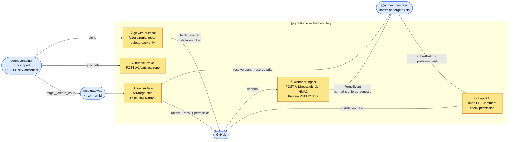

# 🏛️ Architecture

How `@ryph/forge` is put together: the three doors it owns, the one secret domain behind them, the
ports its core depends on, and why it decides nothing.

> **Status: all five doors built.** Doors ① (git wire protocol, read-only), ② (bundle intake),
> and ③ (the forge API — the GitHub adapter in `adapters/forge_api/github.ts`, App JWT +
> installation tokens in `helpers/app_token.ts`, the submit move in `helpers/submit.ts`, and the
> orchestrator-facing service surface in `http/service.ts`) exist in `src/`. Door ④ (webhook
> ingest) landed with inbound triggers: the generic mailroom is `@ryph/webhooks` (mounted into
> this process by `main.ts`, behind `RYPH_FORGE_DB`), the GitHub mailbox and its consumer
> live in `adapters/forge_api/github_webhooks.ts`, and normalized events leave through
> `ports/event_sink.ts` to the orchestrator's `POST /v1/forge/events`. Phase 0 (the de-risking
> spikes) came first and every measured number here came out of it; see
> [the git gateway](git-gateway.md). Door ⑤ (the agents' tool surface) is the
> forge tools: `http/tools.ts` and `mcp/` serve it,
> `core/tool_service.ts` runs a call, `core/tool_grant.ts` checks it against the grant
> `ports/tool_grants.ts` resolves from the orchestrator.
>
> **⚠️ Door ④ changes this service's exposure.** GitHub must be able to reach
> `POST /v1/hooks/github` — the first door here that requires PUBLIC ingress (①–③ face only
> agents and the orchestrator; compose binds the service to 127.0.0.1). When you open ingress for
> it, remember what shares the origin: expose only the path GitHub needs if your ingress can
> route per-path, and rely on the existing guards — HMAC on ④, bearer tokens on ③'s service
> surface, run-scoped grants on ① and ② — for whatever it cannot. Never expose more than the
> webhook path just because the webhook path must be open.

## 📝 The one-paragraph version

`@ryph/forge` is **the entire boundary between Ryph and a code-hosting forge, in both
directions** — and it exists because a **GitHub App installation token cannot be scoped to a ref
pattern**. It can be narrowed to one repo and to `contents:write`, but not to "may only write
`refs/heads/ryph/*`". So a token handed to an agent container is an hour of force-push-`main`
capability, with the customer's branch protection — which we do not control — as the only backstop.
The answer is that **no forge credential ever enters a container**: the agent talks to this package
instead, and this package talks to GitHub. Everything else follows from drawing that line. It owns
git transport, the forge API, and webhook ingest, because all three need the same secrets; it does
**I/O and normalization only**, and hands the orchestrator forge-agnostic facts to decide on.

## 🚪 The three doors

One package, because one credential domain. The App's private key, its installation tokens, and its
webhook secret live here and nowhere else.



| # | Door              | Direction      | Why it _must_ live here                                |
| - | ----------------- | -------------- | ------------------------------------------------------ |
| ① | Git wire protocol | agent → forge  | Needs the installation token to fetch base refs        |
| ② | Bundle intake     | agent → forge  | The patch's front door; the only way work leaves a run |
| ③ | Forge API         | forge → GitHub | Needs the installation token                           |
| ④ | Webhook ingest    | GitHub → forge | Needs the App's **webhook secret** — and PUBLIC ingress |
| ⑤ | Tool surface      | agent → gateway → forge → GitHub | Acts **as the App** — and the App's key may not leave this package |

Door ⑤ keeps "it decides nothing" the way door ① does. Door ① does not decide which repos a run
may clone: it resolves the presented key to a `RunGrant` the orchestrator issued and refuses a
member outside it. Door ⑤ resolves the calling run (the gateway vouches for the id) to a
`ToolGrant` the orchestrator issued — the agent's forge policy, frozen onto the run — checks each
call against it, asks the orchestrator to reserve every write against the run's cap, and executes
with a token narrowed to the one repo and the one permission the call spends. Which capabilities,
repos, threads and labels a run gets, and whether a write is over its cap, are the orchestrator's
answers; the repo's visibility right now is GitHub's; the forge only compares.

> **The name is load-bearing.** This was nearly called `git-gateway`. Under that name, door ④ would
> have landed in the orchestrator — "because a webhook isn't git" — and the App credentials would
> live in two packages. A package name determines what people put in it, so it has to describe the
> job: **the forge boundary**, of which the git wire protocol is one door, not the definition.

## 🔌 Ports & adapters

Same hexagon as [the orchestrator](../../orchestrator/docs/architecture.md) and
[the runner](../../runner/docs/architecture.md): `src/core/` is pure and depends on nothing
concrete, every external effect goes through `src/ports/`, `src/main.ts` binds each port to an
adapter, and `src/http/` is one `Request → Response` handler so tests drive every door without
opening a socket. The fence is machine-enforced by `bun run guard`
(`scripts/check_architecture.ts`, a rules table over the root `scripts/architecture_guard.ts`).

| Port          | What the core sees                                                                         |
| ------------- | ------------------------------------------------------------------------------------------ |
| `ForgeApi`    | `openPullRequest` · `postComment` · `checkPermission` · `listRepos` · `fetchRef`           |
| `RepoCache`   | `refreshBase` (fresh or it throws) · `serveBase` (the held copy, marked stale, when the refresh fails) · `find` (no upstream contact) → the local path, the normalized branch, and how fresh it is; see [the gateway](git-gateway.md#-serving-a-base-the-upstream-cannot-refresh) |
| `PatchStore`  | `put` / `get` / `delete` — a bundle is **one file**, so it is local FS (`RYPH_PATCH_STORE=local`, the default) or S3-compatible object storage (`s3`). Local disk pins this service at one replica: patches/ is its durable output, and a bundle written through one replica 404s at another. The control plane files its run images in the same store under `attachments/`; `delete` is for those (the forge itself never deletes a bundle) |
| `KeyStore`    | Resolve a presented git credential → `{runId, repoPath}`                                   |
| `Diagnostics` | The machinery's own log, total by contract                                                 |

`src/schema.ts` is the ingest boundary, and here it is a **security boundary**: the GitHub webhook
payload is untrusted JSON authored, transitively, by anyone who can open an issue. It becomes a core
type only by surviving a zod schema — length-bounded, unknown keys refused rather than passed
through. See [the threat model](threat-model.md).

`helpers/git_exec.ts` is duplicated from the runner rather than imported, for the reason
`orchestrator/src/core/types.ts` already documents about `WorkItem`: importing another package's
internals couples them at the source level, and the contract has not settled. **Do not soften its
hardened env** — see [the git gateway](git-gateway.md#-gotchas-paid-for-in-blood).

## 🎭 It decides nothing

The sharpest line in this package is what it _refuses_ to do. It verifies, normalizes, and moves
bytes. It does **not** create tasks, pick agents, or authorize anybody.

```
GitHub ──HMAC──▶ @ryph/forge ──ForgeEvent──▶ orchestrator POST /v1/forge/events
                 verify · normalize            dedupe · map→intent · resolve actor ·
                                               authorize · pick agent · create task
```

The tempting shortcut is for this package to call `POST /v1/tasks` directly with a service
credential. It is refused, because that credential would have to be able to **create tasks as
anyone**, and it would drag the authorization decision into the one package that has no store, no
user table, and no business making it. **Secrets and protocol at the boundary; decisions in the
control plane.**

So `ForgeEvent`, `ForgeThread` and `Permission` are core types here and in the orchestrator's
`ports/forge.ts`. The words `PullRequest`, `installation_id` and `Octokit` appear **only** in
`adapters/forge_api/github.ts` and its `ChangeTransport`. A second adapter slots in beside them —
`ForgeApi` is a registry keyed by the provider a connected repo names — and the orchestrator never
notices — the same claim `runner/src/ports/git_transport.ts` makes about Radicle, and which this
project incidentally proved: the gateway _is_ an alternate git backend, and it needed **zero** port
changes. Radicle was that second adapter; `local` (`adapters/forge_api/local.ts`) is a third that is
not a forge at all — a repository on this machine's disk under `RYPH_LOCAL_REPO_ROOT`, fetched from
and delivered into by path, answering a terminal refusal for everything a forge would hold. GitLab
(`adapters/forge_api/gitlab.ts`) is the fourth, and the first with no App: one bot user's token,
deployment-wide, and per-project webhook tokens derived from one master secret
([the README](../README.md#gitlab)).

> **Webhook ingest does not violate _"a report is not a channel"_**
> ([cancellation](../../orchestrator/docs/cancellation.md#️-what-used-to-be-here-the-heartbeat-directive))
> — it exemplifies it. The webhook flows one way and is answered `204`; nothing we return steers
> GitHub. When Ryph needs GitHub, it dials out through door ③. That is the same symmetry as
> heartbeat-in / control-API-out. What is genuinely new is that this is the **first surface carrying
> an untrusted external event that creates work** — which is precisely why it earns a package
> boundary of its own.

## 🗑️ What used to be here

Three designs died on the way to this one. Each left a principle worth keeping.

**A full mirror of every connected repo.** The pitch was "agents finish work even if GitHub is
down." But that goal only needs the agent's **output** to be durable, not a replica of `main` — and
a per-repo replica buys a sync problem, a staleness bound, and an answer of _"yes, at rest,
forever"_ to _"do you store our source?"_. The replaced design keeps a **cache** (losing it is a
re-fetch, not data loss) and makes the **patch** the durable thing. _Durability is about the
artifact, not the replica._

**Per-run repos, `objects/info/alternates`, and a GC interlock.** All of it existed to give a
hostile pusher somewhere harmless to push. Deleting the receive path deleted all three at once.
_Machinery that exists to contain a capability is cheaper to delete than to contain — remove the
capability._

**Ryph `orgs` and `org_members`.** Because the launching human's own GitHub permissions are the
gate, GitHub **is** the authorization source of truth, and an `orgs` table would be a _mirror of a
permission model_ — the very thing rejected above for git objects, but worse: a stale object mirror
is slow, a stale permission mirror is a **security bug**, because yesterday's offboard still has a
row. The installation is the tenant; permissions are checked live and cached briefly. `orgs` returns
only when something GitHub cannot answer needs it — billing, or one Ryph org spanning two
installations — at which point it is a _grouping over installations_, a clean additive migration.

## 🤝 Why I/O and decisions are separate

The split is the same one [cancellation](../../orchestrator/docs/cancellation.md) draws between
recording intent and delivering it, for the same reason: the two have different failure modes and
should be free to fail independently.

This package's failures are **messy and external** — GitHub is down, the token expired, the rate
limit is exhausted, the webhook was redelivered for the third time. The orchestrator's decisions are
**pure and total** — this actor may or may not launch this agent against this repo. Fusing them
would make every authorization decision inherit a network failure mode, which is exactly the trap
the [resilience deferral](../../orchestrator/docs/patch-lifecycle.md) exists to avoid: _a fail-fast
check must never become a hard dependency on the thing you are trying to be resilient to._

Keeping them apart is also what makes the boundary testable. Every decision in the orchestrator is a
pure function over a `ForgeEvent`, so the whole trigger and authorization surface can be exercised
with no GitHub at all — and everything GitHub-shaped is one adapter, behind one port, in one
package.
