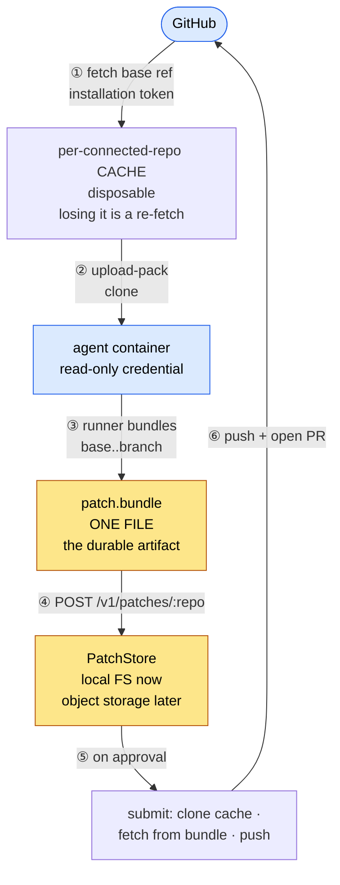

# 🌉 The git gateway

Door ① and ② of [the boundary](architecture.md#-the-three-doors): how an agent gets a repo, and how
its work gets out. Every number in this document was measured against real git, not reasoned about.

## 📝 The one-paragraph version

The gateway is a **read-only git server**. It serves clones out of a **per-connected-repo cache**,
fetching base refs from GitHub with the App's installation token, and that is the _only_ git wire
protocol it speaks — **there is no receive path at all**. Work leaves a run the other way: for each
line it shipped in each repo, the runner runs `git bundle create <baseSha>..refs/heads/<branch>`
and **POSTs a single file** to that repo's intake. So the run's git credential is **read-only**, and
the reason an injected agent cannot push is not that we forbade it — it is that **there is nothing
to push to**. The bundle is the durable artifact; the cache is disposable, because losing it is a
re-fetch.

A run holds a **set** of repos under one credential. The key resolves to the set — one member per
connected repo of the run's checkout, each with its upstream, its base ref and the run's branch
**namespace** in it — and the URL names the member: `/v1/git/:runId/:connectedRepoId/repo.git/…` on the way in,
`POST /v1/patches/:connectedRepoId` on the way out. Naming the repo in the path rather than
inferring it from the bundle is forced, not chosen: every repo of a run carries the same branch
namespace, so the bundle's own header cannot say which one it is for. A member outside the grant's set
answers **401, never 404**, for the reason the run id does.

One grant reads something other than the cache: a **check pod's**. Its member carries
`candidate: {headSha, branchName, bundleKey}` — a commit a run shipped through intake but nobody has submitted,
which no upstream holds yet — and the gateway serves it out of a scratch repo of its own
(`http/candidate.ts`): the stored bundle staged by the same `stageBundle` a submission publishes
through, so the head is re-checked against `headSha` before a byte is served, with the base (and
the change's target, when the grant names one) fetched in beside it from the cache. The candidate
is **never** written into the cache entry, because every run of the upstream clones from that entry
and every clone advertises every ref in it. The key is minted per suite generation, stored hashed
and expires; it reads and never ships — intake and the change-request warm answer it with a 401.
A candidate holds only the bundle's objects and borrows the base's from the cache entry (git
alternates, one way), so it costs about the bundle's size on disk; one whose entry is gone is staged
again. Starting a clone of a reused candidate first moves its base and target branches to the
entry's. Candidate dirs live under the staging dir (wiped on boot) and are swept thirty minutes
after last use.

A person can ask for checks on a commit of their own before any change request exists (a
**local ask**, from `ryph checks` on their machine). When the commit is not on the forge yet, the
orchestrator streams its bundle to the **service** route `POST /v1/service/check-bundle` (shared
`RYPH_FORGE_TOKEN`; not a run door, never public), with `{repo, url, connectedRepoId, userId,
branchName, baseRef?}` in the `x-ryph-check-bundle` header. It is verified as intake verifies a
patch, under the same cap: exactly one ref, which must be `refs/heads/<branchName>` exactly (no
generation suffix), and prerequisites the base cache satisfies, the base being `baseRef` or else
the upstream's default branch. One difference: a laptop's tracking ref may be newer than our cache,
which a run's base never is, so a failure against a base we hold refreshes it once and verifies
again before answering a terminal 400, at most once a minute per (upstream, base) and in memory
per process, so bad uploads cannot each cost an upstream fetch: inside that window the base is as
new as a refresh would make it and the 400 comes at once. A base branch the upstream answers it does not have (a
typo, a remote-tracking name like `origin/main`) is a terminal 400 too, told apart from an outage
(503) by git's own "couldn't find remote ref". It is filed under
`users/<userId>/<branchKey>/<baseKey>/<connectedRepoId>/<headSha>.bundle` (a run's is
`<runId>/<line>[-<n>]/<connectedRepoId>/<headSha>.bundle`, `@ryph/shared/lines` `runBundleKey`: the
branch's last segment, so two lines at one head are two bundles), where `branchKey` and `baseKey` are the first 16 hex
characters of the SHA-256 of the branch's and the base's names' UTF-8 bytes (`checkBundleKey` in
`http/bundle_intake.ts`; the orchestrator derives the same key). The branch is in the key because
the bundle's one ref is `refs/heads/<branch>`, and the base because its prerequisites were proven
against that base only: the same commit asked about on two branches, or against two bases, is two
bundles, and one key would let the second upload replace the first under the first suite's
clone. The route answers
`201 {headSha, bundleKey}`. The check pod's grant names that key as `candidate.bundleKey` and is
served exactly like a run's candidate; the gateway checks only that the key ends
`/<connectedRepoId>/<headSha>.bundle`. **Known limit:** nothing garbage-collects user bundles yet;
each distinct commit asked about stays in the patch store.

A check of somebody's push to a change request — a pull request or a patch no run produced — has
no bundle: its member carries `candidate: {headSha, fetchRef}` instead. The forge already has
that head, so the gateway fetches it **by id** into the cache entry (`ensureCommit`, which writes
no ref, so nothing new is advertised to the runs of the upstream); a forge that will not serve it
by id is asked for `fetchRef` (`refs/pull/<n>/head`, null on Radicle) instead, fetched the same
way — objects only, no ref written and the entry's HEAD untouched, so the fallback advertises
nothing either. The candidate repo is built as for a bundle — alternates, base and target
branches — with the head named by `update-ref`, after `cat-file -e` has found it there: a head
the forge **answered** it does not have (git's "not our ref", or "couldn't find remote ref" for
`fetchRef`: pushed over since, a fork deleted) is a **409**, terminal, since asking again fetches
the same nothing. A head missing because the forge could not be asked (unreachable, a 5xx, a
refused credential) is a **502**, which the pod's clone retries as a platform fault.

That leaves a fork's head in the shared entry as unreferenced objects, and protocol v2 serves any
object an entry holds to a client that names its id — so a run of the upstream could read a fork
pull request's code by guessing nothing more than its commit id. Accepted: `refs/pull/*` already
makes every pull request head public on the forge, to anyone.

Borrowing has edges, none of which can serve the wrong code:

- **Objects are content-addressed.** Whatever the entry holds under an id is that id's content, so
  the worst a moved or rebuilt entry can do is lack an object, never hand over a different one.
- **An entry rebuilt at the same path.** A candidate is reused while its alternates still name the
  entry's path. If the entry was deleted and fetched again in between — after the base was
  force-pushed, say — the new one may lack base objects the candidate's bundle builds on, and a
  clone fails on a missing object. It keeps failing until the candidate is staged again, which
  takes it going unused for the thirty minutes the sweep waits; the check's launch retries fail
  meanwhile.
- **A protocol-v0 client between two requests.** The advertisement and the pack request are two
  HTTP requests, and another clone's advertisement may move the candidate's base and target
  branches in between. A v0 client that then asks for the old tip is refused with "not our ref"
  (v2 does not hold wants to the advertised tips). A retry sees the new advertisement.
- **gc against the TTL.** The entry's fetches may run `git gc --auto`, which keeps unreachable
  objects for two weeks (`gc.pruneExpire`), so a base force-pushed away stays readable far longer
  than the thirty minutes an unused candidate lives.

## 🌿 The shape



Note what is **not** on that diagram: a per-run repo, an `objects/info/alternates` link, a GC
interlock, a `pre-receive` hook, a ref ACL. All of them existed to make a hostile push harmless. See
[what used to be here](#️-what-used-to-be-here-the-receive-path).

## 📦 Why a bundle, and not a packfile

A bundle is a packfile **plus a header naming the refs it carries and the commits it requires**.
That self-description is the whole point: it is what lets the gateway _validate_ an upload from an
untrusted container. Reject unless the bundle declares **exactly one ref**, that ref is **a line of
the run's `branchNamespace`** — `refs/heads/<namespace>/<line>`, or a later generation
`<namespace>/<line>-<n>` (n ≥ 2), with a valid line name (`@ryph/shared/lines`); nothing else under
the namespace and nothing outside it — and its **prerequisite matches the run's recorded
`baseSha`**. A bare packfile carries none of that.

A **line** is one independent stream of work in one repo of a run: its own branch, generations and
change request. The default is `work`; line names are `^[a-z0-9][a-z0-9-]{0,39}$`, hold no `--`,
and never end in `-<digits>` (that is how a generation is spelled). The rule is one copy,
`@ryph/shared/lines`, which the orchestrator and the runner use too.

Bundle the **named branch**, never `HEAD`:

```sh
git bundle create out.bundle "${BASE}..refs/heads/${BRANCH}"   # ✅ declares refs/heads/ryph/…
git bundle create out.bundle "${BASE}..HEAD"                   # ❌ declares HEAD; the fetch refspec
                                                               #    then cannot find the branch
```

The runner already creates `ryph/<agent>/<runId>/<line>` locally
([namespace rule](../../orchestrator/src/helpers/ids.ts)), so bundle that.

Measured, on a 120 KB repo with two agent commits: **602 bytes**. Base moved on origin mid-run —
push still succeeded, PR showed exactly the agent's commits. Workspace deleted before submit — head
SHA matched **exactly**, which is what lets `patches.head_sha` be a real provenance anchor rather
than a hopeful one. Re-submitting the same bundle: _"Everything up-to-date"_, exit 0 — **git-level
retry is safe** (PR _creation_ still needs its own idempotency key; see
[patch lifecycle](../../orchestrator/docs/patch-lifecycle.md)).

## 🔒 Two caps, both mandatory, neither optional

**This is the least obvious thing in this package, so it goes first.**

The design once claimed the read-only door had no request-body problem, because upload-pack requests
are "a few KB of wants". **Measured false:**

| Repo                            | Framing                          | Body            |
| ------------------------------- | -------------------------------- | --------------- |
| 4 commits, 1 ref                | `Content-Length`                 | **184 B**       |
| 10,000 refs                     | `Content-Length` + **gzip**      | 247,782 B       |
| **25,000 refs — a plain clone** | **`Transfer-Encoding: chunked`** | **1,250,124 B** |
| 25,000 refs, `postBuffer=100M`  | `Content-Length` + **gzip**      | 618,732 B       |

Want-lines are exactly **50.0 B/ref**. Above `http.postBuffer` (default **1 MiB**) git switches to
chunked — at **≈21,000 refs**. Below it, `Content-Length` **and gzipped**. Both hold under protocol
v2. Git also sends a 4-byte probe POST before a chunked body, which the auth layer must tolerate.

> **The chunked-body surface is a property of the HTTP endpoint, not of the git operation.**
> Read-only-ness bounds nothing — anyone can POST to `/git-upload-pack`.

What _does_ survive is a difference in **kind**: an upload-pack body is bounded by **ref count**, a
property of the repo we can measure; a receive-pack body is bounded by **whatever the client feels
like pushing**, which is attacker-controlled and unbounded.

And the corollary that inverts: request bodies are safe under `git http-backend` **only because it
buffers the whole body and hard-caps it at 10 MiB**. That is a gift from http-backend — and going
direct **throws it away**. Proven: the same 30 MB request http-backend refused,
`upload-pack --stateless-rpc` swallowed whole and answered with a **200 MB pack**.

| Cap                    | Why                                                     |
| ---------------------- | ------------------------------------------------------- |
| **upload-pack body**   | We forfeited http-backend's free 10 MiB by going direct |
| **bundle intake body** | An agent that commits a 500 MB file POSTs 500 MB        |

**Neither may buffer-then-check.** Reject _while streaming_, or the cap is the DoS.

## ⚙️ Direct `upload-pack --stateless-rpc`, not CGI

Both were built and both worked (v2, chunked, gzip, fetch, `--depth`, `--filter`). Direct is ~115
lines against ~194. But the deciding reason is not line count:

> **Direct makes read-only _structural_.** `receive-pack` has no route at all, rather than being
> switched off by a config flag that has to stay correct. That is the same "isolation is structural,
> not policy" principle the rest of the design runs on.

| Approach      | Gives you free                                                               | Costs you                                                                                                              |
| ------------- | ---------------------------------------------------------------------------- | ---------------------------------------------------------------------------------------------------------------------- |
| **CGI**       | gzip inflation · path resolution · the pkt-line preamble · **the 10 MB cap** | header splitting · env plumbing · a 10 MB _ceiling_ (breaks >209,715 refs) · **errors as HTTP 200 with an empty body** |
| **Direct** ✅ | one obvious route per operation                                              | ~3 lines of `DecompressionStream("gzip")` · a path-traversal regex · the preamble · **your own cap**                   |

Auth happens **before** the spawn: parse `Authorization: Basic`, SHA-256 the password, look it up in
`git_virtual_keys`, resolve `run_id` → cache path. **The credential, not the URL, selects the repo**
— the run id still appears in the path and must agree, as belt-and-braces and for readable logs.
Disagreement is `401`, never `404`, for the same reason the
[runner surface](../../orchestrator/docs/architecture.md#-runner-surface--v1runsid) answers
uniformly: a `404` would confirm which run ids exist.

## 📼 Serving a base the upstream cannot refresh

The cache is a pull-through cache, and a pull-through cache has one question to answer: what
does it do when the pull fails and it still holds a copy? Here the answer depends on **who is
asking**, and the port makes the asker choose by name.

- **`serveBase`** is what a clone gets (`info/refs`, the upload-pack fallback, bundle intake, the
  services read). If the refresh fails and the entry already resolves the branch, it serves that
  copy and **marks it stale** in the entry: `git config ryph.<branch>.staleSince <ISO instant>`,
  set on the first failure after the last success and `--unset` by any successful refresh. A run
  during a GitHub outage therefore clones the last good tip instead of failing at
  `during: "cloning"`, and the mark is how it later learns that it did.
- **`refreshBase`** is what a read gets whose answer must be the upstream's as of now: the
  `.ryph/` tree id an environment is built from, a default branch's head, a change request's
  head (which the runner checks against the forge's own sha). It has no freshness field because
  it can only be fresh: a caller holding a `CachedRepo` cannot act on a stale tip by the type it
  holds.

Two things a stale serve never covers. A **cold entry** has nothing to serve, so a first fetch
that fails is still a refusal. And an upstream that **refused** (`UpstreamRefused`) is the repo
owner's decision, not an outage, and the copy the cache holds is one they no longer grant. A
refusal is either a mint GitHub answered with a definitive 4xx other than 429 (an installation
suspended, removed, or short a permission), or git's own definitive answers, classified in one
place in the adapter from the words git uses: `couldn't find remote ref` (the branch was deleted
or renamed), `repository '...' not found` and GitHub's `Repository not found` (deleted, private,
or dropped from the installation, so the token still mints and git gets a 404), `could not read
Username` and `Authentication failed` (a 401, with or without a credential presented), and
`The requested URL returned error: 401`, `403`, or `404`. Everything else git reports stays an
outage: a host that cannot be resolved or connected to, a stalled transfer, a 5xx, a 429, and a
path upstream that is missing (which is how the tests simulate an outage). The same
classification covers `ensureCommit`'s fetch and `remoteDefaultBranch`'s `ls-remote`.

The two refusals do different things to the entry, and `UpstreamRefused.reason` says which.
`missing-ref` (git's `couldn't find remote ref`) is about one branch, and the refresh drops the
entry's copy of it along with its stale mark, through `refreshBase` and `serveBase` alike. Kept,
the next advertisement would go on listing the deleted tip, `find` would call it fresh, and a
run whose target was merged and auto-deleted upstream would have `warmTarget` swallow the
refusal, fetch the old tip, hear "fresh" from `/base`, and have `update_from_base` merge a dead
branch and report itself caught up. Dropped, the fetch fails with git's own `couldn't find
remote ref`. `repo` (every other definitive answer, and a mint the forge refused) is about the
whole repo for this caller and keeps every branch: an installation can be restored, and the
branches still exist upstream.

How a run learns it. git's wire protocol carries no freshness signal, so the answer sits beside
it: `GET /v1/git/:runId/:connectedRepoId/base?ref=<branch>` answers
`{ ref, commit, staleSince: string | null }` from the entry alone (the mark, and the sha the
branch resolves to), under the same credential as the clone and with no upstream contact, and
the runner asks it right after each clone or fetch. After a fetch the runner also holds `commit`
to what it landed on: the entry is shared, so another run's successful refresh between the fetch
and the question clears the mark and moves the branch, and a fetch that landed on the stale tip
would otherwise read as fresh. A mismatch fetches once more; a second mismatch refuses the base
("moved at the origin while it was being read; try again"). A clone or adopt reads the mark
alone, since nothing acts on its tip as "the base now". When the
cache has nothing to serve, `info/refs` and `git-upload-pack` answer 502 with a **`text/plain`**
body naming the reason (no copy held, or the upstream refused, in its own words), because that is
the one kind of error body git prints to the user; the JSON routes stay JSON.

How a run fetches after its clone. The landing cue's fetch, `update_from_base`'s and a change
request's head name the member URL and an explicit refspec, never `origin`:
`git -c http.proxy= -c http.<url>.proxy= -c remote.<url>.proxy= fetch -- <member URL> +refs/heads/<branch>:refs/remotes/origin/<branch>`
(runner `helpers/fetch.ts`), with the run's key riding the subprocess environment as on the clone,
and the answer read from `origin/<branch>`, not `FETCH_HEAD`. The checkout's config is the agent's
to write: a fetch through `origin` would take its `remote.origin.url`, `.uploadpack` and `.fetch`,
and its `http.proxy`. A fetch by URL takes none of them, and the proxy keys the member URL matches
are pinned empty. Two keys `-c` cannot undo still rewrite the URL, `url.<base>.insteadOf` and
`remote.<member URL>.url`; a fetch they send elsewhere lands on a commit this route's `commit`
does not name (or the change request's warm answer's `headSha`), and is refused as having moved.
None of this is a defence: the agent shares the runner's uid and can read the key. It keeps ryph's
fetches working whatever the agent did to its remote.

Why a strict sibling rather than flipping `ensureBase` in place: every caller that stopped
failing would have started serving stale silently, and the strict readers (`ryphTree` above
all: a stale tree id builds yesterday's machine) would have needed an `if (stale)` guard each,
one missed guard away from a wrong build. Renaming makes the choice a compile error.

Both contacts are bounded, so a GitHub that hangs rather than refuses fails into the seam too:
the mint gives up after 15 seconds (`AbortSignal.timeout`, the budget every REST call gets), and
the fetch subprocess carries `http.lowSpeedLimit=1` / `http.lowSpeedTime=30`, which git applies
while it is still waiting for the first byte (measured: a stalled upstream fails in exactly
`lowSpeedTime`). Without the bound a hung fetch would hold the repo's serialized operation chain,
and every clone of that repo behind it.

Why the token is minted **inside** the seam: `info/refs` used to mint the installation token
before asking the cache, and a mint needs `api.github.com`. Tokens are reused for about
50 minutes, so a stale serve gated on the mint would have covered only the first 50 minutes of an
outage, and nothing after a forge restart. The credential is now a thunk the cache resolves as
the first step of its fetch, so a mint that cannot reach GitHub is one more failed refresh, judged
where every other one is.

## 🩸 Gotchas, paid for in blood

Every one of these was hit for real.

1. **Forgetting `GIT_PROTOCOL` silently downgrades every client to v0.** The `info/refs`
   advertisement measured **1,564,124 B instead of 138 B** — an **11,000× regression that throws no
   error and fails no test**. Sanitize it off the `Git-Protocol` header and pass it through.
2. **Git gzips upload-pack request bodies.** Under direct you must inflate. (Under CGI, omitting
   `HTTP_CONTENT_ENCODING` makes http-backend read gzip as pkt-lines and die at exit 141.)
3. **Pump stdin concurrently with draining stdout.** Awaiting the body write first **deadlocks** on
   large responses. And catch `pipeTo`'s rejection when upload-pack dies early, or an unhandled
   rejection takes the process with it.
4. **A 401 hangs a real git client on a blocking credential prompt** — `GIT_TERMINAL_PROMPT=0` is
   **not enough**. Reproduced live: a VS Code prompt appeared and only cleared when a human
   dismissed it.
   > **`helpers/git_exec.ts` is the only thing that defends against this.** Under its env
   > `credential.helper` resolves to **nothing** — `GIT_CONFIG_GLOBAL=/dev/null` and
   > `GIT_CONFIG_SYSTEM=/dev/null` strip the helper — and a 401 fails immediately with
   > `could not read Username … terminal prompts disabled`. Its "no git subprocess can prompt"
   > invariant is **load-bearing, not decorative**. Never spawn git without it.
   >
   > **And the config hardening alone was measured incomplete** (phase 1, reproduced again): an
   > inherited **`GIT_ASKPASS`** env var — VS Code sets one in every integrated terminal — is a
   > *third* prompt channel that survives both `/dev/null` configs and `GIT_TERMINAL_PROMPT=0`,
   > and popped a real GUI dialog when a gateway test answered 401. `git_exec.ts` now empties
   > `GIT_ASKPASS` and `SSH_ASKPASS` too. The same test also closed a fourth hole: an ambient
   > `GIT_CONFIG_COUNT` would inject arbitrary config at command-line precedence past the
   > `/dev/null` hardening; it is neutralized unless deliberately set for the extraheader seam.
5. **`uploadpack.allowFilter` defaults false**, so `--filter=blob:none` **silently degrades to a
   full clone** with only a warning. Easy to ship a "partial clone" that isn't.
6. **Amplification: a 116-byte request produced a 209,925,584-byte response.** A rate-limiting
   concern, not just a size one.
7. **Once a streaming `Response` is returned you cannot signal failure** except via git's sideband.
   Status codes do not carry pack-time errors.

**Streaming does work**, and properly: a 200 MiB response through a reader throttled to 5 MB/s over
40 s held RSS flat at **85 MB** across 11,253 chunks — real backpressure via `ReadableStream.pull`.
And upload-pack self-defends well: 500 MB of garbage was cut off at 20 MB in 33 ms. But that is
**git protecting us, not our architecture** — hence the caps.

## 🗑️ What used to be here: the receive path

The gateway was once a real git remote. The agent pushed to a **per-run bare repo**, which reached a
shared cache's objects through `objects/info/alternates`, guarded by a **`pre-receive` hook**
enforcing "this run may create `refs/heads/ryph/<run-id>`, may not force-push, may not delete".

It fell to a question: _what does the agent achieve by force-pushing `main` **in its own scratch
repo**?_ Nothing. Nothing downstream reads it. The gateway only ever read one ref by name. So the
hook was never the control — **"the gateway reads one ref" was**, and that is an invariant of code
we own rather than one enforced against a hostile client.

Once the hook stopped being load-bearing, the per-run repo was carrying a capability nobody needed.
Deleting it took the alternates with it, and the alternates took the **GC interlock** — a
_correctness_ invariant (never prune an object a live run points at) that had to be right forever.
Three pieces of machinery, all of them containment for a capability we could simply not grant.

The principles it leaves behind:

- **Remove the capability, don't contain it.** Containment is machinery that must stay correct
  forever; removal is a thing you do once.
- **Isolation is structural, not policy.** The agent cannot push because there is no route — not
  because a hook, a flag, or a config said no.

Kept from that era: `receive.maxInputSize`'s _lesson_, if not the setting. A `pre-receive` hook runs
**after** the pack is indexed, which is far too late to stop a 100 GB push — the check has to live
where the bytes arrive. That is why [the caps](#-two-caps-both-mandatory-neither-optional) stream.
