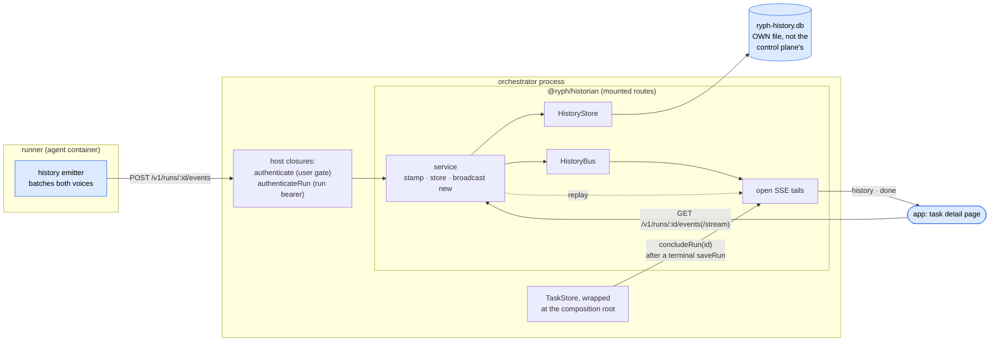

# @ryph/historian — architecture

The permanent record of what happened during a run. The runner emits every transcript chunk (what
the model did: assistant text, thinking, tool calls, tool results) and every diagnostics event (the
machinery's story) as `HistoryEvent`s; the historian stores them append-only and serves them back —
paginated for history, streamed for watching a run live.

## The one noun

`HistoryEvent` — `(runId, lane, seq, at, voice, kind, level, text, payload)`. Two voices share the
envelope: `transcript` (kind = chunk kind) and `diag` (kind = the dot-namespaced event key). The
**runner assigns `seq`**: it is the single writer for its run, so one counter across both voices is
a total order for free — and `(runId, lane, seq)` doubles as the idempotency key, which is what
makes the emitter's blind retries safe (`INSERT … ON CONFLICT DO NOTHING`). Ordering is always `seq`
within a lane; `at` is the runner's clock and display-only.

## Lanes

A run's history is split into lanes. Lane `""` is the run's own transcript; a subagent's is `sa-<n>`
(n from 1 to `MAX_SUBAGENT_LANES`, 16: the runner's cap on starts, pinned by its limits test), and
the boundary refuses anything else with a 400, on ingest and on read. Each lane has its own seq
counter, so lanes are independent records under one run: `history_events`' primary key is
`(run_id, lane, seq)`, which is the read index, the idempotency key and the bus's subscription key
alike. Every read names one lane — absent means `""`, so a reader that never heard of lanes is
unaffected. The run's read gate covers every lane, and a run's conclusion ends every lane's tails.

`GET /v1/runs/:id/lanes` is what a viewer draws the run's subagents from, with nothing asked of the
control plane: each lane that has a transcript `subagent.start`, with that start, its latest
`subagent.resume` and its latest `subagent.end` (the runner writes all three `keep`), plus `ranMs`,
the sum of `payload.durationMs` over the lane's latest 256 `subagent.end`s (0 with none; anything
but a number from 0 to a day counts nothing): a continued subagent's time in all. A lane is running
while it has no end, or its latest resume is after its latest end.

The run token is readable in the run's container, so what a lane holds is the agent's to write, and
the listing is bounded against that rather than against an honest runner. It probes exactly the 16
lanes there can be, each with LIMITed reads from one end of a partial index,
`history_events_lane_lifecycle` on `(run_id, lane, kind, seq)` over transcript starts, resumes and
ends: one statement for the three events, one for `ranMs`. A lane's other rows are never read, and
neither are its ends past the latest 256. The predicate's kinds and voice are literals in the
statement, never parameters, so a cached generic plan can still prove it may use the index. Each
event in a summary is clipped (`clipLaneEvent`): its text and payload strings cut to 4,096
characters, and its payload cut down to its kind's fields (`id`, `label`, `mode`, `task`; `id`,
`message`; `id`, `reason`, `answerChars`, `durationMs`). The whole event is in the lane.

`GET /v1/runs/:id/lanes/stream` is the same listing live: every summary on connect, then a lane's
fresh summary (`event: lane`) whenever one of those three events is stored for it, and `done` with
the run. The bus carries that as a signal of its own (`subscribeLanes`; on Postgres the
`ryph_history_lanes` channel), never as the lane's transcript, and the stream re-reads the listing
and sends only what changed. A stream reads at most once a second, however many signals arrive, and
folds the signals in between into that read. Phase/lifecycle transitions are NOT here — they stay in
the orchestrator's `run_events`; readers merge.

## Ports

| Port           | What the core sees                                                                                                                                                                                               |
| -------------- | ---------------------------------------------------------------------------------------------------------------------------------------------------------------------------------------------------------------- |
| `HistoryStore` | Idempotent append that returns ONLY what was new; seq-ordered pagination of one lane; the lane listing                                                                                                           |
| `HistoryBus`   | Live fan-out to a lane's subscribers. Two adapters: an in-process listener map for the single process, and Postgres `LISTEN`/`NOTIFY` for replicas, where a tail on one and an ingest on another must still meet |

The service publishes only the rows the store actually inserted, so a retried batch acks as
duplicates and never replays onto live listeners. The SSE handler subscribes FIRST, buffers, replays
from the store, then drains the buffer — dedup by seq closes the overlap without locks.

## Auth is injected, never owned

The historian cannot verify a run token (the runs table is the host's) and has no idea of a user.
Its routes take two gates from the host: `authenticate` (the same user gate as the rest of the
surface, for reads) and `authenticateRun` (a closure over the host's `getRun` + `runTokenMatches`,
for ingest — unknown run and bad token answer alike).

## A run's ending comes from the host, not the record

`historianRoutes` returns `concludeRun(runId)` alongside its routes: the host calls it when a run
reaches a terminal state, and the open SSE tails for that run say `done` and hang up. The one thing
a watcher needs to know is the one thing the history cannot tell it — a run ending is a lifecycle
transition, and those live in the orchestrator's `run_events`, which the historian never sees.
Without the signal a finished run's tails idle on a keepalive drip forever.

The **host's store is the choke point**, wrapped at its composition root
([`concludeOnTerminal`](../../orchestrator/src/main.ts)): every terminal path — the runner's result,
a user's cancel, the reaper's `lost` verdict or its kill — must persist the run to make it real, so
one wrapper catches all of them and a path added later cannot forget to announce itself. Two
properties fall out of firing _after_ the write lands: a client that reloads on `done` always reads
the final state, and the core never learns the historian exists.

Deliberately not the runner's job. Two of the five terminal states (`lost`, a hard-killed
`cancelled`) are the orchestrator's own verdict, reached precisely when the runner is gone or wedged
— a client waiting on a runner-sent "finished" would wait forever in exactly the cases that matter
most. It would also race the happy path, announcing the end before the orchestrator has processed
the result and flipped the state.

`done` waits out a short grace (`CONCLUDE_GRACE_MS`, ~4 s) and re-reads the store first: the runner
POSTs its result and only _then_ flushes its last history batch on the way out. Hanging up the
instant a run reads terminal would promise a complete record while its ending is still in flight.

## Its own database file

`RYPH_HISTORY_DB` (default `ryph-history.db`), with its own `drizzle.config.ts` and `db:push` —
deliberately NOT part of the orchestrator's shared file or push. The transcript firehose is the
biggest, fastest-growing data in the system; in its own file it can neither contend with
control-plane writes nor hold run-state's backups hostage. A split-out historian process takes its
file with it.

## HTTP surface (mounted into the host's route table)

| Route                                   | Auth       | Behavior                                                                                                                      |
| --------------------------------------- | ---------- | ----------------------------------------------------------------------------------------------------------------------------- |
| `POST /v1/runs/:id/events`              | run bearer | Batch ingest, ≤200 events, each with an optional `lane` (default `""`); duplicates re-acked (`{accepted, duplicates}`)        |
| `GET /v1/runs/:id/events?after=&limit=` | user gate  | One lane's ascending seq page (`lane=`), ≤1000 (default 1000); `{events, lastSeq, hasMore}` — follow `hasMore` from `lastSeq` |
| `GET /v1/runs/:id/events/stream?after=` | user gate  | SSE of one lane (`lane=`): replay → live tail; `id:` = seq, `Last-Event-ID` resumes; `done` closes a concluded run            |
| `GET /v1/runs/:id/lanes`                | user gate  | `{lanes}`: each subagent lane's start, latest resume and latest end, in `sa-<n>` order (Lanes, above)                         |
| `GET /v1/runs/:id/lanes/stream`         | user gate  | SSE: each `LaneSummary` on connect, then a lane's fresh one (`event: lane`) on its start/resume/end; `done`                   |
| `POST /v1/runs/:id/live`                | run bearer | The browser's live uplink (README, "The live channel")                                                                        |
| `GET /v1/runs/:id/live/stream`          | user gate  | The browser's live SSE                                                                                                        |
| `POST /v1/runs/:id/live/commands`       | run bearer | The background commands' live uplink (README, "The background commands' channel")                                             |
| `GET /v1/runs/:id/live/commands/stream` | user gate  | The background commands' live SSE                                                                                             |

Plus one non-HTTP export beside them: `concludeRun(runId)`, the host's terminal signal (above).

## The runner's end

One shared `httpHistoryEmitter` (`runner/src/adapters/history/emitter.ts`) behind two thin adapters
— `historyNarrator` and `historyDiagnostics` — tee'd alongside the console narrator and logger
diagnostics. The ports did not change. The emitter is total and non-blocking: interval +
size-triggered batches, one POST in flight, backoff on 5xx (same seqs — dedup upstream), definitive
drop on 4xx, a bounded buffer, and a deadline-bounded final drain at dispose time. Every hole it
leaves is admitted in the record itself, by a `history.dropped` marker naming its `reason` —
`overflow` when the run outpaced the emitter, `rejected` when the batch was refused and was never
going to land. Its own failures go to the base logger diagnostics only, never the tee that feeds it;
the emitter is constructed before that tee exists, so wiring it the other way is a compile error
rather than a rule to remember.
