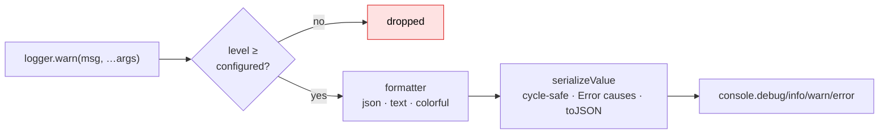

# @ryph/logger

Named/scoped loggers with level filtering and pluggable formatters, shared by every ryph service.
Every service logs the same way: `new Logger("db")`, five levels (`debug` → `critical`), and a
recursive serializer that keeps `Error` causes, survives cycles (`[Circular]`), and honors `toJSON`.

## ⚙️ How it works

One global config (level + formatter + output), any number of named `Logger` instances. A call is
filtered by level, then handed to the active formatter, then written to the matching `console`
method — so `error`/`critical` go to stderr and the rest where they belong. A composition root
whose stdout is a data channel (the runner: the `Result` JSON) sets `stderr: true` to pin every
level to stderr instead.



The **format default is context-aware**: `colorful` on a terminal (so `bun run dev` is readable)
and `json` otherwise (so a container's stdout is machine-parseable) — no configuration needed for
either to be right.

## 🚀 Usage

```ts
import { Logger, setupLoggerFromEnv } from "@ryph/logger";

setupLoggerFromEnv(); // once, in the composition root

const logger = new Logger("provisioner");
logger.info("container launched", { runId, image });
logger.error("launch failed", err); // the full cause chain lands in the log
```

Libraries just `new Logger(...)`; only a **composition root** calls a setup function.

## 🎛️ Configuration

| Variable            | Values                                                                                    |
| ------------------- | ----------------------------------------------------------------------------------------- |
| `RYPH_LOG_LEVEL`    | `debug` · `info` (default) · `warn` · `error` · `critical`                                 |
| `RYPH_LOG_FORMAT` | `json` · `text` · `colorful` — defaults to `colorful` on a terminal, `json` otherwise        |

`setupLoggerFromEnv({ level, stderr })` reads those env vars over an optional default level (the
runner and its bake step pass `LogLevel.DEBUG`); `stderr: true` routes every level to stderr and
makes the terminal detection for the format default look at stderr too. `setupLogger({ level,
formatter, stderr })` is the fully programmatic form; a custom formatter is any function
implementing `LogFormatter`. If `--allow-env` isn't granted, setup silently keeps its defaults
rather than throwing.

## 🧬 The serializer

`serializeValue` is the careful part: it walks arbitrary log arguments and produces something safe
to render. It **keeps `Error` cause chains**, **honors `toJSON`**, and **survives cyclic
references** (`[Circular]`) instead of throwing. The text formatter runs args through it just as the
JSON one does, so no formatter throws on a cyclic payload. It's exported, so a custom formatter can
reuse it.

## ⚡ Quick start

```sh
bun run ci    # type-check, tests (fmt and lint run from the repo root)
```
