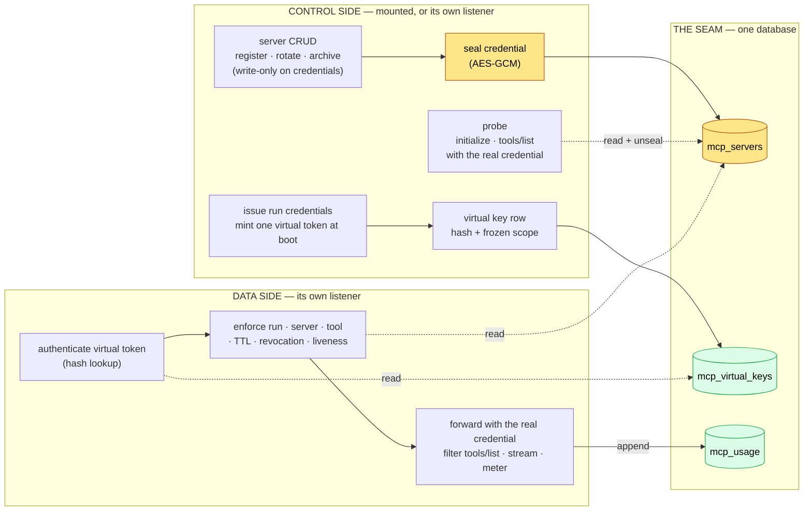
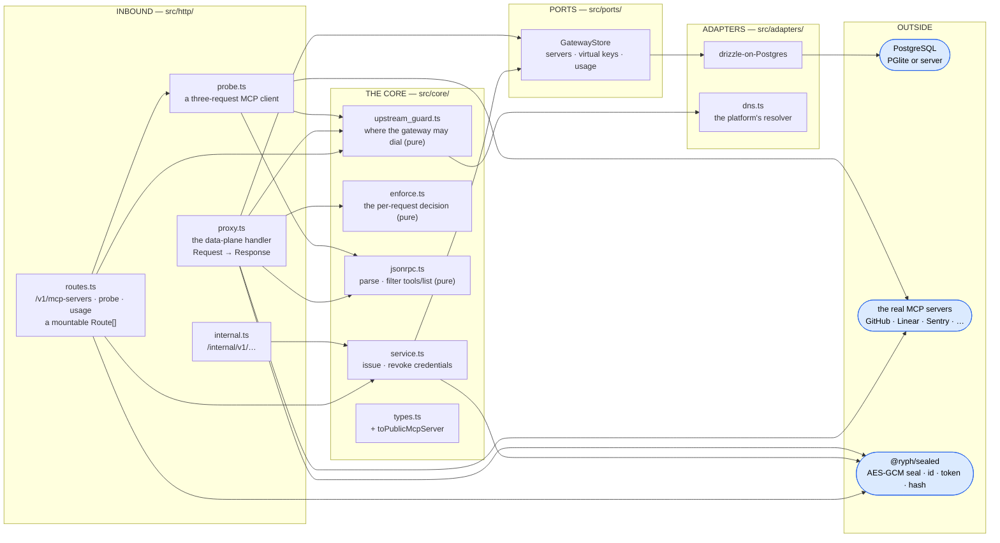
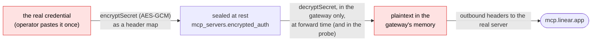
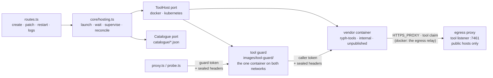

# 🏛️ Architecture

How the MCP gateway is put together: the control-plane / data-plane split it inherits from the
[model proxy](../../model-proxy/docs/architecture.md), the ports and adapters behind each half, the
shared store that is the seam, the service-authed surface a remote control plane reaches it through,
and why the data plane is a boring reverse proxy with exactly two inspections. (What the package
_is_ — real MCP credentials sealed in one place, run-scoped virtual tokens everywhere else — is the
[README](../README.md)'s opening.)

## 🪞 Control plane and data plane

The package has two halves with very different jobs, and they never share a listener. The **control
side** owns records and policy: mounted into the control plane in the single process, and on its own
control listener (`:7431`) when `src/main.ts` runs standalone. The **data side** owns enforcement
and the hot path and always answers on its own port (`:7430`) in both.

**Who may reach the control side.** Registering, repointing, rotating, archiving and probing a
server are **admin-only**, as is reading a run's tool-call trail: each either holds an org
credential or aims one somewhere (`PATCH url` then `probe` is, in two calls, "decrypt the org's
token and send it to a host I chose"), so they take `role: "admin"` on the verified token and answer
a verified non-admin `403 admin_only`. **Listing servers does not** — the agent form every user
fills in needs the names. Two rules bound the credential inside that surface: moving a credentialed
server's `url` **requires the credential again in the same request** (`400
credential_required`),
and an **archived server is never probed** — archiving is the kill switch, and the probe is the one
other place the real credential goes out.

**Why the split matters.** The control side is the internet-facing surface users authenticate
against; the data side is what every agent container on the run network dials. Keeping them apart
means the run network never reaches a management surface, and the data plane holds no state a user
created — a gateway restart mid-run is a non-event.

**The seam between the two halves is the shared store, not an API.** The control side writes
`mcp_servers` and `mcp_virtual_keys`; the data plane reads them per request and appends `mcp_usage`.
No registration handshake, no in-memory mapping a restart would lose.

**What is an API is the link to the CONTROL PLANE**, and only when they are different processes.
`src/http/internal.ts` serves three service-authed routes (`RYPH_MCP_GATEWAY_TOKEN`) — look up a
server's metadata, mint a run's credentials, kill them — which is exactly what the orchestrator's
`ToolAccess` port asks for. The surface is mounted **only when the token is set**, and it draws the
definitive-`400` / could-not-ask-`503` line the model proxy's does, for the same reason: a transient
outage must never be reported as a permanent verdict.

**A new package, not a mode of the model proxy**, because the two hold different secret classes (the
master-key-per-package rule), speak different protocols on the wire (JSON-RPC over streamable HTTP,
with a server→client stream), and grow in different directions (OAuth brokering, and hosted servers,
which it now runs). What they share — sealing, id and token minting, hashing — is
[`@ryph/sealed`](../../sealed/README.md).

## 🔌 Ports & adapters

A hexagonal architecture like the rest of the workspace: a pure `src/core/` behind a single port,
bound to an adapter at a composition root. The `src/http/` layer is the inbound edge — two surfaces,
one per plane — plus the probe, which is the control side's one outbound call.

| Port           | What the core sees                                                                                                                                                                                                          |
| -------------- | --------------------------------------------------------------------------------------------------------------------------------------------------------------------------------------------------------------------------- |
| `GatewayStore` | Servers, virtual keys, and the append-only usage trail — a dumb row-holder; every decision (sealing, minting, allow/deny) is made elsewhere and handed here to persist                                                      |
| `ToolHost`     | Where hosted servers run: `ensureNetwork`, `launch`, `stop`, `list`, `inspect`, `address`, `logs`. Adapters: `docker`, `kubernetes` (`src/adapters/tool_host/`) — see _Hosted servers_ below                                |
| `LeaseStore`   | Where the hosting lease is recorded: `read`, `create`, `replace` at a version. [`@ryph/service`](../../service/README.md)'s, with its Kubernetes Lease store (`src/adapters/lease/`) — see _Hosted servers_ below           |
| `Catalogue`    | Which servers can be set up — hosted images and remote presets: `list`, `get`. Adapter: the shipped directory of JSON (`src/adapters/catalogue/directory.ts`); a catalogue service can replace it without the core noticing |

`src/core/` depends on nothing concrete. `enforce.ts` is a **pure function** of a virtual key, the
path's run id and slug, the server row, and the clock; `jsonrpc.ts` is pure functions over strings
and plain objects; `upstream_guard.ts` is pure given an injected resolver — so every rule is
unit-tested with plain values. The same `bun run guard` fence as the other packages holds the
layering: core → core/ports (plus the `@ryph/sealed` kit), ports → ports/core.

## 🔒 The credential's whole life

One upstream credential exists in exactly two forms, and the boundary between them is the point of
the package:

- **It is sealed as the header map upstream will receive** — `{"Authorization":"Bearer …"}` for a
  bearer, the operator's map for `headers` — so the data plane sets what it unseals and never
  interprets it.
- **It never appears in an API response.** `toPublicMcpServer` strips the sealed field in exactly
  one place; every route returns metadata plus an `authLast4` trace. The probe unseals a credential
  to _use_ it and returns only what upstream said.
- **A container never holds it.** What a run receives is a **virtual token** — random, run-scoped,
  stored as a SHA-256 hash only, carried as an env var the harness config references and never as a
  literal in a file.
- **The master key is this package's, and only this package's.** `RYPH_MCP_KEY` seals MCP
  credentials; the model proxy and the control plane each hold their own.
- **A credential is bound to where it goes** (`v2`, `core/sealing.ts`): a remote row's url, a hosted
  row's slug, container and settings, under a key derived from `RYPH_MCP_KEY` for this class alone.
  Repointing a row in the database leaves a credential that no longer opens; the API takes the
  credential again with any such change, and an edit of the credential, url or settings lands only
  while the row still has the credential and destination it was read with (`server_changed`
  otherwise). Credential header names that steer the request (`Host`, `Forwarded`, …), and values
  that are not visible ASCII, are refused at the API and again at every forward and probe
  (`credential_header_refused`), and a `Headers` throw — which quotes the value — is caught into the
  same fixed answer and never logged. **A hosted credential's address is a pure, injective function
  of the launch it is bound to**: its launch key (`core/sealing.ts` `launchKey`, 128 bits of SHA-256
  over the credential binding — row id included — the image digest and a custom image's caller-auth
  env var, as a fixed-shape array; a catalogue entry by its id, since entries ship with the gateway
  and every row is relaunched at boot). The container is `ryph-tool-<key>`, and both launchers
  refuse any vendor launch under another name; the guard routes `/<key>/mcp` only to that container
  (its route table refuses any other host); and the data plane and the probe compute the key from
  the row as read and dial `<guard>/<key>/mcp` — never the slug, never the stored url. A stale
  route, a superseded or failed launch, A→B→A, a database revert, a slug swap or two rows racing can
  therefore only leave the key unserved. The in-memory route table only picks the refusal:
  `hosted_stale` (503) when this gateway's launch for the row was made from other inputs than it has
  now, which the supervisor relaunches at once — as does a startup wait, against the row's backoff;
  `hosted_starting` (503) while a launch is coming by itself (boot, the lease, a shutdown or
  handover, a backoff, the guard not yet routing the key), and for a connection the guard refused to
  a row still starting or while the guard is (re)launching; `hosted_not_running` (502) when this
  gateway has no container for it and none coming, or when its launch cannot be derived any more
  (whatever is still routed). Settings and image changes move a row to a new key, so the supervisor
  sweeps every container no live row's current key names on every tick, not only at boot — judged
  again under the name's lock before each stop, so an edit back to a key the sweep listed as stale
  keeps its fresh container — and a row whose launch cannot be derived keeps none. A route to a
  container the sweep or a failed relaunch removed is dropped, and a ready route is marked not ready
  while its container is replaced under the same name, so those calls answer `hosted_starting`
  rather than an uncoded 502. A credential that will not open, or that upstream refuses, leaves the
  container up and says so on the row; it is never a relaunch.
- **The sealed format is versioned** (`@ryph/sealed`'s), so the OAuth phase — access and refresh
  tokens the gateway refreshes and re-seals — coexists with rows sealed today under the same
  `encrypted_auth` column.

## 🎫 The virtual token's life

One token per run, minted at the runner's boot-time credentials fetch and dead when the run ends:

1. **Issue** (`makeMcpCredentialIssuer.issue`, reached from the orchestrator's credentials route —
   in-process under the single binary, or via `POST /internal/v1/runs/:id/mcp-credentials` when the
   two are separate). The scope arrives frozen from the run's snapshot: which servers, which tools.
   Each server is checked to exist and be unarchived (a definitive refusal otherwise); its slug and
   name are copied into the row and the result, so the data plane never looks a slug up. A random
   token is minted; its hash and the frozen scope land in `mcp_virtual_keys`. The result hands back
   the token and one gateway URL per server, `/v1/mcp/<runId>/<slug>`.
2. **Spend** (the data plane). Each request is authenticated by hashing the presented bearer;
   `enforce.decide` then applies TTL, revocation, **that the path's run id is the token's** and
   **that the path's slug is in the scope** (the credential selects the run; the path must agree —
   the git gateway's belt and braces), and the one deliberately _live_ check: the server row still
   exists, is unarchived, and carries a credential if it needs one.
3. **Revoke** (`revokeForRun`, called when a run reaches a terminal result). The RUN is recorded as
   revoked (`mcp_revoked_runs`) before its keys are stamped, and the data plane's key lookup joins
   that record — so an issue racing the revoke cannot leave a live key behind, whichever write
   commits first, and an issue after it is a definitive refusal. The TTL is only the backstop.

An unknown, revoked and expired token, a wrong run id, and a slug outside the scope all answer
**identically** (`401`): distinguishing them would confirm to a probing caller which tokens
exist(ed) and which servers a run may reach. A live token whose server was archived answers `403` —
the caller _is_ who it claims to be, it just may no longer proceed.

## 🚦 A boring reverse proxy with two inspections

The data plane is deliberately dumb — hash the presented token, one row lookup, one row read, a pure
`decide()`, then a streamed passthrough — with the minimum of JSON-RPC awareness the tool allowlist
needs:

- **Request bodies are bounded and parsed** (tool arguments, small) to read `method` and, for
  `tools/call`, `params.name`. A name outside `allowedTools` answers a JSON-RPC `-32601` _method not
  found_ — indistinguishable from a tool that does not exist. JSON-RPC **batches are refused**: the
  2025-06-18 spec removed them, and a batch through an allowlisting proxy would be a bypass.
- **Upstream gets the judged message, re-serialised — never the client's bytes.** JSON parsers
  disagree: Go's `encoding/json` matches keys case-insensitively and keeps the last duplicate, so
  forwarding the raw body let `"Method":"resources/read"` pass here as a method-less response and
  run upstream, and `params` carrying both `name` and `Name` pass the allowlist under one tool and
  run the other. So the door also refuses (`400`, JSON-RPC `-32600`, or `-32700` for bytes that are
  not UTF-8 JSON) a key repeated in any object, a top-level member JSON-RPC does not define, a
  `params` member that could fold to `name` or `arguments` without being spelled so, and a
  method-less message that is not a well-formed response. Inside `arguments` the keys are the tool's
  data, spelled as it likes. Numbers are carried exactly as written.
- **`tools/list` responses are filtered.** The one place a response is buffered (capped) and
  rewritten, in both framings upstreams use — a JSON body, or an SSE stream with the result in an
  event's data — so the model never sees the tools it may not call. SSE is read by the spec's rules
  (any line ending, data split over several lines), the same ones the client applies, and an event
  whose data cannot be read is dropped rather than passed on. The framing is decided by **sniffing
  the body**, never by `content-type` — media types are case-insensitive, and a server may send
  `application/octet-stream` or no label at all — and a body in neither framing is answered `502`,
  because a body the gateway cannot read is one it cannot filter. A server that emits
  `notifications/tools/list_changed` triggers a re-list, filtered again.
- **The METHOD is default-denied.** A run's credential may use `initialize`, `ping`, the four client
  notifications the spec defines (`initialized`, `cancelled`, `progress`, `roots/list_changed`),
  `tools/list` and `tools/call`, and nothing else: `resources/*`, `prompts/*`, `completion/*`,
  `logging/*` and every vendor extension answer `-32601` and a `denied` usage row **without dialing
  upstream**. A scope that bounds tools but not capabilities is not a boundary — a server exposing
  the same data as tools and as resources (GitHub's, Linear's) would otherwise hand a run scoped to
  one read-only tool everything the org credential can reach. A message with no method is a client
  _response_ to a server→client request; it names no capability and passes.
- **Everything the method allowlist admits streams.** `initialize`, `ping`, notifications, client
  responses, the standalone server→client GET stream, `Mcp-Session-Id` — all pass through untouched.
  The session id is upstream's and leaks nothing.
- **Credentials are substituted at the edge.** The inbound bearer (our virtual token) is never
  forwarded; the unsealed upstream headers are set on the outbound request only. Headers travel by
  **allowlist** both ways — `accept`, `content-type`, `mcp-session-id`, `mcp-protocol-version`,
  `last-event-id` in; `content-type`, `mcp-session-id`, `mcp-protocol-version`, `cache-control` out
  — so no cookie, `www-authenticate` or server banner crosses in either direction. `last-event-id`
  rides a **POST only**: the filter runs on the POST that asked, so a resumed GET stream would be
  relayed unfiltered, replaying whatever followed that id — the tool list included. For the same
  reason a filtered `tools/list` event carries **no `id:` line**: a body the gateway rewrote is not
  one a client can usefully resume.
- **Upstream refusing our credential** (`401`/`403` from them) is never forwarded raw — an SDK
  client would go looking for OAuth with us — but answered as a JSON-RPC error the model can read,
  and recorded as `rejected` so the server page can say "credential rejected".
- **Caps reject while streaming**, never buffer-then-check: request body (1 MiB), `tools/list` body
  (4 MiB) and the time to read it (30 s — the one buffered read, and so the one that needs a
  deadline of its own), any other POST response (32 MiB, counted as it streams and cut past the
  line), the time to upstream's headers (30 s; the body may then stream as long as it likes),
  concurrent POSTs per run (16), and concurrent GET streams per run (4). The GET notification stream
  is uncapped in BYTES — low-volume, and it legitimately lives for the whole session — so what
  bounds it is how many of them a run may hold open at once.
- **A run has a total request budget**, not only a concurrency limit: `RYPH_MCP_PER_RUN_REQUESTS`
  (default 10 000) requests through the data plane across the run's whole life, `429` past it. The
  budget and the slot are taken **before** the request is parsed or judged, so a denied call counts
  exactly like an allowed one — it costs a `mcp_usage` row and a database connection either way, and
  the cheapest attack is a loop of calls to a tool that does not exist. The counters are per-process
  and swept once a run has been idle for a day.
- **Metering** appends
  `mcp_usage { runId, serverId, method, tool, status, httpStatus,
  durationMs, at }` for every
  POST, fire-and-forget. `status` is `ok`, `error` (a non-2xx or an unreachable upstream), `denied`
  (the allowlist) or `rejected` (upstream refused our credential). Denied and rejected rows are the
  interesting ones.
- **The upstream guard runs before every forward.** A registration-time check is not enough against
  a name that changes its mind: the URL's verdict is cached briefly and re-resolved, and a refusal
  answers `502` without dialing. fetch cannot pin a resolved address, so this is a re-check rather
  than a pin; the platform's own service hosts sit in private ranges in every deployment shape
  shipped, which is what makes the range rule cover them.

Definitive refusals vs could-not-ask: scope and auth failures are `401`/`403`; a malformed request
is `400`; the upstream being down or refused by policy is `502`. An unknown, revoked and expired
token all look the same.

## 🔎 The probe

The control side's one outbound call, and the one place it unseals a credential. A hand-rolled
three-request MCP client — `initialize`, `notifications/initialized`, `tools/list` (paged), then a
polite `DELETE` of the session — over plain fetch: the gateway's runtime stays dependency-free, and
the SSE-or-JSON framing it reads is the same one the data plane's filter already parses. It returns
tool names, **descriptions** and **annotations** on purpose: tool poisoning lives in descriptions,
and the person ticking a tool should read what it claims to do. Verdicts are structured, not HTTP
codes — "credential rejected" and "host down" are answers about upstream the UI shows the operator,
so they ride a `200` with `ok: false`. It never stores anything.

## 🧰 Hosted servers

A second kind of server the gateway **runs** rather than reaches: the operator picks a catalogue
entry (Grafana), answers its settings, pastes its secret, and the gateway launches the vendor's
image on a network of its own, fronts it with the tool guard, waits for it to answer, and lists its
tools in the same picker as any remote server. What follows is where each piece lives.

- **The record.** `McpServer.kind` is `remote` (every row before this) or `hosted`. A hosted row
  adds `catalogueId` or `custom` (an operator-named image), `settings` (public, editable), and
  `host` — `{ handle, status, imageDigest, startedAt, lastError }`, five flat `host_*` columns in
  the table. `status` is `starting · healthy · unreachable · stopped`; `update-available` is never
  stored, only reported — `healthy` seen through a catalogue whose pinned digest moved.
- **The credential does not move.** A hosted row's `encryptedAuth` is the same sealed header map a
  remote one carries — for Grafana, `X-Grafana-URL` (derived from the setting) and
  `X-Grafana-Service-Account-Token` — and the container is launched with its settings and never its
  credential. Rotation is a row write; nothing reacts to it.
- **The address is derived, so there is no SSRF exemption.** A hosted row's `url` is a marker
  (`hosted://<slug>`) that nothing dials; the data plane dials its launch key on the guard (above).
  `checkUpstreamUrl` refuses any hosted row outright, nobody can type a hosted URL (a PATCH naming
  one is refused), and the `ALLOW_*` flags open nothing for it. A `url`-typed SETTING is the one URL
  an operator does type into a hosted row, and it meets the ordinary rule — `resolveSettings` takes
  the check as a dependency, on create and on every PATCH, over every url in the result rather than
  only the ones the body named. It has to: the value becomes the container's env _and_ a sealed
  outbound header riding each call beside the credential.
- **The tools network confines the server.** Under docker the launcher makes it internal with
  gateway mode `isolated` and refuses to host where the engine cannot (packages/launcher's
  src/tools.ts), so a vendor's container reaches the guard and the egress relay and nothing else: no
  service, no docker host, no LAN. Its internet is the egress proxy's tool listener, through the
  relay, with a claim `relaunch` mints per launch (`core/tool_egress.ts`, `ToolHost.egressProxy`)
  and merges into the vendor's env last — never the guard's: any public host, any port, nothing
  private. Under Kubernetes the namespace's NetworkPolicies are the same shape. The catalogue
  refuses an entry that names a proxy variable.
- **Three layers keep a run from dialling a hosted server around the gateway.** The tools network,
  which no agent container joins and which confines (above; **not** under OrbStack, whose networks
  do not isolate — measured: a run reaches a tool container's IP). The guard, the only container
  ever published and only on `127.0.0.1`, running the backend's own guard image
  (`ToolHost.guardImage`), answering nobody without the per-boot guard token. And a per-launch
  caller token the vendor server itself demands and only the guard presents — the layer that holds
  where the network does not, and between hosted servers on one network — and neither it nor the
  guard's token is ever a word in a container-runtime argv: `ToolLaunchSpec.secretEnv` is passed as
  `-e NAME` and its values are set on the CLI process, since `/proc/<pid>/cmdline` is
  world-readable. So `callerAuth` is REQUIRED: a catalogue entry names the env var or opts out with
  a reason in the file, and a custom container must name one, which `targetFor` refuses to launch
  without.
- **The lifecycle is a service over two ports**, tested against a fake ToolHost: create answers
  `201 starting` at once and launches in the background; readiness is a probe with retries (5 min in
  the gateway, `RYPH_MCP_HOSTING_STARTUP_TIMEOUT_MS`) rather than a sleep; a settings change
  relaunches; archive stops and removes **whatever availability says** — it is the last moment
  anything names that container, since every other path walks live rows; boot ensures the network,
  sweeps (`ToolHost.list()` against the rows: a container of ours that is not a live row's current
  launch key's is removed — containers named before launch keys included), launches the guard with a
  fresh token, and relaunches every row that is not `stopped`, since its caller token, egress claim
  and route died with the last process. The supervisor sweeps the same way on every tick, so what a
  settings or image change left under its old key does not wait for a reboot. A clean exit removes
  every container it launched or the backend lists as this deployment's, and the guard, and touches
  no row, so the next boot relaunches them; nothing they hold outlives the process anyway. The
  supervisor, on the composition root's interval, probes healthy rows (three misses make one
  `unreachable`) and relaunches unreachable ones on a doubling backoff, 30 s to 10 min. On the local
  backends containers run with no restart policy: a crash is a status, not a loop. A Kubernetes
  Deployment cannot opt out — its pods restart `Always` — so there the kubelet does restart a
  crashing vendor container, on its own backoff. The probe misses all the same, so the row still
  reads `unreachable` and relaunches on the schedule above.
- **One gateway acts at a time.** Hosting acts by stable names, and Kubernetes runs two gateways at
  once through every rolling update and eviction, so every call that changes what runs — a launch, a
  stop, the guard's relaunch, the shutdown sweep — is refused by a process that does not hold the
  hosting lease at that moment (`core/lease.ts`, over [`@ryph/service`](../../service/README.md)'s
  `makeLease`, stored as the Lease `ryph-tools/mcp-hosting`). Boot waits for it; a clean shutdown
  sweeps and then releases, so a successor launches after the sweep and never during it; a crashed
  holder's lease is taken once it has not changed for 15 s by the taker's own clock. A process that
  loses it stops acting, sweeps nothing, and drains so its container restarts. Where only one
  gateway can exist the lease is `SOLE_GATEWAY`, held always.
- **The catalogue is data behind a port.** One JSON file per entry, validated at load by a strict
  schema that refuses mounts, privileges, unknown keys, unpinned images, headers derived from a
  setting nobody was asked for, any credential delivery but headers, and silence about how the image
  authenticates its own callers. `catalogue_test.ts` instantiates every shipped hosted entry against
  a fake host and checks nothing secret reaches it. A `remote` entry (a vendor's own endpoint) is
  the same file with a URL template instead of an image: only a reviewed `choice` may vary the host,
  typed values reach the URL past an anchored pattern, and the route re-checks the rendered URL
  against the upstream rule (see `catalogue/README.md`).
- **Where it runs.** The single process wires a ToolHost from its provisioner's backend (docker);
  manual answers `hosting_unavailable` with the fix. The standalone gateway ships with hosting
  unavailable — it is not handed a container socket.

## 🧪 What the tests pin down

Every rule above has a unit test over plain objects, and the data plane has a test per behaviour
against a fake upstream. Beyond those, `tests/sdk_roundtrip_test.ts` runs the **real
`@modelcontextprotocol/sdk` client and server** with the gateway handler between them and no sockets
— the client transport's `fetch` is the gateway, the gateway's upstream fetch is the server
transport — in both response framings. It is the spike that decided the design, kept as the
regression test for what it verified: session passthrough, filtered listing, an allowed call
round-tripping, a denied call surfacing as _unknown tool_, in-call notifications reaching the
client, and upstream seeing only the real bearer.

Hosting has its own set: the lifecycle against a fake ToolHost (`hosting_test.ts` — boot, launch,
the startup window, relaunch and image updates, reconcile, the supervisor's backoff, the guard
following every change), the routes over it (`hosted_routes_test.ts`), both adapters' argv
(`tool_host_argv_test.ts` — a vendor on the tools network only, never the run network, the guard
created on its edge and connected after, only the guard published and only on `127.0.0.1`, the
guard's image the configured one, the hardening flags, the two backends diffable), the egress claim
against the egress proxy's own code (`tool_egress_test.ts` — its listener alone, any public host and
port, nothing private), and the guard image's own program (`tool_guard_image_test.ts`, which imports
`images/tool-guard/main.ts` — the token gate, the route table the gateway writes, what is stripped
and rewritten, and SSE streaming over real loopback sockets).
