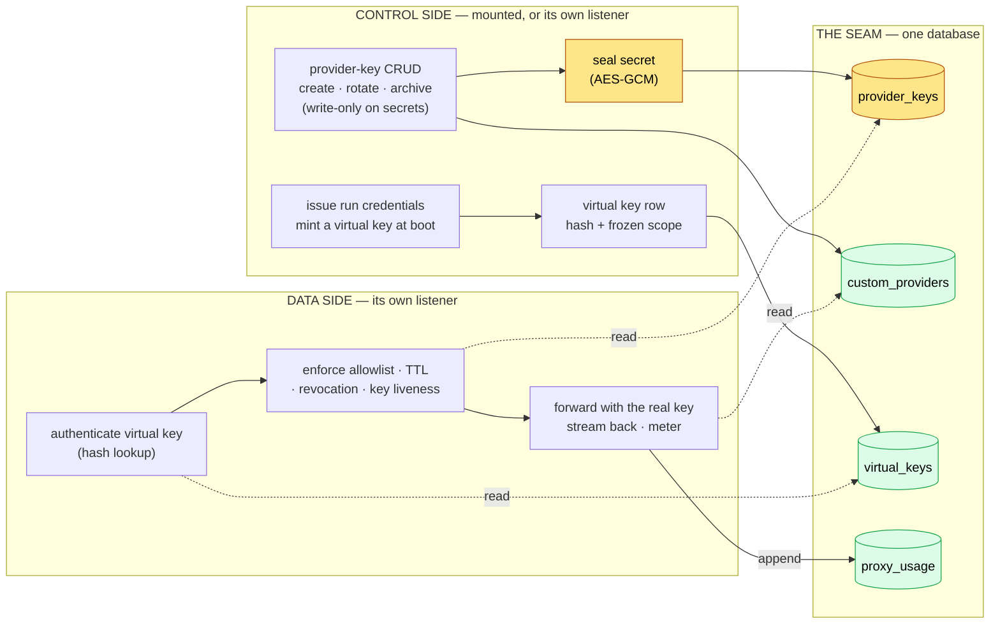
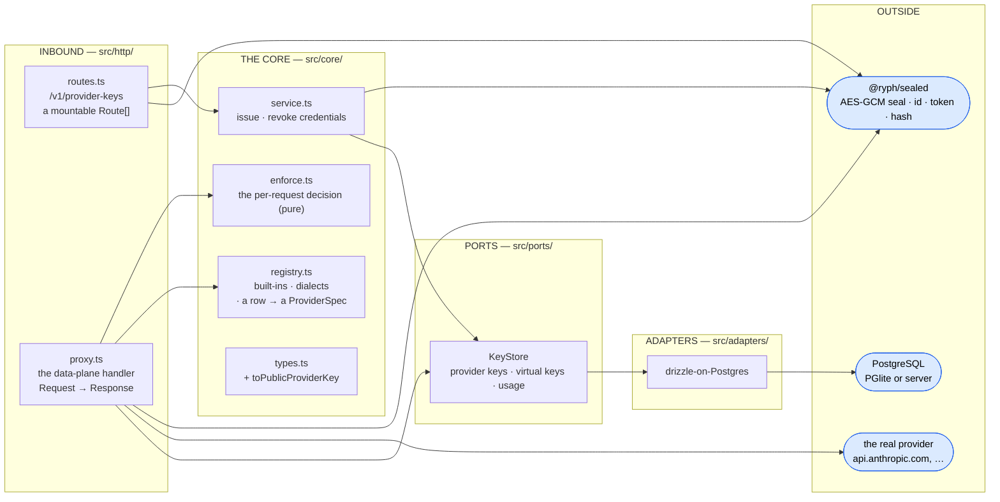
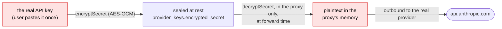

# 🏛️ Architecture

How the model proxy is put together: the control-plane / data-plane split that is the whole point of
the package, the ports and adapters behind each half, the shared store that is the seam between its
two halves, the service-authed surface a remote control plane reaches it through, and why the
enforcement path is a boring authenticated reverse proxy. (What the package _is_ — real keys sealed
in one place, run-scoped virtual keys everywhere else — is the [README](../README.md)'s opening.)

## 🪞 Control plane and data plane

The package has two halves with very different jobs, and they never share a listener. The **control
side** owns records and policy: mounted into the control plane by [@ryph/host](../../host/README.md)
in the single process, and on its own control listener (`:7421`) when `src/main.ts` runs standalone.
The **data side** owns enforcement and the hot path and always answers on its own port (`:7420`) in
both. This asymmetry is the design — it mirrors
[@ryph/auth](../../auth/docs/architecture.md#-issuer-and-verifier)'s issuer/verifier split.

**Why the split matters.** The control side is the internet-facing surface users authenticate
against; the data side streams every token of every completion. Keeping them apart means the
high-volume path never rides the control plane — the same reasoning that keeps the transcript
firehose out of the orchestrator. And the proxy holds no state a user created: it can be deleted and
redeployed freely, because everything it reads (keys, scopes, the metering trail) lives in the
shared store. A proxy restart mid-run is a non-event — the next request just works.

**The seam between the two halves is the shared store, not an API.** The control side writes
`provider_keys`, `custom_providers` and `virtual_keys`; the proxy reads them per request and appends
`proxy_usage` — the same key store in-process under the host, the same database when the two
listeners are one standalone process. No registration handshake, no in-memory mapping a restart
would lose — the same "separate package, mounted routes, shared database" idiom
[@ryph/auth](../../auth/docs/architecture.md#-two-deployments-one-boundary) already uses.

**What is an API is the link to the CONTROL PLANE**, and only when they are different processes.
`src/http/internal.ts` serves three service-authed routes (`RYPH_MODEL_PROXY_TOKEN`) — look up a
key's metadata, mint a run's credentials, kill them — which is exactly what the orchestrator's
`ModelAccess` port asks for. The orchestrator fills that port with an in-process issuer under the
host and with `adapters/model_access/http.ts` over the network, and the HTTP layer above it cannot
tell which it got. That is the whole reason the port was worth having.

The surface is mounted **only when the token is set**: no token means no remote control plane, so it
does not exist rather than existing unauthenticated. And it draws the line the link depends on — a
**definitive** refusal (unknown provider, unknown/archived/mismatched key) answers `400`, every
could-not-ask failure answers `503`. The same split the historian's run-token verify draws, for the
same reason: a transient outage must never be reported as a permanent verdict.

## 🔌 Ports & adapters

A hexagonal architecture like the rest of the workspace: a pure `src/core/` behind a single port,
bound to an adapter at a composition root. The `src/http/` layer is the inbound edge — two surfaces,
one per plane.

| Port       | What the core sees                                                                                                                                                                                   |
| ---------- | ---------------------------------------------------------------------------------------------------------------------------------------------------------------------------------------------------- |
| `KeyStore` | Provider keys, custom model endpoints, virtual keys, and the append-only usage trail — a dumb row-holder; every decision (sealing, minting, allow/deny) is made elsewhere and handed here to persist |

`src/core/` depends on nothing concrete: `enforce.ts` is a **pure function** of a virtual key, its
backing provider key, the requested model, and the clock — so every rule is unit-tested with plain
objects. `registry.ts` holds what static knowledge is left (the two built-in providers, and which
**dialects** each harness kind can drive) plus `customProviderSpec`, the pure projection that turns
a `custom_providers` row into the identical `ProviderSpec`. The two sources are joined in exactly
one place — `service.ts`'s `resolveProvider`, which is why that function and not a constant is what
the proxy, the issuer and both route lists all reach for; it is also why `core` is allowed to see
the `KeyStore` port at all. Model _catalogues_ live nowhere for the built-ins, because a stored list
would only ever be stale; a registered endpoint declares its models because nothing else in the
system can know them (see the [README](../README.md#-custom-model-endpoints)). Sealing, id and token
minting, and hashing come from the shared [`@ryph/sealed`](../../sealed/README.md) kit — the one
workspace member a fenced scope may import. The same `bun run guard` fence as the other packages
holds the layering: core → core/ports (plus that kit), ports → ports/core.

## 🔒 The secret's whole life

One provider secret exists in exactly two forms, and the boundary between them is the point of the
package:

- **It never appears in an API response.** `toPublicProviderKey` strips the sealed field in exactly
  one place; every route returns metadata plus a `last4` trace, never the secret. There is no `GET`
  that could leak one.
- **A container never holds it.** What a run receives is a **virtual key** — a random run-scoped
  token whose only stored form is a SHA-256 hash (the `RYPH_RUN_TOKEN` pattern). Exfiltrating it
  from a workspace buys an attacker a dead, model-bounded, run-scoped credential.
- **The master key is this package's, and only this package's.** `RYPH_SECRETS_KEY` seals provider
  secrets, and once key CRUD moved onto the control listener, nothing in the control plane needs to
  open one, so a compromised control plane should not be able to.
- **A secret is bound to where it is sent.** The `v2.<iv>.<ciphertext>` format carries the key's id,
  its provider and a custom endpoint's request shape (base URL, auth header and scheme, extra
  headers) as authenticated data, under a key derived from `RYPH_SECRETS_KEY` for this class alone
  (HKDF). A database writer who repoints a key or an endpoint gets a secret that no longer opens;
  changing an endpoint's shape through the API drops its keys' secrets, which are entered again.
- **The sealed format is versioned**, so a later scheme — sealing to a proxy-held keypair, making
  even the key-CRUD writer _write-only_ on secrets — can coexist with rows sealed today. That is the
  strongest end state: real key material in plaintext in exactly one process, the one that must
  present it outbound anyway.

## 🎫 The virtual key's life

A virtual key is minted at the runner's boot-time credentials fetch and dies when the run ends:

1. **Issue** (`makeCredentialIssuer.issue`, reached from the orchestrator's
   `GET /v1/runs/:id/credentials` — in-process under the host, or via
   `POST /internal/v1/runs/:id/credentials` when the two are separate). A random token is minted;
   its hash and a **frozen scope** — which provider key, which models — land in a `virtual_keys`
   row. The response hands back the env the harness needs (the provider's key var carrying the
   virtual token, its base-URL var pointing at the proxy), so an SDK picks it up without knowing
   ryph exists. A **custom endpoint** has no SDK convention to borrow, so it gets ryph's own two
   names plus `RYPH_MODEL_PROVIDER_CONFIG` — its slug, its dialect and its declared models, as one
   JSON blob, riding the env map so that the orchestrator→runner wire shape does not change.
   Archived, an endpoint refuses here the way an archived key does: a definitive `400`, because a
   run that starts and cannot call a model is worse than one that never starts.
2. **Spend** (the proxy's data plane). Each request is authenticated by hashing the presented token;
   `enforce.decide` then applies the frozen allowlist, the TTL, revocation, and — the one
   deliberately _live_ check — whether the backing provider key still exists and is unarchived.
3. **Revoke** (`revokeForRun`, called when a run reaches a terminal result). Every live virtual key
   of that run is stamped `revoked_at`; the TTL is only the backstop.

The frozen-scope / live-liveness split is deliberate: **what a run may call** is decided once at
provision and never drifts (editing the agent's policy mid-run changes nothing), but **whether it
may still spend your money** is checked live, so archiving a key cuts off in-flight runs on their
next request. Same line the orchestrator's snapshots draw, one credential deeper.

An unknown, revoked, and expired virtual key all answer **identically** (`401`): distinguishing them
would confirm to a probing caller which tokens exist(ed). A live token whose backing key was
archived answers `403` — the caller _is_ who it claims to be, it just may no longer spend.

## 🚦 Why a boring reverse proxy

The data plane is deliberately dumb: hash the presented token, one row lookup, one row read, a pure
`decide()`, then a streamed passthrough. It buffers only the **request** body (bounded — prompts,
not completions) to read the model name for the allowlist check; the **response** streams through
untouched, because buffering an SSE completion would stall every token: a pull-through stream hands
each chunk on the moment it arrives and reads usage off it on the side (`src/core/metering.ts`, pure
and per dialect). The usage row is written once the body ends — finished, failed or abandoned — and
fire-and-forget: metering must never fail or slow a model call. Money is not the data plane's
concern at all; reports price the recorded tokens at read time (see the
[README](../README.md#-usage-and-cost)). Hop-by-hop and credential headers are stripped both ways,
and the real key is set on the outbound request only. At proxy request rates (one request per agent
_turn_, not per token) a hash lookup per request is nothing — the same "plain HTTP + Postgres is
enough" reasoning the
[orchestrator](../../orchestrator/docs/architecture.md#-why-plain-http--postgres) makes.

The path is the one thing it does not forward verbatim. Each provider carries a `baseUrl` **with its
path** and a `clientBasePath` — the segment the client already had in its own base URL — and the
proxy strips the second off the incoming path before appending what is left to the first
(`forwardTarget`, pure, with the table in its comment as a unit test). Replacing the target's
pathname, which is what this did while there were only two providers with no path between them,
would post `/chat/completions` at the domain root of an endpoint whose real address is
`…/accounts/X/ai/v1`. A path that does not start with `clientBasePath` is appended whole rather than
refused: a provider may serve something we did not anticipate, and the allowlist is what polices
spending. Which provider a request belongs to is resolved **per request** through the store, so
registering or archiving an endpoint takes effect on the next request — no restart, no cache to go
stale — and an archived one answers `403` like an archived key, never a `502`.

The one harness-specific wrinkle lives on the _runner_ side, not here: a harness that can't be
pointed at the proxy by the conventional provider base-URL env var needs its own redirection (pi,
for instance, goes through a generated `models.json` — see
[harnesses.md](../../runner/docs/harnesses.md#-routing-through-the-model-proxy)). The proxy itself
is harness-agnostic: it speaks each dialect's native API and rewrites nothing but the path prefix,
the credential headers, and the hop-by-hop ones.
