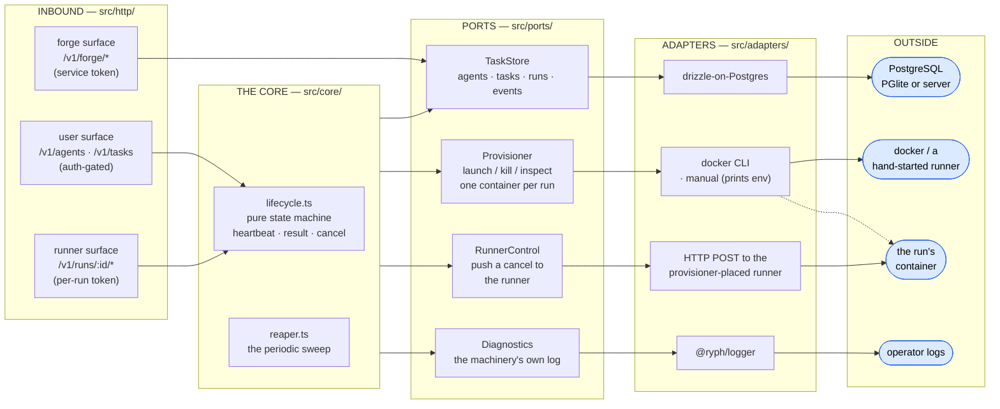

# 🏛️ Architecture

How the control plane is put together: the ports the core depends on, the three HTTP surfaces that
drive it, the snapshots that make editable agents safe, and why it is plain HTTP on Postgres. (What
the orchestrator _is_ — the roster, the runs, the reaper — is the [README](../README.md)'s opening.)

## 🔌 Ports & adapters

Like [the runner](../../runner/docs/architecture.md), the orchestrator is a small **hexagonal
architecture**. `src/core/` holds the _run state machine_ (`lifecycle.ts`, pure) and the _reaper
sweep_ (`reaper.ts`) and depends on nothing concrete; every external effect goes through a port
(`src/ports/`); `src/main.ts` is the composition root that binds each port to an adapter
(`src/adapters/`). The `src/http/` layer is the inbound edge — one pure `Request → Response`
handler, so tests drive every surface without opening a socket.

Four columns, left to right: the core, the ports it depends on, the adapters that implement them,
and the outside thing each adapter reaches.

| Port            | What the core sees                                                                                                                           |
| --------------- | -------------------------------------------------------------------------------------------------------------------------------------------- |
| `TaskStore`     | Agents, tasks, runs, and the append-only event trail — a dumb row-holder; every transition is decided in the core and handed here to persist |
| `Provisioner`   | `launch({runId, image, env})` → a handle, `kill(handle, {graceful})`, `inspect` — one container per run, nothing about _what_ runs inside    |
| `RunnerControl` | A single best-effort `requestCancel(run)` to the provisioner's `controlUrl` for it — the push layer of cancellation                          |
| `Diagnostics`   | The machinery's own log, total by contract                                                                                                   |

`src/helpers/` are _owned_ utilities (the slug and branch-name rules), not ports; id and token
minting, hashing, and sealing come from the shared [`@ryph/sealed`](../../sealed/README.md) kit, the
one workspace member a fenced scope may import. `src/schema.ts` is the ingest boundary: every JSON
payload — from a user or a runner — is validated before it becomes a core type.

The layering is machine-enforced, not convention. `bun run guard` (`scripts/check_architecture.ts`,
wired into CI) walks the resolved module graph and fails the build if a fenced scope imports outside
its allowance: `src/core/` may reach only the core, ports, and helpers; `src/helpers/` only helpers
and the core; `src/ports/` only other ports and the core. Adapters and the composition root are the
outer layer, free to bind anything.

## 🎭 The HTTP surfaces

`makeHandler` builds **one** `Request → Response` function that answers every surface; they differ
only in how a request proves it is allowed.

### 👤 User surface — `/v1/agents`, `/v1/tasks`

Authenticated with [@ryph/auth](../../auth/README.md) access tokens. In the default local deployment
auth is [mounted in-process](../../auth/docs/architecture.md#-two-deployments-one-boundary) by
[@ryph/host](../../host/README.md): the same process verifies its tokens against the local JWKS, its
`/v1/auth/*` routes are spread into this same handler, and its tables live in the same file.
Standalone, the same tokens are verified against the auth service's JWKS URL (`RYPH_AUTH_URL`).
Every user handler opens with
`const caller = await deps.authenticate(req); if (caller instanceof Response) return caller;` — the
gate is one injected function that yields a **principal** (the verified user, or the break-glass
identity `RYPH_AUTH=off` collapses to), so "who asked" is recorded wherever it matters (task origin,
patch approvals, report provenance) and turning auth off stays a composition-root decision, not
scattered `if`s.

`http/user_api.ts` composes the user routes and keeps the public view types, serializers and repo
permission gate available at their original import path. Implementations live in `http/user/`:
`agents.ts` and `agent_policies.ts`; `task_start.ts` for launch/setup and `tasks.ts` for reads,
streaming and cancellation; `responses.ts` for the inbox and responses; `patches.ts`; `repos.ts` and
its `repo_connections.ts` helpers; `workspaces.ts`; `command_allowlist.ts`; and `deployment.ts` for
harnesses, limits, sizes and egress. `public_views.ts` owns redaction and `repo_access.ts` owns the
shared permission/size gates. These modules import shared helpers directly, not back through the
composing facade. The task stream stays ahead of the task-id matcher; `user_routes_test.ts` checks
that precedence and the complete route inventory.

`bun run lint:length` reports source files over 800 lines without failing on their length. It also
runs after the unchanged architecture guard; the warning is a prompt to look for a useful seam, not
a requirement to split files arbitrarily.

| Route                                                  | What it does                                                                                                                                                                                                                                                                                                                                                                                                                                                                                                                                                                                                                                                                                                                                                                                                                                                                                                                    |
| ------------------------------------------------------ | ------------------------------------------------------------------------------------------------------------------------------------------------------------------------------------------------------------------------------------------------------------------------------------------------------------------------------------------------------------------------------------------------------------------------------------------------------------------------------------------------------------------------------------------------------------------------------------------------------------------------------------------------------------------------------------------------------------------------------------------------------------------------------------------------------------------------------------------------------------------------------------------------------------------------------- |
| `POST /v1/agents`                                      | Create an agent blueprint → `201` (an unknown `harnessKind` is refused when an image map is set; a `modelPolicy` is validated against the key rows and the dialects the harness can drive; a `toolPolicy` against the MCP server rows and the harness's tool support). Carrying **either policy needs `role: "admin"`** — `403 {code: "admin_required"}` otherwise                                                                                                                                                                                                                                                                                                                                                                                                                                                                                                                                                              |
| `GET /v1/agents` · `GET /v1/agents/:id`                | The roster (archived included)                                                                                                                                                                                                                                                                                                                                                                                                                                                                                                                                                                                                                                                                                                                                                                                                                                                                                                  |
| `PATCH /v1/agents/:id`                                 | Edit any subset; `systemPrompt: null`, `modelPolicy: null` and `toolPolicy: null` clear, absent leaves alone. CHANGING a policy to a non-null value needs `role: "admin"`; resending it unchanged, clearing it, and every other edit do not                                                                                                                                                                                                                                                                                                                                                                                                                                                                                                                                                                                                                                                                                     |
| `POST /v1/agents/:id/archive`                          | Soft-delete, idempotent; archived agents take no new tasks                                                                                                                                                                                                                                                                                                                                                                                                                                                                                                                                                                                                                                                                                                                                                                                                                                                                      |
| `POST /v1/mcp-servers/:id/archive`                     | Archive a tool server (`tools:manage`) through the gateway — refused (`409`, `server_in_use`, the agents named) while a live agent's tool policy still names it                                                                                                                                                                                                                                                                                                                                                                                                                                                                                                                                                                                                                                                                                                                                                                 |
| `GET /v1/harnesses`                                    | The offered harness kinds (`RYPH_HARNESS_KINDS`), the one image they all launch on, and each kind's wire dialects, whether it can use tools and whether it reads skills — what a UI builds agent forms from                                                                                                                                                                                                                                                                                                                                                                                                                                                                                                                                                                                                                                                                                                                     |
| `GET /v1/run-sizes`                                    | The configured size classes (`RYPH_RUN_SIZES`) and which is the default — what the repo and workspace settings offer                                                                                                                                                                                                                                                                                                                                                                                                                                                                                                                                                                                                                                                                                                                                                                                                            |
| `GET · PUT /v1/reserved-capacity`                      | Slots held warm per size class (`resources:manage`): every configured class with its saved slots and, when the cluster could be asked, how many are ready; `supported: false` where the provisioner cannot reserve. `PUT {slots}` replaces the setting (unknown or unreservable class `400`, unsupported `409`); the Lease holder applies it on its next tick. See [kubernetes.md](kubernetes.md#reserved-capacity)                                                                                                                                                                                                                                                                                                                                                                                                                                                                                                             |
| `POST /v1/tasks`                                       | `{agentId, spec, repo \| connectedRepoId (+ref?) \| workspaceId, model?, lifetime?, rerunOf?}` → freeze the repo list (one entry, or the workspace's), mint a run, provision → `201 {taskId, runId, state}`; every connected repo of the checkout is gated LIVE on the requester's `write` permission there — a collaborator grant on GitHub, permissionless on a public Radicle repo (below). `lifetime` names the run's idle clocks; absent, five minutes alone and thirty once a person has spoken. `rerunOf` names a task the caller may read: the images it started with are copied onto the new run (`409` if one is gone). `spec` is `{title?, instructions?}`: no title, and one is made from the instructions; no instructions, and the task starts awaiting its prompt — the first message to its run ([run-lifecycle.md](run-lifecycle.md)); a title without instructions is a `400`                                 |
| `GET /v1/tasks`                                        | One PAGE of the task list, newest first, each row with its agent's name and its current run's state: `?limit=` (default 50, capped 100) and `?cursor=` walk it by keyset, `?ids=` resolves named tasks instead. Filters, AND'd, OR'ing within each: `?status=live,succeeded,failed,broken,cancelled`, `?agent=`, `?origin=`, `?workspace=`, `?repo=`, `?mine=true`, `?from=`/`?to=`, `?q=` (words of the title, last one a prefix). An unknown value is `400`, never a quietly empty page                                                                                                                                                                                                                                                                                                                                                                                                                                       |
| `GET /v1/tasks/stream`                                 | The same list, live (SSE, same filters): `sync` carries the newest page on open and on every reconnect, `task` one row that moved, `leave` one that no longer matches. No `done` — a list is never finished. A heartbeat that changes nothing a row shows sends nothing                                                                                                                                                                                                                                                                                                                                                                                                                                                                                                                                                                                                                                                         |
| `GET /v1/tasks/:id`                                    | Task detail: its agent, every run (credentials redacted) with its event trail and its inbox, its patches, and the response the latest run is the attempt at                                                                                                                                                                                                                                                                                                                                                                                                                                                                                                                                                                                                                                                                                                                                                                     |
| `POST /v1/tasks/:id/cancel`                            | Record cancel intent, push it to the runner if reachable → `202`                                                                                                                                                                                                                                                                                                                                                                                                                                                                                                                                                                                                                                                                                                                                                                                                                                                                |
| `POST /v1/tasks/:id/finish`                            | End the run as its agent's own finish would, once the agent said it was done: a `finish` cue in the run's inbox, honoured at the agent's next settle → `202`, and a repeat answers `202` and posts nothing; `409` before then, once the agent finished by itself or the run is finalizing, or for a run not running or being cancelled                                                                                                                                                                                                                                                                                                                                                                                                                                                                                                                                                                                          |
| `POST /v1/runs/:id/messages`                           | `{text, attachmentIds?}` → a message in the run's inbox from the caller, kind `user` → `201 {message}`; `409` once the run is terminal. The images are ids from the upload below, this run's and never sent before (`409` if one was); text may be empty only with images. The first one flips the run to attended                                                                                                                                                                                                                                                                                                                                                                                                                                                                                                                                                                                                              |
| `POST /v1/runs/:id/attachments`                        | A raw image body (≤ 5 MiB, PNG/JPEG/GIF/WebP decided by sniffing, the claimed type ignored), on a run the caller may steer → `201 {id, mime, bytes}`, stored unclaimed until a message carries it; `400` for an empty body, `413`/`415` for too large or not an image, `409` once the run is terminal; `409` too once the run holds 20 uploads no message carried; `503` on a deployment with no attachment store. Unclaimed uploads older than a day are swept by the reaper                                                                                                                                                                                                                                                                                                                                                                                                                                                   |
| `GET /v1/runs/:id/attachments/:attachmentId`           | The image's bytes, for a caller who may read the run, only on the path of the run that owns it: its sniffed type, `nosniff`, a `sandbox` CSP and an `inline` disposition                                                                                                                                                                                                                                                                                                                                                                                                                                                                                                                                                                                                                                                                                                                                                        |
| `DELETE /v1/runs/:id/attachments/:attachmentId`        | Takes back an upload no message carried (the composer, when a chip is removed), on a run the caller may steer → `204`, row and bytes deleted; `404` for anything else, a sent image included                                                                                                                                                                                                                                                                                                                                                                                                                                                                                                                                                                                                                                                                                                                                    |
| `GET /v1/runs/:id/background`                          | A run's background commands, for a caller who may read the run (the gate its images take; `404` otherwise) → `{jobs: [{id, label, command, cwd, service, startedAt, timeoutAt, endedAt, reason, exitCode, signal, logBytes, logTruncated, logTail, hasLog}]}` in the order they were numbered, no log body. On a concluded run, a job with no exit record is shown ended with it: `reason: "run_ended"`, `endedAt` the run's last update                                                                                                                                                                                                                                                                                                                                                                                                                                                                                        |
| `GET /v1/runs/:id/background/:jobId/log`               | A job's stored log, same gate: `text/plain; charset=utf-8`, `nosniff`, a `sandbox` CSP; `404` when there is none, `400` for a job id that is not `bg-<n>`                                                                                                                                                                                                                                                                                                                                                                                                                                                                                                                                                                                                                                                                                                                                                                       |
| `GET /v1/responses` · `GET /v1/responses/:id`          | The responses ([the automations door](#-automations-surface--v1automationsevents) opens them), with their task, agent and run state; one with its run and inbox                                                                                                                                                                                                                                                                                                                                                                                                                                                                                                                                                                                                                                                                                                                                                                 |
| `POST /v1/responses/:id/close`                         | A person closing a response: its run is cancelled, the response closes at once with `closed-by-user` → `202`                                                                                                                                                                                                                                                                                                                                                                                                                                                                                                                                                                                                                                                                                                                                                                                                                    |
| `GET /v1/patches`                                      | One page of the approval queue (`?state=` narrows; `?limit=`/`?cursor=` as the task list): each patch with its task, agent, repo, summary, and commits                                                                                                                                                                                                                                                                                                                                                                                                                                                                                                                                                                                                                                                                                                                                                                          |
| `GET /v1/patches/:id`                                  | One patch as a row of the queue carries it (`runLive` and `heldDestination` included), and its `diffBasis` (`{mode, targetRef, sincePatchId}`): what its diff is measured against, which can move                                                                                                                                                                                                                                                                                                                                                                                                                                                                                                                                                                                                                                                                                                                               |
| `GET /v1/patches/:id/diff`                             | What the patch changes, read by the forge out of its bundle: an unpublished patch against the tip of the branch the submission would land it on, a settled one from its own base → `{diff, baseSha, headSha, truncated, omitted, moreOmitted}` and the `diffBasis` fields it was measured with                                                                                                                                                                                                                                                                                                                                                                                                                                                                                                                                                                                                                                  |
| `POST /v1/patches/:id/approve` · `/reject` · `/retry`  | The human decisions in the [patch lifecycle](patch-lifecycle.md); the approver is recorded (break-glass positively). An approve or retry may name the `{diffBasis}` its diff was read against, with that diff's `baseSha`; the diff is measured again, and the action refused `409 diff_basis_moved` if either has moved since                                                                                                                                                                                                                                                                                                                                                                                                                                                                                                                                                                                                  |
| `POST /v1/installations` · `GET …`                     | Register (verified against the forge) and list GitHub App installations                                                                                                                                                                                                                                                                                                                                                                                                                                                                                                                                                                                                                                                                                                                                                                                                                                                         |
| `GET /v1/installations/:id/repos`                      | The installation's live repo listing, with connected flags — the connect picker                                                                                                                                                                                                                                                                                                                                                                                                                                                                                                                                                                                                                                                                                                                                                                                                                                                 |
| `POST/GET/PATCH /v1/connected-repos` (+`/:id/archive`) | Connect (gated on ADMIN, live), list, set policy, disconnect. `sizeClass` in a PATCH is the platform admin's alone, as on `PATCH /v1/workspaces/:id`. A GitHub body names its `installationId`; a Radicle one names a `rad:` RID and no tenant at all — its coordinates come from the repository's signed identity document, "ADMIN" means **delegate or the platform `role: "admin"`** — what it governs is ryph's behaviour toward the repo, which Radicle has no opinion about — connecting seeds the repo with scope `all` and disconnecting unseeds it. A `local` body is `{provider: "local", path}`: the forge validates the path and answers its canonical real path (stored as both `repoRef` and `url`) and default branch, `422 {error, reason}` passes its refusal on, and `503` means it has no local provider; connecting and administering one needs `repos:manage-all`, while writing to it is open to any user |
| `GET /v1/connected-repos/:id/radicle`                  | That repository's identity document, read FRESH: delegates, visibility, whether ryph may fetch it, and the `rad follow` lines a maintainer pastes to see ryph's work. `404` for a repo on another forge                                                                                                                                                                                                                                                                                                                                                                                                                                                                                                                                                                                                                                                                                                                         |
| `GET /v1/forge-providers`                              | Which forges a repo can be connected through here — the boundary's answer, so a connect form never offers one this deployment cannot honour — and whether GitHub and Radicle are acted on as the deployment or as one person; `502` when the forge does not answer, never a guess                                                                                                                                                                                                                                                                                                                                                                                                                                                                                                                                                                                                                                               |
| `GET /v1/radicle/identity`                             | Who ryph is on the Radicle network (DID, NID, alias), and the two `rad` lines that make its patches visible. `404` when no node is configured                                                                                                                                                                                                                                                                                                                                                                                                                                                                                                                                                                                                                                                                                                                                                                                   |
| `POST/GET/PATCH /v1/workspaces` (+`/:id/archive`)      | A saved, named list of connected repos: create, list with members, rename, archive (releases the members). Changing one needs ADMIN on every live member (live) or `role: "admin"`; the answer carries `canManage`                                                                                                                                                                                                                                                                                                                                                                                                                                                                                                                                                                                                                                                                                                              |
| `POST/PATCH/DELETE /v1/workspaces/:id/repos[/:repoId]` | Add a member (directory, ref, description; gated on ADMIN of that repo and the workspace's own bar, live — membership decides what a `/ryph` command on it checks out; at most 20), edit it (the workspace's bar), remove it (ADMIN of that repo, or `role: "admin"`); a repo belongs to at most one workspace                                                                                                                                                                                                                                                                                                                                                                                                                                                                                                                                                                                                                  |

**Why `POST /v1/tasks` asks `write` while `/ryph` asks more.** A public Radicle repo answers `write`
"allowed" to anybody — the subject is not even consulted — so this route on such a repo is gated on
nothing about the repo at all. That is deliberate, and it does not contradict `commandTier` refusing
`write` on Radicle [below](#-forge-surface--v1forge). The two doors have different populations. A
comment thread is reachable by **any DID on the open network**, so a `write` gate there would let a
stranger spend this deployment's budget by typing. This route is reachable only by an authenticated
principal of this deployment — somebody already admitted, already attributable, already inside
whatever quota is kept. The account is what holds this door; what the repo permission still buys is
the other half, refusing a requester on a private Radicle repo, or on a GitHub repo they were never
given access to.

[@ryph/model-proxy](../../model-proxy/README.md)'s management routes (`/v1/provider-keys` — create,
rotate in place, archive; write-only on secrets) mount into this same surface behind the same gate,
the auth trick again — the host spreads both route lists into this handler. When the proxy runs as
its own process it serves those same paths on its own control listener instead, verifying the same
JWKS, and the app's BFF routes them there; this process then reaches it through the `ModelAccess`
port's HTTP adapter and never holds the provider master key at all.
[@ryph/mcp-gateway](../../mcp-gateway/README.md)'s control side (`/v1/mcp-servers` — register,
rotate, archive, probe; write-only on credentials) mounts the same way, and the `ToolAccess` port is
its twin: an agent's `toolPolicy` is validated against the gateway's server rows, and this process
never holds `RYPH_MCP_KEY`.

Run rows are never serialized raw: `toPublicRun` strips the two credentials (`tokenHash`,
`controlToken`) in exactly one place, so no user-facing response can leak them.

### 🤖 Runner surface — `/v1/runs/:id/*`

Authenticated with a **per-run bearer**, minted at provision time and stored only as a SHA-256
digest — the raw token exists only in the runner's memory, handed over by the bootstrap exchange
below and never put in the container's environment. A request must present a bearer that hashes to
_that run's_ `tokenHash`, so a container can speak for its own run and nothing else. A missing run
and a bad token answer **identically** with `401`: replying `404` first would confirm which run ids
exist.

| Route                                               | What it does                                                                                                                                                                                                                                                                                                                                                                                                                                                                                                                                                                                                                                                                                                                                                                                                                                                                                                                                                        |
| --------------------------------------------------- | ------------------------------------------------------------------------------------------------------------------------------------------------------------------------------------------------------------------------------------------------------------------------------------------------------------------------------------------------------------------------------------------------------------------------------------------------------------------------------------------------------------------------------------------------------------------------------------------------------------------------------------------------------------------------------------------------------------------------------------------------------------------------------------------------------------------------------------------------------------------------------------------------------------------------------------------------------------------- |
| `POST /v1/runs/:id/heartbeat`                       | `{seq, phase, message?, idleDeadlineAt?, idleState?, declaredOutcome?, finished?}` → `{cancel}` — recorded (the idle clock too, a gauge the reaper backstops; what the agent declared (`in-progress`, `success`, `no-changes` or `failed`), kept until a beat names another or clears it with `null`, and whether it finished, kept for good), and told whether this run has been asked to stop                                                                                                                                                                                                                                                                                                                                                                                                                                                                                                                                                                     |
| `POST /v1/runs/:id/result`                          | The runner's `RunnerResult`, idempotent under retry → `{ack: "Accepted"}`; a terminal verdict also revokes the run's virtual keys and closes the run's response (the same `concludeRun` the reaper calls on a `lost` verdict); a branch already reported mid-run adopts its patch by head                                                                                                                                                                                                                                                                                                                                                                                                                                                                                                                                                                                                                                                                           |
| `POST /v1/runs/:id/patches`                         | `{branch, baseSha, title?, description?}` — a patch submitted while the run goes on, born exactly as one from a result → `201 {patchId, state}` (`200` when the head adopts an existing patch); `409` once terminal                                                                                                                                                                                                                                                                                                                                                                                                                                                                                                                                                                                                                                                                                                                                                 |
| `GET /v1/runs/:id/messages`                         | `?after=<seq>&wait=<s>` — the inbox pull: held up to 25 s for a message past the cursor, and `after` acknowledges everything up to it; `ack` takes `0`/`false` (acknowledge nothing) or `1`/`true` (the default), and any other value is a `400` → `{messages}`; `409` once terminal                                                                                                                                                                                                                                                                                                                                                                                                                                                                                                                                                                                                                                                                                |
| `GET /v1/runs/:id/runner/attachments/:attachmentId` | An image this run was handed (with its task, or on a message) → its bytes; an upload no message carried yet is `404`, and a run that is terminal `409`. Its own path: the user door holds the plain one                                                                                                                                                                                                                                                                                                                                                                                                                                                                                                                                                                                                                                                                                                                                                             |
| `POST /v1/runs/:id/runner/attachments`              | Raw bytes of an image one of the agent's tools returned (a screenshot, a file its read tool opened), sniffed and capped like the user upload → `201 {id, mime, bytes}`, stored already claimed (`claimedBy: "tool"`, `source: "agent"`) so both GETs serve it; `409 {error: "cap"}` past 200 per run, `409` once terminal                                                                                                                                                                                                                                                                                                                                                                                                                                                                                                                                                                                                                                           |
| `PUT /v1/runs/:id/runner/background/:jobId`         | A background command as it started, `{label, command, cwd, service, startedAt, timeoutAt}` (`command` clipped to 4 KiB) → `201 {id, created: true}`, or `200 {id, created: false}` when the job is already on record (first write wins); `409` past 64 per run                                                                                                                                                                                                                                                                                                                                                                                                                                                                                                                                                                                                                                                                                                      |
| `POST /v1/runs/:id/runner/background/:jobId/exit`   | How it ended, `{endedAt, reason, exitCode, signal, logBytes, logTruncated, logTail}` → `200 {id, ended}` (`false` when it had already ended); the tail is ANSI-stripped, credential-redacted and cut to 64 lines / 16 KiB                                                                                                                                                                                                                                                                                                                                                                                                                                                                                                                                                                                                                                                                                                                                           |
| `PUT /v1/runs/:id/runner/background/:jobId/log`     | Its log as `text/plain` (≤ 4 MiB, `413` over), written once → `200 {id, stored: true, bytes}`, or `200 {id, stored: false}` unread when it has one. Cleaned like a check's (and `\r` made `\n`), cut to its last 4 MiB of UTF-8, under the job, keyed by its upload                                                                                                                                                                                                                                                                                                                                                                                                                                                                                                                                                                                                                                                                                                 |
| `POST /v1/runs/:id/base/stale`                      | `{bases: [{path, commit, since}]}`: the repos whose base the forge served from its cache because every refresh from upstream since `since` has failed, one `base-stale` event per repo the run was actually given (a path it never had is dropped) → `204`; `409` once terminal                                                                                                                                                                                                                                                                                                                                                                                                                                                                                                                                                                                                                                                                                     |
| `POST /v1/runs/:id/setup/failed`                    | `{failures: [{kind: "step", path, step, index, total, code, output, discarded} \| {kind: "invalid", path, error} \| {kind: "discarded", path, after} \| {kind: "dirty", path, files}]}`: the repos whose setup did not finish (a step failed, or setup.yml was invalid), or whose tree was put back (`discarded`: for a step that failed in the repos `after` names; `dirty`: for the `files` its own finished setup left), which the run went on without, one `setup.failed` event per repo and kind the run was actually given (its detail opens with the kind in brackets, `[dirty] …`, for the run page to branch on) (a path it never had is dropped, and so is a `discarded` whose `after` names none of the run's repos), its text cleaned of escapes, controls and credentials and clipped (a long one lands clipped, an entry that is no warning is dropped alone), shown on the run page as a warning → `204`; `409` once terminal or for a second report |
| `POST /v1/runs/:id/checks`                          | `{path, headSha, branch, baseSha, checks?}` — the agent's `ryph__run_checks`: a check suite for a commit intake stored → `202 {suiteId, state, reused, text}`, `200` with the text when no checks run; `429` past `RYPH_CHECKS_MAX_PER_RUN` ([checks](checks.md))                                                                                                                                                                                                                                                                                                                                                                                                                                                                                                                                                                                                                                                                                                   |
| `GET /v1/runs/:id/checks`                           | `{text, awaiting}` — the agent's `ryph__check_status`, and how many verdicts the run is still owed; `?at=<sha>:<path>` (repeated, at most 8; a read, so a query rather than a body) adds the suites on those commits the run may read, `&named=1` answers those alone; `?awaiting=1` answers `{owed: [{id, requests}]}` alone, which verdicts, by name, the runner holds a stop on                                                                                                                                                                                                                                                                                                                                                                                                                                                                                                                                                                                  |
| `GET /v1/runs/:id/checks/:suite/log`                | `?check=<name>[&generation=<n>]` — the agent's `ryph__check_log`: one check's whole stored log as `text/plain`, its generation in `x-ryph-check-generation`; `404` for a suite the run may not read, as for none ([checks](checks.md))                                                                                                                                                                                                                                                                                                                                                                                                                                                                                                                                                                                                                                                                                                                              |
| `GET /v1/runs/:id/checks/declared`                  | `{declared, unread}` — what each repo's `.ryph/checks.yml` declares at its base, for the prompt, and the paths of the repos whose read did not answer (`["*"]` when the repos could not be listed); bounded at 15 s, both empty where checks are off                                                                                                                                                                                                                                                                                                                                                                                                                                                                                                                                                                                                                                                                                                                |
| `POST /v1/runs/:id/bootstrap`                       | The first request a container makes, and the one route authenticated by the launch's **single-use bootstrap bearer** instead of the run bearer: answers `{env}` — the run bearer, control token, git and egress credentials and the addresses they go to — with `Cache-Control: no-store`; one `DELETE … RETURNING` spends the bearer, and a redeemed exchange records a `bootstrap-redeemed` run event. The launch environment carries only this bearer and routing. Expires a few minutes past the startup grace; a terminal or cancelled run, a replay and a wrong run all answer `401`                                                                                                                                                                                                                                                                                                                                                                          |
| `GET /v1/runs/:id/spec`                             | `{workItem, injectedContext, services, environment, checks, skills}` — the frozen input snapshot, fetched by the runner on boot; `checks` is `{enabled}`, or null where this orchestrator has no checks; `skills` is the frozen list, whether the repos' own may be added and what is left of the listing cap, without the org provenance, or null for a harness that reads no skills ([skills.md](skills.md))                                                                                                                                                                                                                                                                                                                                                                                                                                                                                                                                                      |
| `GET /v1/runs/:id/skills/:digest`                   | `{files}` — one skill bundle the run was frozen with (`{path, executable, content}`, base64), from the catalogue this process booted with, else the store; `404` for a digest the run was not frozen with, `409` once terminal                                                                                                                                                                                                                                                                                                                                                                                                                                                                                                                                                                                                                                                                                                                                      |
| `POST /v1/runs/:id/skills/report`                   | `{loaded, dropped}` — the working-repo skills the runner loaded and the skills it could not give the agent, bounded and held to the run's own repo paths (none when its working-repo skills are off), frozen names and budget, no reserved name loaded, written as `skills.repo` and `skills.dropped` events → `204`; `409` once terminal or for a second report                                                                                                                                                                                                                                                                                                                                                                                                                                                                                                                                                                                                    |
| `GET /v1/runs/:id/credentials`                      | `{env, mcp?}` — a run-scoped virtual model key minted from the run's frozen model scope ([@ryph/model-proxy](../../model-proxy/README.md)) and, for a run with a tool scope, one virtual MCP token plus a gateway URL per server ([@ryph/mcp-gateway](../../mcp-gateway/README.md)); `{env: {}}` for a run that calls neither; refused once terminal                                                                                                                                                                                                                                                                                                                                                                                                                                                                                                                                                                                                                |

The three background command routes answer `400` for a job id that is not `bg-<n>`, `404` for an
exit or a log of a job never started, `410` once the run concluded and `503` on a deployment with no
store. A label, a command and a cwd lose their control and bidi characters before they are clipped
(a line break becomes a space), since the agent holds the run token and can write them itself.

A log has one writer. Before a byte of its body is read, a run with 2 log uploads already in flight
answers `429`, and an upload must claim the job's log under the run's row lock: a job that has its
log answers `200 {id, stored: false}`, one whose exit is not recorded yet `409` (a log belongs to an
ended job, and the runner records the exit first — the agent's token cannot take a running job's log
ahead of it), and one whose log another upload is writing `409`. Every `409` there carries a `code`
beside its `error`: `running` (the exit is not recorded yet; retry after recording it), `busy`
(another upload holds the claim) or `lost` (this upload's claim was taken over as stale). Each
upload writes under its own claim's key (`runs/<runId>/background/<jobId>/<claim>.log`) and the row
names the one it marked, so an upload whose claim was taken as stale never overwrites the winner's
object. Only the claimant reads its body, within 15 s (`408` past it) and 4 MiB; an upload that
stores nothing (too large, too slow, a failure) gives the claim back so the runner's retry can take
it, and a claim held two minutes without finishing is taken for dead. A run concluding during the
upload still gets its log marked, so no stored object is left without its row. Cleaning runs in the
runner's order: escapes out; then C0 controls but a tab and the line ends, DEL, C1 and the bidi
controls, so none can split a credential past the redactor; then a `\r` that opens a line is dropped
(it would read as a blank one) and the rest become `\n`; then credentials are redacted. The stored
log is the runner's people's view of the output (already cleaned on its side, and cleaned again
here). `logTruncated` says whether that view is only the end of the output, as the runner reported
it. `logBytes` is the view's size as the exit record reported it until a log is stored, and from
then the stored object's own size — so it describes what the page serves, whichever upload won the
claim.

Every route here is **inbound-only with two exceptions**: a heartbeat's answer carries `{cancel}`,
and the inbox pull answers messages — never work: a message is text the agent reads, framed as
untrusted, and nothing in it can widen the run's scope
([run-lifecycle.md](run-lifecycle.md#-the-inbox-and-the-idle-clock)). That reversal is
[cancellation](cancellation.md)'s doing — the push channel needs to _dial_ the container, which the
single-process deployment can never do and a networked one can only do when the control plane's
network reaches the run's. Where it could not, a cancel silently became a wait for the grace period
and then a SIGKILL. The flag reads the run's durable desired state, so it is true on every beat
until the run ends, and it is the runner's job to act on it once.

What each of these does to a run's state is [the lifecycle](run-lifecycle.md).

### 🌉 Forge surface — `/v1/forge/*`

Spoken only by [@ryph/forge](../../forge/docs/architecture.md)'s git gateway, authenticated with the
shared `RYPH_FORGE_TOKEN` service credential (constant-time compared; the surface is not even
mounted without it). This is where the decision/boundary split lands in routes: the gateway holds
secrets and moves bytes, and asks this control plane every question that needs a run row.

| Route                             | What it does                                                                                                                                                                        |
| --------------------------------- | ----------------------------------------------------------------------------------------------------------------------------------------------------------------------------------- |
| `POST /v1/forge/git-keys/resolve` | `{token}` → the run grant `{runId, repos: [{…, branchNamespace}]}` for a live run's git virtual key; **every** failure (unknown, expired, revoked, run concluded) is the same `404` |

The `repo` in the grant is the task's **original** upstream coordinates — what the gateway fetches —
never the gateway-shaped URL frozen onto the WorkItem. Two facts, two columns. Phase 4 adds
`POST /v1/forge/events` (normalized webhook intake) to this same surface.

An event names its repo by `{provider, repoRef}`, and that pair is what a connected repo is matched
on — exactly for Radicle, where a RID is base58 and case is meaning, case-insensitively for GitHub,
which is. Who may command an agent is `checkPermission(commandTier(provider))` — `write` on GitHub,
`admin` on Radicle — **or**, on Radicle only, the repo's admin-kept command allowlist. The tiers
differ because "write" does not mean the same thing on both: GitHub's is a grant somebody
deliberately made, Radicle's is permissionless on a public repo (every peer pushes into its own
namespace), so asking for it there would gate on nothing at all. The allowlist widens who may
command and nothing else: checks that really do mean "may your work land here" — every repo of a
workspace checkout, say — ask `write` on both forges, and get Radicle's permissionless answer.

### 💬 Chat surface — `/v1/chat/*`

Spoken only by [@ryph/chat](../../chat/README.md), authenticated with the shared `RYPH_CHAT_TOKEN` —
the same credential this process presents the other way, when it asks the chat service a question
(is this sender a commander, what does this thread say, what is this room called and how is the bot
addressed there — frozen onto a bound run's work item as `chat`) or binds a conversation to a run
and tells it how the run ended (`ports/chat_access.ts`). One link, one token, both directions; the
surface is not mounted without it.

| Route                    | What it does                                                                                                                                                                                                                                                                                                                      |
| ------------------------ | --------------------------------------------------------------------------------------------------------------------------------------------------------------------------------------------------------------------------------------------------------------------------------------------------------------------------------- |
| `POST /v1/chat/mentions` | one normalized mention of the bot, with the images the chat service fetched for it as base64 (`images: [{data}]`) → `200 {outcome, reply, react, runId?, taskId?}` for every decision; `413` for a body over `MAX_MENTION_BODY_BYTES` (40 MiB, counted as it streams); `5xx` only when the door could not decide (its store down) |

**Every** mention in every room reaches this door, and the chat service decides nothing about work.
A room with no command policy is a **response room**: a mention reaches only the run its response
bound there (`joined`), and says "No response is running right now." otherwise. A **command room**
(`command_rooms` + `command_room_channels`, admin-managed through
`GET/PUT/DELETE /v1/command-rooms/:chatroomId` on the user surface) runs the forge door's ladder
(`deliverChatMention` in `http/chat_api.ts`): the channel's target, else the room's default, else
`not-served`; the commanders on every mention (a user group asked live — a no is silent, an unknown
is `unverifiable`; or "the room", honoured only in a private channel); the agent named by the first
word, else the default; a live run already working this thread is **joined** by the same agent and
refuses another out loud; otherwise the thread is read (before the claim), the mention claimed
(`chat_mentions`, the forge events' dedupe), the room's starts-per-hour checked, the visibility rule
applied — a public or web-public channel may only command public repos, asked live of the forge, and
the refusal never names the repo — the owner's repo access re-checked live, and the run started with
origin `chat`, acting for the room's owner, bound to the thread. A chat identity is never a ryph
user: it can start and steer within the room's policy, and nothing else.

### 🔔 Automations surface — `/v1/automations/events`

Spoken only by [@ryph/automations](../../automations/docs/architecture.md), authenticated with the
shared `RYPH_AUTOMATIONS_TOKEN`. Each fire carries a **signal** — `{status, key, title}`, read out
of the payload by the trigger's payload format over there; the orchestrator parses no payload. A
fire whose automation names a **response** opens one — a run, a chatroom conversation bound through
the chat service — or, while one is open for the fire's **slot**, **joins** it as a message in the
run's inbox (headed `Update <n> for this response (<status>[: <title>]).`) and starts nothing
(`200
{outcome: "joined"}`); the response closes with the run, and the next fire for that slot opens
anew. The slot is the automation's correlation applied to the fire: `"automation"` one per
automation, `"key"` one per `signal.key` (a keyless fire takes the automation-wide slot), `"fire"`
none shared (`responses_one_open` is unique on `(automation_id, key)` while open). With nothing
open, a `resolved` fire is dropped (`resolved`) and an `update` (acknowledged, assigned…) is dropped
(`ignored`) — an update never starts a run, response or not.

## 📸 Snapshots: agents are editable

An agent is a **blueprint users edit** — rename Ada, swap her system prompt, point her at a
different image. That freedom is exactly why a run cannot read from live agent and task rows: a run
that started ten minutes ago must keep meaning what it meant when it started, even as the agent
changes underneath it.

So a run **freezes a snapshot at provision time**, composed exactly once in `createTask`:

- `workItem` — the full payload the runner receives (`composeWorkItem`), the same shape
  [@ryph/runner](../../runner/README.md) ingests.
- `injectedContext` — the agent's system prompt at that instant, or `null`.
- `skills` — the skills the run was given, each by name, description, source and content digest,
  plus whether the runner may add the checked-out repos' own; `null` for a harness that reads no
  skills. A catalogue change or an admin's toggle mid-run changes nothing for it, and the runner
  fetches exactly the frozen digests ([skills.md](skills.md)).

`GET /v1/runs/:id/spec` serves `workItem` and `injectedContext` verbatim, and `skills` without the
org provenance, beside the run's services, its environment and whether checks run; none of them is
ever recomposed.

- `image` — the concrete container ref that was launched (`null` when unresolved, e.g. manual dev).
- `modelScope` — which provider key the run spends and which models it may call (the task's pick,
  else the policy default), or `null` for a run that calls no models. Boot-time credentials are
  minted from this frozen scope, so editing the agent's policy mid-run changes nothing — with one
  deliberate live exception: archiving the backing provider key cuts off in-flight runs, because
  "what the run means" freezes but "whether it may still spend" must not.
- `toolScope` — which MCP servers the run may reach and which of their tools it may call, or `null`
  for a run that calls no tools. The same rules: the virtual MCP token is minted from this at boot,
  editing the agent's tool policy mid-run changes nothing, and archiving a server cuts in-flight
  runs off from it live.

- `injectedContext.brief` — what memory had to say about the run's repo and the org at task start,
  rendered under the agent's `memoryPolicy.budgetTokens` by [`@ryph/memory`](../../memory/README.md)
  over the `MemoryAccess` port, and frozen here so the spec serves what the run was told. A brief
  that could not be composed is a memoryless run, never a failed one — and a **toolless** one where
  memory is concerned: composing the brief is also what opens the run on memory's side, so a call
  that failed leaves the platform memory server with nothing to answer for, and it is left out of
  `toolScope` rather than handed to the agent as tools that fail every call. While the agent
  remembers and the brief landed (a brief with nothing to say counts — memory was asked), the
  gateway's platform memory server joins `toolScope` by default. The brief is fetched on a shorter
  deadline than the other memory calls (3s, against 10s), because it alone sits on the path of a
  person waiting for their task to start; the evidence it carries is checked entry by entry here,
  and an entry the runner's spec schema would refuse is **dropped and named in the log** rather than
  frozen onto the run, where it would fail the boot of that run and of every later run briefed with
  the same memory.

Editing Ada mid-run changes none of these for the in-flight run — only the next task she is
assigned. Agents are **archived, never deleted** (`archivedAt`), so a historical run always resolves
the agent it named. Memory keys on `agentId` and is deliberately its own service, reached through
the port at task start, from the runner surface when a run's staleness check finds briefed memories
whose evidence changed (`POST /v1/runs/:id/memory/stale`, relayed for the ids the run's brief
actually carried and recorded as a `memory-stale` event), and again at conclusion, when memory hears
how the run ended.

One memory relay is **reconciled** rather than merely best-effort: what became of the change a run
delivered. The run's `introduced` claims wait on that fate, and nothing else would ever ask again,
so the patch row carries `memoryFateReportedAt` — written when memory acknowledges the report — and
the reaper redelivers for every settled patch still missing one (`reportChange` is idempotent per
patch, so redelivery is free but for what it carries, which a redelivery may add to as a union —
each patch settles its own change, since a workspace run's patches land independently). A patch
reaches a fate in five ways: its pull request closed or merged, its change request merged without it
(`missed`), a person rejected it, a newer patch superseded it, or its submission failed past
retrying (a terminal forge refusal or exhausted attempts, which nothing but a human retry moves).

## 🚦 Why plain HTTP + Postgres

The tempting default for "thousands of heartbeating containers" is a broker — NATS, Redis Streams.
The control plane deliberately does **not** use one, for two reasons:

- **The traffic is small.** A run beats on the order of once every few seconds. Even at 5,000
  concurrent runs that is a few hundred small idempotent requests per second — comfortably one
  process, one database. Heartbeats are a **gauge** (last-write-wins, guarded by a monotonic `seq`),
  not an event stream to be durably queued; results are idempotent by run id. Neither needs broker
  delivery semantics.
- **The firehose lives elsewhere.** The high-volume stream — every block of every agent's transcript
  — is [@ryph/historian](../../historian/README.md)'s job, and that is where a broker would earn its
  keep. It runs in-process in the default [host](../../host/README.md) deployment today, over its
  own tables and its own ports, and can be given a database of its own or peeled out into a
  standalone service by configuration alone. Keeping the firehose off the control plane's tables is
  what keeps the control plane a single boring process.

Persistence is [drizzle](https://orm.drizzle.team/) on PostgreSQL — embedded via PGlite for the
single-process deployment, a server for the networked one, with no difference above the driver:
`schema.ts` is the source of truth, everything a UI sorts or filters on is a real indexed column,
and reads go through the relational `db.query.*` API so a backend change stays a schema-and-driver
edit. The [database workflow](development.md#-database) is `db:push` for dev and generated
migrations for deploys.
