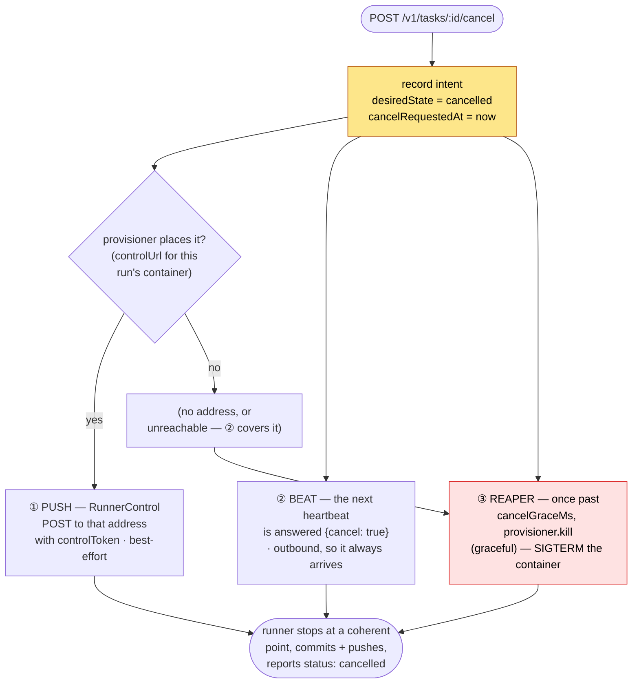

# 🪂 Cancellation

## 📝 The one-paragraph version

Cancelling a run is **recording an intent, then delivering it three ways** — two that ask, one that
enforces — so that a runner which is healthy, one that cannot be dialed, and one that is wedged all
still stop. `POST /v1/tasks/:id/cancel` flips the run's `desiredState` to `"cancelled"` and stamps
`cancelRequestedAt` — that is the whole state change; it never itself kills anything. Delivery is a
**push** to the runner's own inbound cancel endpoint, a **flag on the next heartbeat's answer**,
and, if the run is still going past its grace period, the **reaper escalating to a provisioner-level
kill**. Like the runner's own [graceful cancel](../../runner/docs/cancellation-flow.md), the point
is that a cancel is _gentle first_: the runner is asked to stop at a coherent point and push
whatever it already committed, and only the reaper's final kill is forceful — and even that is a
SIGTERM the runner handles gracefully.

A cancel ends a run **interrupted**, so its work is never taken as a success. A run whose agent
already said it was done is ended with a **finish** instead (`POST /v1/tasks/:id/finish`), which is
no cancel and uses none of the deliveries below: it is a message in the run's inbox, honoured at the
agent's next settle like the agent's own finish, without waiting on check verdicts (see
[the run lifecycle](run-lifecycle.md#-the-inbox-and-the-idle-clock)).

## 🧅 The three deliveries

All three exist because each has a blind spot the others cover:

| # | Layer                           | Fires when                                                           | Blind spot it covers                                                                                       |
| - | ------------------------------- | -------------------------------------------------------------------- | ---------------------------------------------------------------------------------------------------------- |
| ① | **Push** (`RunnerControl`)      | The instant cancel is requested, _if_ the provisioner places the run | Immediate — milliseconds. But needs the orchestrator to be able to _reach into_ the container's network    |
| ② | **Beat** (heartbeat answer)     | The next heartbeat, ≤ `RUNNER_HEARTBEAT_INTERVAL_MS` away            | The direction that always works: the runner dials out, so no route into the run network is needed          |
| ③ | **Reaper kill** (`Provisioner`) | `cancelRequestedAt` is older than `RYPH_CANCEL_GRACE_MS`             | Works even if the runner is unreachable, wedged, or silent — nothing inside the container has to cooperate |

② is why ① is now an optimisation rather than the mechanism. The push has to _dial the container_,
and the single-process deployment can never do that — a `ryph` binary on a laptop has no route to a
container's address — so every cancel there used to wait out the full grace period and arrive as ③.
With replicas the push is also a lottery: the replica handling the cancel is rarely the one that
launched the run. The beat's answer reads `desiredState` straight from the row, so any replica
answers it correctly, and it stays `true` on every subsequent beat — acting on it exactly once is
the runner's job.

They are the same shape the runner's design settled on: **one cancel concept, several _sources_, one
mechanism the core honors** — its internal `cancelSignal`. The push is a source; the beat's answer
is a source; the reaper's SIGTERM is a source; the runner funnels all three into the same signal,
which is why the outcome is identical whichever arrives first (a graceful stop and a self-reported
`cancelled`).

## 🎯 1. The push — the prompt channel

When `cancelTask` records the intent, it fires `runnerControl.requestCancel(run)`, which asks the
provisioner where it placed the run (`Provisioner.controlUrl`, from the run id and its handle) and,
if it says, sends a single best-effort HTTP POST there carrying the run's `controlToken` (the
orchestrator's own credential for that endpoint, distinct from the runner's token). A successful
push appends a `cancel-pushed` event.

The address is never the run's to give. The run is untrusted, and this request leaves the control
plane with a credential on it: a target the run reported would let it point the control plane at
anything the control plane can reach. For the same reason a redirect is not followed — the runner's
endpoint answers `202`, so a `3xx` is something else answering, and it counts as a refusal.

On the other side is the runner's [inbound control API](../../runner/docs/cancellation-flow.md): an
authenticated `POST /cancel` bound to `0.0.0.0` on the runner's port (default `8080`), which aborts
the run's cancel signal and answers `202`. It is fast — the harness stops, the tree is committed and
pushed, and the runner reports `cancelled` itself, all within milliseconds of the POST.

The push is **best-effort by design** — a failed push needs no handling, because the beat and the
reaper both still fire. It is the only channel that lands in milliseconds, so when it can't, the
cancel is late rather than lost: one heartbeat interval late now, where it used to be the whole
`cancelGraceMs`.

> **Reachability is a real constraint, not an assumption.** Docker places a run by its container's
> name (`http://ryph-run-<id>:8080/cancel`), so the orchestrator must be able to resolve and dial
> it. That holds when both sit on one docker network (`RYPH_DOCKER_NETWORK`). It does **not** hold
> for an orchestrator on the host with containers in Docker, nor toward a confined run on its
> internal network — there the push fails with `runner_control.cancel_unreachable` and the cancel
> lands on the next beat. Kubernetes places no address at all: `ryph-runs` admits no ingress, so its
> runs are cancelled by ② below, as are the manual adapter's.
>
> This is what ② exists for. It does not remove the constraint — the push is still the only _prompt_
> channel — but it bounds the cost of hitting it at one heartbeat interval instead of the whole
> grace period.

## 📡 2. The beat's answer — the channel that always arrives

Every heartbeat is answered `{cancel}`, read straight off the run's `desiredState`. The runner's
gateway fires `onCancelRequested` the first time it sees `true`, which aborts the same controller
the inbound endpoint aborts; later beats keep saying `true` and are ignored.

The direction is the whole point: the runner dials **out**, so this needs no route into the run's
network, no address for the run, and no cooperation from the provisioner. It works on a laptop, on a
container network, and behind NAT alike. It is slower than the push by up to one
`RUNNER_HEARTBEAT_INTERVAL_MS`, and it needs the runner to still be beating — a wedged runner
answers neither channel, which is what ③ is for.

See [the directive section](#️-the-directive-and-why-the-beat-is-not-it) for why this is not a
revival of the removed poll.

## 💀 3. The reaper's kill — the enforcement backstop

If neither ask lands — unreachable, no address, or the runner is wedged — the run keeps going. The
[reaper](run-lifecycle.md#-the-reaper) catches it: once `cancelRequestedAt` is older than
`RYPH_CANCEL_GRACE_MS` (default 120 s), `planSweep` returns `kill-graceful` and the sweep calls
`provisioner.kill(handle, {graceful: true})` — a `docker stop`, SIGTERM with the runner's own
graceful window before SIGKILL. Enforcement is re-issued on every sweep past the grace period,
including after a failed kill, but the transcript records `kill-requested` only once. A targeted
store query checks for that durable event without loading the full transcript on each retry.
`docker stop` on an already-stopping container is a no-op, so re-issuing is harmless.

SIGTERM is not a hard kill: it is the runner's second cancel _source_, funnelled into the same
signal the push aborts. A healthy-but-unreachable runner therefore still stops gracefully and still
reports its own `cancelled` result — it just does so `cancelGraceMs` later than it would have.

Note the two different kills the reaper can issue: this **graceful** one (a cancel that did not get
through) versus the **hard** kill that accompanies a `lost` verdict (a run presumed already dead).
The grace period is the difference between "we asked you to stop and you didn't" and "we've given up
on you."

### Cancellation before the first heartbeat

A cancelled runner may be refused bootstrap and exit without ever heartbeating or reporting a
result. Before consulting the timeout planner, the reaper inspects a cancelled run that has a
container handle but no heartbeat. If the provisioner confirms `exited`, the reaper asks it to clean
up, records the run as **cancelled** with a `cancel-confirmed` event, and concludes its credentials
and outcome. This does not wait for either the cancel grace or the startup grace. A missing
Kubernetes Job or Docker container counts as exited; an inspection failure is `unknown`, not
evidence that the run stopped.

When Docker has already removed the agent container, `kill` cannot read its run label to identify
its services. Docker's orphan reconciliation, at boot **and at the end of every sweep**, reclaims
those labelled services and the network once the run is terminal.

If exit cannot be confirmed, ordinary graceful-kill retries continue. The startup timeout remains
the hard-kill backstop: only after that kill succeeds does a pre-heartbeat cancellation conclude as
**cancelled**, rather than **lost**. A failed kill leaves the run active for another attempt.

After inspection and cleanup, the reaper re-reads the run before saving this verdict. A runner
result or first heartbeat that landed meanwhile prevents the pre-start cancellation verdict from
overwriting it. If a heartbeat arrived during the hard kill, the run remains active even though its
container was killed: a result may still arrive, otherwise the ordinary heartbeat timeout marks it
lost on a later sweep.

A run that reaches one of its [limits](run-lifecycle.md#-the-reaper) — its wall clock, or its spend
cap — enters this same path from the sweep rather than from a person: `planSweep` records the cancel
request with a `limit-reached` event, the push and the beat's answer carry it, and this kill follows
once the grace lapses. The proxy's refusal of the run's calls and the Job's own deadline are the
backstops to that, for a run the reaper never gets to.

## ↩️ The directive, and why the beat is not it

This section used to record a removal, and now has to record a partial reversal — so here is both,
because the reasoning that removed the first design is what shaped the second.

Cancellation was once a **poll**: the runner's core consulted
`OrchestratorGateway.shouldContinue()`, and every heartbeat answer carried a
`{directive: "continue" | "cancel"}` back down, with a `GET /v1/runs/:id/directive` to re-check
between beats. The inbound endpoint replaced that, because a poll bounds cancel latency by how often
the core happens to ask. The orchestrator's half lingered, sending a directive nothing read, and was
later deleted outright.

The principle that removal left behind was **a report is not a channel** — and the explicit
prescription was that a provisioner the control plane cannot dial should be given _a way in_ rather
than have the poll revived. That prescription turned out not to be payable. The deployment that
cannot be dialed is not a hypothetical future one; it is the default one. A `ryph` binary running on
a laptop has no route to a container's address, so **every** cancel there waited out
`RYPH_CANCEL_GRACE_MS` and arrived as the reaper's SIGTERM. What the user asked for was "stop"; what
they got was "stop in two minutes, violently". Replicas made it worse rather than better: the
replica that takes the cancel is rarely the one that launched the run.

So the answer now rides the beat. What makes it a different thing from the design that was removed:

- **The core never asks.** There is no `shouldContinue()`, no `/directive` route, and nothing polls.
  The flag arrives on the answer to a report the runner was sending anyway, and is pushed into the
  same `AbortController` as a SIGTERM or an inbound `POST /cancel`. The core still sees one
  `cancelSignal` and still cannot tell who asked.
- **Latency is the beat interval, not the core's curiosity.** That was the specific defect of the
  poll: the core decided when to look. Here the transport decides, at `RUNNER_HEARTBEAT_INTERVAL_MS`
  (10 s by default) — and the push channel, when it works, still lands in milliseconds.
- **It is state, not a command.** The flag is `run.desiredState === "cancelled"` read straight from
  the row, so it is true on every beat until the run ends and any replica answers it identically.
  Acting on it exactly once is the runner's business.

The honest summary is that "a report is not a channel" was a good rule that cost more than it was
worth: keeping it meant the most common deployment could not cancel a run promptly at all. The
narrower rule that replaces it is that **an answer may carry state, never a command** — `{cancel}`
tells the runner what the control plane wants, and the runner decides what to do about it.

## 🤝 Why intent and delivery are separate

The state change (`requestCancel`, pure) and the deliveries (push, reaper) are deliberately
decoupled. Recording intent is instantaneous and idempotent — a second cancel on an
already-cancelling run is `already-requested`, a no-op. Delivery is where the messy realities live
(is the runner reachable, is it wedged), and each mechanism is free to fail because the other
remains. A cancel to a run that is _already terminal_ is refused with `409`: there is nothing left
to stop.
