# 🩹 Patch Lifecycle

A **patch** is one repo's share of a run's output on its way to a forge — a run that checked out
several repos ships one branch per repo it changed, and each becomes a patch of its own, all born
together as a **set** (`setId`). A set is a grouping, never a transaction: the forge cannot land two
repositories atomically, so each part is approved, submitted and settled on its own clock and its
pull request names the others. This is how a patch is born, how it gets approved, how it reaches a
pull request, and why a failed submission is never a problem. Every transition is a pure function in
`core/patch_lifecycle.ts` — it takes the current `Patch` and returns the next `Patch` plus the
events to append, so persistence is the caller's job, each transition is trivially unit-testable,
and the store stays a dumb row-holder. Exactly the contract [the run lifecycle](run-lifecycle.md)
uses.

## 📝 The one-paragraph version

A patch is **durable the instant [the gateway](../../forge/docs/git-gateway.md) has the bundle** —
its birth does not depend on the forge being reachable, and that is the whole point: _"agents finish
work even if GitHub is down"_ is true because the **artifact** is durable, not because we hold a
replica of `main`. Everything after birth is delivery, and delivery is allowed to fail, because the
retry sweep always fires. **Approval gates submission, never persistence.** So the two things people
conflate — _is the work safe?_ and _has a human said yes?_ — are answered by two different
questions, and only the second can ever say no.

## 🔁 Patches during the run, and generations

A patch used to be born once, at the end, from the runner's result. A run
([run-lifecycle.md](run-lifecycle.md#-the-inbox-and-the-idle-clock)) ships patches while it goes on:
the agent's `submit_patch` tool commits, bundles and uploads exactly as finalize does, then reports
the branch on `POST /v1/runs/:id/patches`, and the patch is born through the same door
(`core/open_patch.ts`) with the same rules — the presence of a branch, a connected repo the task
holds, the repo's policy for the born state — plus the runner's `baseSha` and the agent's own title
and description for the pull request. The result that arrives later lists the same branch and
**adopts** the row by head (`(connected_repo_id, head_sha)`, the same idempotency a retry relies on)
rather than opening a second. What happens next reaches the agent through its inbox as `system`
messages — submitted as pull request N, approved, rejected with why, merged, missed (not in the
merge), closed, failed past retrying, superseded, released (its change request merged with nothing
of the run's on it) — so it can follow up, wait or revise without polling. A patch that reaches the
forge with a `.ryph/` different from the default branch's also gets its branch's environment built,
and the build's result arrives the same way
([environment builders](environment-builders.md#builds-a-patch-asks-for)).

After a patch **lands**, its branch is done with: pushing more onto a merged pull request is a
terminal refusal, and a second pull request from the same branch would show the first patch's
commits again. So every patch carries a `generation`, and the rule is:

- **Within a generation, patches are cumulative on one branch.** A later patch pushes onto the open
  pull request an earlier one opened (the submitter finds the earlier `submitted` patch of the same
  run, repo and generation whose pull request is still open, and delivers _onto_ it — fast-forward
  only, from the tip the forge just read), or supersedes a still-waiting one. A closed or rejected
  pull request stays in the generation; the next patch opens a fresh pull request from the branch as
  it stands.
- **A generation ends only because its change request merged.** The merge is what the runner acts
  on: it fetches the branch the change request merged into and tells the agent, which rebases its
  new commits onto it; the next submit ships them as the line's next branch
  (`<namespace>/<line>-<n>`), bundled from where they meet the merged tip, and the patch opens a
  fresh pull request with only the new work. Supersession is by generation: a newborn replaces its
  task's waiting patches of the same repo and generation, and of its own branch (same run and path)
  also a failed one, and an earlier generation's waiting ones only where that generation landed — an
  earlier generation that did not land is nothing to replace.
- **A merge lands, and a landed generation's patches are never delivered on their own.** See
  [Landing](#-landing) below.
- **A merge is recorded, and the submit sweep settles every patch** carrying the change request's
  forge ref against it — merged when the merge holds its head, missed when it does not — each
  relaying its own fate and telling its run (while the run is alive to hear it). It is looked up by
  `(connectedRepoId, forgeRef)` on either forge — the ref is a number on GitHub and a 40-hex
  collaborative-object id on Radicle, and nothing here reads it.

`forgeUrl` is **nullable**, and null is a real answer rather than a missing one: a Radicle
deployment with no explorer configured has no web address for a change request, and there the id IS
the address. `forgeRef` is never null — without it the patch has no forge identity and could never
be settled.

### 🧵 Lines: several change requests from one repo

A run may ship several **independent** streams of work in one repo, each its own branch, its own
generations and its own change request: a **line** (`@ryph/shared/lines`). The run owns a branch
**namespace** per repo, `ryph/<agent>/<runId>` (`branchNameFor`, the repo entry's
`branchNamespace`); a line ships on `<namespace>/<line>`, its later generations on
`<namespace>/<line>-<n>`. The default line is `work`, so a run that never names a branch ships on
`<namespace>/work` exactly as it always shipped one branch; the bare namespace is never a branch.
Line names are `^[a-z0-9][a-z0-9-]{0,39}$`, hold no `--` and never end in `-<digits>` — the forge,
this side and the runner all hold to that one rule.

- **Intake.** The forge takes a bundle only on a line of the run's namespace, and files it per
  branch: `<runId>/<line>[-<n>]/<connectedRepoId>/<headSha>.bundle` (`runBundleKey`, the same rule
  on both sides), so two lines at one head never overwrite each other's bundle. The runner's report
  names the line and generation (`BranchOutcome.line`, `.generation`), and birth refuses one its
  branch's name does not parse to (the name is stored bare), another line of the run already at the
  same head (one head is one line's work), and a ninth distinct line of one run in one repo
  (`MAX_LINES_PER_REPO`, the runner's own limit, repeated as the backstop — counted again under the
  run's row lock as the row is written, so two births of new lines cannot both pass it).
  `Patch.line` is a column. Stored repo entries (`tasks.repos`, `runs.work_item.repos`) name the
  namespace `branchNamespace`: migration 0059 renamed the key from `branchName`, whose value, the
  run's one branch, was already the namespace string.
- **Everything that asks "the same stream of work" keys on (task|run, repo, path, line,
  generation)**: the earlier open patch a submission is pushed onto (`earlierOpenPatch`),
  supersession at birth, the landed sibling and the newer patch of the landing rule
  (`landedSiblingOf`, `landedVerdict`, and their SQL twin `listPatchesDueLandingRule`), the merged
  cue's siblings (`cueMerged`), the base a release cue names, and the task's landings. Two lines
  never stack on or replace each other. Idempotency stays `(connected_repo_id, head_sha)`: one head
  is one piece of work, and the runner refuses a line that carries another shipped line's commits: a
  courtesy, since the agent can skip the runner; birth holds one the forge reads as doing so (Review
  holds).
- **A task's change request binds the default line only.** `targetChangeRequest` (a `/ryph` on a
  pull request, "work on #N", a mid-run checkout) is worked by `work`; every other line of that repo
  opens a change request of its own against the branch the change request merges into — the entry's
  `targetRef`, never its `ref`, which is the change request's head. A release therefore lands, and
  cues, the default line alone.
- **One base per line** (`lineBase`, core/landing.ts). A fresh change request of the default line
  opens against the repo's `ref`; one of any other line against where that line's own last merge
  went (`task.landings[path]["<runId>/<line>"].onto`), else the entry's `targetRef ?? ref` — where
  the runner starts a new line. A line's name is its run's: a landing of any line but the default is
  kept under `<runId>/<line>` (`landingKey`; `work` stays under its name, the task's), and counts
  for that run's patches of the line alone (`landingOf`), so a later run's new `fix` neither opens
  against where an earlier run's `fix` merged, nor reads as landed by it, nor overwrites its record.
  Every other rule follows: birth never supersedes, nor adopts the row of, another run's patch of a
  line other than the default. The submission, the diff a reviewer reads and a held patch's
  destination all take it from there.
- **Cues carry the line** (`PatchPayload.line`, `ReleasedPayload.line`): the runner routes each to
  (path, line), never to a path alone.
- **A fork pull request's head ships `work` alone** (`worksForkHead`): it delivers onto that pull
  request or nowhere. Birth refuses a patch of any other line (`open_patch.ts`), the submit sweep's
  fork guard fails one that got past it, and `lineBase` puts every line of such an entry on the
  fork's head, `pull/<n>/head`, which the forge refuses as a base for anything but that pull request
  — so the forge's backstop holds for every line, not only the default one.

**What a merge moves, per line.** The landing record is the LINE's: `task.landings[path][<key>]` —
the change request, where it merged, the generation that ended — and with it everything that reads
one: that line's next generation starts on its `onto`, which its merged cue names, its waiting
patches are held or replaced, its cue is sent. A sibling line's record, generation, waiting patches
and open change request are untouched. Only the DEFAULT line's merge (the change request the task
worked among them) moves the PATH: `task.repos[i]` and the live run's spec entry, which the default
line is based on and the gateway serves. Any other line's merge moves that line alone — its next
base is its own landing's `onto` — because moving the path for it would open every other line's next
change request against a branch only that line went to, and, in a task working a change request,
drop the base the task still targets, so the default line's next push would be refused. The gateway
refreshes each such `onto` beside the repo's own branches (the grant member's `lineBases`), so the
line's landing fetch sees it as it stands. "Never back" is per line: a late merge of an older
generation of a line is kept against that line's record.

Checks follow the same split: a `ryph__run_checks` ask replaces only the run's earlier asks on the
same line's branch (any generation), and a patch's own checks are keyed by the patch.

## 🚦 The state machine

Seven states. Three are terminal-by-decision, one is terminal-by-nothing, and the one that surprises
people is `failed`.

```mermaid
stateDiagram-v2
    [*] --> pending_approval : gateway has the bundle · policy = require-approval
    [*] --> pending_approval : gateway has the bundle · policy = auto · finalization (the runner's word or the run's state), result fallback, or cancellation intent
    [*] --> queued           : gateway has the bundle · policy = auto · explicit submission without cancellation intent
    [*] --> pending_approval : gateway has the bundle · its lineage says unrebased, overlapping or unread (held with its reason)

    pending_approval --> queued     : a human approves (a held one: only with its diff in view; a landing hold also once its run is over)
    pending_approval --> rejected   : a human rejects
    pending_approval --> superseded : a newer patch for the same task and repo
    pending_approval --> pending_approval : held · its generation landed or ended

    queued --> submitting : the submitter takes the lease
    queued --> superseded : a newer patch for the same task and repo
    queued --> pending_approval : held · its generation landed or ended
    submitting --> pending_approval : held · its generation landed or ended (the sweep, after its claim)
    submitting --> superseded : a newer patch carries it (the sweep, after its claim)
    failed --> superseded : a newer patch of its branch holds its commits
    failed --> pending_approval : held · its generation landed or ended

    submitting --> submitted : the forge opened the PR
    submitting --> failed    : retryable error · backoff
    submitting --> failed    : terminal error · or attempts exhausted
    submitting --> queued    : lease expired · reclaimed

    failed --> queued : the clock ran out · or a human retries

    submitted --> [*]
    rejected --> [*]
    superseded --> [*]

    classDef live fill:#fef9c3,stroke:#ca8a04,color:#000;
    classDef done fill:#dcfce7,stroke:#16a34a,color:#000;
    classDef bad fill:#fee2e2,stroke:#dc2626,color:#000;
    class pending_approval,queued,submitting live
    class submitted done
    class failed,rejected,superseded bad
```



**`failed` is not terminal.** It is _"queued, with a clock and a reason"_. This is the edge worth
staring at, and it is deliberate: the promise is that a patch is **durable and retryable always**,
and making `failed` terminal would demote that promise from a type-level guarantee to a convention.
A terminal `failed` needs a resurrect path, and resurrect paths rot — they are written once, tested
never, and discovered during an incident. So the only way out of `submitting` that loses work is a
human saying `rejected`.

## 🌱 Birth: durability is not a decision

`openPatch(args, policy, allowAutoApproval, at)` creates the patch after the runner reports its
shipped bundle. It touches **nothing external**. The policy on `connected_repos.submission_policy`
decides only _which_ state it is born into — and that is the **only** time the policy is consulted:

| Policy                         | Submission                                               | Born into          | What it means                                       |
| ------------------------------ | -------------------------------------------------------- | ------------------ | --------------------------------------------------- |
| `require-approval` _(default)_ | anything                                                 | `pending_approval` | A human must look before anything reaches the forge |
| `auto`                         | explicit, without cancellation intent                    | `queued`           | The submitter will pick it up on the next sweep     |
| `auto`                         | finalization, result fallback, or cancellation requested | `pending_approval` | A human reads the work before it ships              |

> **`pending_approval` and `queued` differ only in what unblocks them.** Both are equally durable.
> That is what makes _"finish work even if GitHub is down"_ hold under **every** policy, rather than
> only the convenient one.

**`auto` applies to explicit submissions, not finalization leftovers.** Even a successful run may
leave unfinished work. Finalization reports it immediately with `requiresApproval: true`, so a patch
is durable before the final result arrives, but waits for a human. The result adopts an existing
patch by head, or creates a pending patch if reporting failed. An unchanged explicitly submitted
head keeps its existing state; new leftover commits require fresh approval. If an explicit
submission's report failed before its patch was recorded, result fallback also creates a pending
patch: the fallback does not carry explicit submission intent. The runner's `requiresApproval` is a
courtesy, since the agent shares its container: a birth also waits for a human once the run's own
state says it is finishing — a person asked it to finish (`finish-requested`), the agent said it
finished, or the run reached its `finalizing` phase, which a later heartbeat never moves back.

Note the one discipline this imposes upstream: _whether_ a patch is opened is driven by the
**presence of a `BranchOutcome`**, never by `result.status === "success"`. A run can succeed with an
opinion and no commits — the agent declared the task needed no code changes
([the type-level corner](../../runner/docs/git-flow.md)) — and code that keys on `success` to decide
birth would break there. Submission intent decides the **state at birth**, never birth itself.

## 🎯 Submission: intent, then delivery

The split is lifted straight from [cancellation](cancellation.md), for the same reason.
`markSubmitting` **records intent** — it is pure, and it takes a lease. The GitHub call is the
caller's **delivery**, and it is free to fail, because `planPatchSweep` always fires again.

**The lease is taken by the write, not by the transition.** `markSubmitting` judges the copy it is
handed, and the sweep iterates a snapshot taken at the top of the tick — so two submitters holding
the same copy both get `applied` from it. The submitter therefore persists through
`savePatchIfState(patch, [state])`, a write conditioned on the **stored** state, and only the caller
whose write lands goes on to the forge. Without that, a sweep still working through its list can
reach a patch another sweep already took, see `queued` on its stale copy, and deliver it twice — at
one replica whenever a GitHub call outlasts the reaper tick, and at N replicas with no slowness
needed at all.

A person's approve, reject and retry write the same way, narrowed further to the row exactly as they
read it (its `version`, which every write but the cue's and memory's acknowledgements bumps): a hook
check recorded, a landing's hold or a newer patch superseding it meanwhile is not written over. The
route answers 409 `patch_changed` instead, and the page reads the patch again.

```
markSubmitting(patch, at)          queued | failed -> submitting   (refuses if nextAttemptAt > now)
   │
   ├─ forge.submitPatch(...)  ──▶  markSubmitted(patch, {ref, url, branch}, at)   -> submitted
   │
   └─ it threw / it said no   ──▶  markFailed(patch, err, at, cfg)           -> failed
```

`markFailed` distinguishes two things that look identical at the call site and must not be treated
alike:

| Error kind    | Example                                   | What happens                                                                                |
| ------------- | ----------------------------------------- | ------------------------------------------------------------------------------------------- |
| **Retryable** | 502, timeout, rate limit, GitHub is down  | `attempts + 1`, `nextAttemptAt` = exponential backoff                                       |
| **Terminal**  | 403 on the repo, the base ref was deleted | Straight to `failed` with no clock — retrying a permanent refusal only burns the rate limit |

Both land in `failed`. The difference is whether a clock is set. A human can always retry either.

### 🔑 Idempotency is `(connected_repo_id, head_sha)`

The dangerous failure is not "the submit failed". It is **"the PR was opened and the response was
lost"** — because the naive retry opens a second PR, and it does so on every network blip.

So a retry must **find the existing PR for this head and adopt it** rather than create one. The key
is `(connected_repo_id, head_sha)`.

> **The git-level push is already safe** — re-pushing an identical bundle answers _"Everything
> up-to-date"_ and exits `0` (measured). **PR creation is a separate API call and is not.** Do not
> let the first fact reassure you about the second.

`head_sha` is available for exactly one reason: the gateway recorded it when the bundle arrived.
That receive record is the same fact that serves as [provenance](../../forge/docs/threat-model.md) —
it pays rent twice.

### 🎯 Onto a pull request

A task born from a `/ryph` command **on a pull request** carries `targetChangeRequest`, naming the
pull request AND its repo. That repo's entry is checked out at the pull request's head branch, and
its patch is pushed **onto that branch** instead of opening a pull request of its own; every other
repo of the checkout — the rest of a workspace — opens a pull request of its own. Everything above
still holds — the patch is born, gated, and retried exactly the same way — with three differences at
the moment of delivery:

- **The forge looks again.** Hours can pass between the command and the push, so the pull request is
  re-read at push time: still open, not merged, head still in this repo, head still the same branch,
  and that branch still not the repo's default. Any other answer is **terminal** — reopening a pull
  request is a decision, not a blip, and a human can retry the patch once it is made.
- **Fast-forward only, from the tip it just read.** If somebody pushed while the run worked, the
  run's commits no longer build on the branch and no retry changes that: **terminal**. If somebody
  pushed in the seconds between the look and the push, the push's lease refuses it: **retryable**,
  and the next attempt names the real reason. A human's commits are never overwritten, and a deleted
  branch is never re-created.
- **Nothing is opened, so nothing can double.** A re-push of the same head is _up-to-date_, and
  `forgeRef`/`forgeUrl` name the pull request the commits went into, and `forgeBranch` the branch.

## 🛬 Landing

What a merge does, in one place; the code that does it is `core/merge_settle.ts`,
`core/merge_record.ts`, `core/merge_release.ts`, `core/landing.ts` and `core/landing_rule.ts`, and
everything else links here.

**First, the merge is recorded** (`change_request_merges`, one row per repo and change request):
where it merged, as the forge named it, and which heads merged — GitHub's `pull_request.head.sha` at
the merge (never the merge commit, so a squash or rebase merge names what was asked to merge), or
the commit of the Radicle revision the delegates merged, which may be older than the change
request's latest. The forge's merge event writes it, or the merge poll's read made into that event,
wherever ryph's work reached the change request: a patch of ours is on it, a live run works it, or a
task targets it. Writing it, and withdrawing the change request's check suites, is all either door
does — the delivery is answered once the row is written — and everything below is the submit
sweep's, from the record, so a slow forge never holds the mailroom and a merge the process records
and then dies on is still settled. A later word of the merge (another delegate's merge of a newer
revision, the forge's read of what merged) only adds heads, and makes the record due again.

**The order, per patch of the merged change request** (oldest first). Every patch is judged and
settled before any is landed, so a landing that fails leaves that one owed (2), never unsettled:

1. **Judge and settle.** A patch merged when git says a head the record names holds it, asked of the
   forge's repo cache in one question for every pushed head, each with the base its patch row
   records and the branch the record says it merged into (`Forge.mergeContainment`,
   `POST /v1/service/merge-containment`): the head is an ancestor of a merged head, or its change is
   exactly a merged head's, both ways — what the head changed past its base is all the merged head
   changed past where it left that branch (the forge's rule, never by author, date, message or patch
   id). A push that only undid part of what merged is never merged by it. It settles `merged` when
   the merge holds it and `missed` when it does not — never by push order or which patch is newest —
   and a `merged` is one whichever rule held it (4). The bases are the runner's word, so a forged
   one reaches only the run's own patches: it can read one merged, which credits the run's claims
   and names it as where the agent's rebase starts. The verdict is written once, over the verdict
   that was read; a later merge may revise it toward more of the work having landed (closed → merged
   or missed, missed → merged), never back. Memory is told once the run is cued (4) — `landed` for
   merged, `dropped` for missed — so a slow memory service never holds the cue back.
2. **Land.** The repo at the patch's path moves onto the branch the forge says it merged into
   (GitHub's base at the merge, which a stacked pull request outlives; Radicle's default branch),
   inferred when the forge said nothing usable: the base the task recorded for it (`targetRef`),
   else — for the run's own pull request, not a change request the task worked — the entry's own
   `ref`, else the repo's default branch. Every candidate is held to the same rules (a bare branch
   name a checkout can stand on, never `HEAD`, one of the run's own output branches, nor a `pull/…`
   or `patches/…` head, in any case); when none passes — which only happens when the default branch
   itself fails them — the repo stays where it is, and the landing records the branch it stands on,
   held to the same rules, so the cue still fires. If even that branch fails them, no landing is
   recorded and the cue waits (it only ever carries a recorded landing). Either way a change request
   the task worked stops being targeted, with a `merge-landed` run event saying so. The task's entry
   and the live run's spec move in their own spellings, and the landing is recorded per path and
   generation, in one transaction with the run event. A merge of an older generation never moves a
   repo back. A missed patch is landed too — its change request merged, so the repo moves all the
   same — and a change request's merged patches are landed first, so a generation's landing is
   recorded off one that merged where one did. The settle keeps the forge's branch on the verdict,
   and the patch owes its landing until the landing's transaction answers it, whatever the answer;
   one left owed (the landing failed after the settle) is landed, ruled and cued by the submit
   sweep's **landing reconcile** (`reconcileMergedLandings`). A settle racing it lands once: the
   second landing of a generation is kept, not written. Neither the landing reconcile nor the cue
   outbox (4) touches a patch whose merge record is unsettled: a verdict written by a settle whose
   record grew meanwhile was judged against fewer heads, and the settle that judges every head
   lands, rules and cues it.
3. **Rule.** A patch whose generation has a merged or missed sibling (same run, repo, path,
   generation) — its change request merged, so the generation is over either way — or a landing
   recorded at its generation or later (a release's among them, below), is never delivered on its
   own: replaced by the newest patch of its branch that is newer than it, else **held**. A missed
   patch replaces nothing: what it holds did not merge. A hold while the sibling's landing is still
   owed tells the agent to submit again, as one after it does; only a landing answered with nothing
   recorded makes the note say ryph could not tell where.
4. **Cue.** The run is told the patch merged, and onto which branch (`onto`, read off the landing);
   or, for a missed patch, that its change request merged without it (a `missed` cue). The cue is
   claimed before it is posted, so racing settles post it once, and marked once it was, over the
   verdict it cued; one that could not be posted waits in its outbox for the submit sweep
   (`sweepMergedCues`). A run that is over is never told: its cue is marked without a post, at the
   merge or by the sweep for a run that ended after it. Only the newest patch of each verdict per
   run, path and generation is cued, merged ones first; an older one is marked without a post. The
   merged cue names the runner's landed head (`landedHead`): the head of the newest patch of that
   run, path and generation that merged, past which the agent's rebase starts. The cue's own text
   names no command: it defers to the note the runner adds to it, which spells out
   `git rebase --onto origin/<onto> <landed head> <branch>`, since only the runner knows the line's
   local branch and its landed head, which moves forward only. A missed cue that ends its generation
   lands it at the generation's base. A missed note whose generation has a merged patch waits until
   that patch's cue is marked. A cue is never posted before its landing is recorded: when the
   landing records none (2, a branch no rule allows), the merged cue waits in its outbox, and so
   does a missed note gated on it; the rule's hold note — that ryph could not tell where the work
   goes — is what the run hears of its waiting patches meanwhile.

**What a merge settles: what it contains, and nothing else.** A patch's commits count as landed only
when git says the merge holds its head; every other patch on the change request is `missed`. That
covers each way a change request merges without some of ryph's pushes: on Radicle every submit of a
generation while the change request is open adds a revision, and the delegates may merge an older
one; on GitHub a push can land on the pull request's head branch just after it merged; and anywhere
a person can force-push a pushed patch away before merging. An accepted cost of judging by git: a
person who rebases a pull request with edits of their own before merging leaves none of ryph's heads
in what merged, so every patch on it is `missed` — memory drops their claims, and a live run's agent
rebases the work onto what merged, where it may conflict. A missed patch's commits are past the
landed head, so the agent's rebase past it carries them. A run that is over ships nothing more: its
missed patch is shown as not in the merge, and its work waits for a person. **When the merge
contained nothing of the generation**, no `merged` cue comes, but the change request is done, so the
generation is too: the missed patches are landed, the rule holds or replaces the generation's
waiting patches, and the newest missed patch's cue carries `onto` — once no sibling of the
generation is still on its way to a change request or waiting for its verdict on this one (a sibling
waiting on another change request is that one's). The cue names the generation's base, the agent
rebases the whole generation past it onto what merged, and its next patch opens a fresh change
request. A missed patch always ends its generation, even where another patch of it is still open on
a second change request (one opened after the first was closed, the first then reopened and merged):
that one is held or replaced like any other, and the work goes out again on a fresh change request —
a rare duplicate, accepted.

**Containment is asked in one place: the submit sweep.** The forge may first have to fetch a merged
head it never saw, so nothing that answers a webhook waits on it. The sweep's **settle reconcile**
(`reconcileMergeSettles`) takes the due records — one not yet settled, and a settled one a push with
no verdict has reached since, in flight when the merge was heard, of this task or ANOTHER on the
same change request — and settles each, waiting on them a bounded time. One ask at a time per record
across processes: the ask's deadline is stamped on the record first, and an ask that outlives it is
simply asked again. A late push the merge contains is settled merged, landed onto the record's
branch (the forge's word, never another task's inference), ruled and cued, whatever task it belongs
to; one it does not contain is missed.

**No answer is never a guess.** While the forge cannot answer (unreachable, failing, a malformed
reply) the patches stay unsettled and the record asks again on a backoff; a merge that named no head
is first read off the change request (`fetchChangeRequestHead`'s `mergedHeads`), which grows the
record. A refusal — the forge's own terminal answer: the upstream has none of the merged heads, an
id names no commit, or the question is one it will not read — runs out sooner. Every ask counts
toward one total, and the latest ask's kind picks the limit (a few for a refusal, about five hours'
worth otherwise), so a forge that alternates between the two still runs out. Once the asks run out,
every patch still waiting settles `missed`, marked unproven, once, and the run is told plainly that
ryph could not confirm its commits merged. Never `merged`: that would skip commits nobody saw merge.

**A task that works the change request with nothing of its run on it: the release.** A `/ryph` on a
pull request, or a change request checked out mid-run, whose current run had no patch on it when it
merged: no landing of that run's lets the task go, so the merge record does
(`core/merge_release.ts`). The submit sweep's **release reconcile** (`reconcileMergeReleases`) takes
the records whose releases are not made yet (the record is the outbox), and one whose release throws
is asked again later (`release_retry_at`), behind the rest. Each task still targeting the change
request whose current run has no patch on it stops targeting it; the repo moves onto where it merged
by the landing's rules, with the live run's spec, a `merge-landed` event and — in the same
transaction — the **release cue** in the run's inbox
(`{ kind: "released", path, onto, forgeRef, generation }`, its text naming the rebase past the
generation's base when a patch of it named one), owed on the landing until after the prompt for a
run still awaiting one. The release records a landing for the path, marked as the run's
(`releasedRun`), at the run's current generation there (`releaseGeneration`), so the rule holds or
replaces the run's waiting patches of it — built on the merged change request's head — as for a
landed generation. The runner fetches `onto`, the agent rebases that generation past its base onto
it, and its next patch opens a fresh change request. A change request checked out after the release
drops that landing (`core/retarget.ts`). The release is made only while, under the run's lock, none
of the run's patches is on the change request; one reaching it afterwards is judged against the
record like any late push.

**Nothing is pushed onto a merged change request.** Once its merge is recorded, the submit sweep
never delivers a patch onto it: while any verdict on it is still out the patch waits, as it was;
then the rule holds or replaces it, or the landing moved where it goes. A patch whose task still
works the merged change request lets the task go there (or waits for its run's own landing to) and
is handed to the rule. Where it goes is read off the same patches the rule judged. What remains is
the window before the control plane hears the merge: a push in it is refused on GitHub once the
forge's read sees the merge; one past that read lands on the head branch and is judged like any late
push. On Radicle it becomes a revision the reconcile judges like any late push.

**Without events: the merge poll.** GitHub's user mode has no webhooks, so the submit sweep asks
instead (`core/merge_poll.ts`), only while the forge acts as a person, about the change requests of
unsettled submitted patches on live repos with no installation, through the forge's own read
(`/v1/service/change-request-head`). A merged or closed answer becomes the webhook's event — a merge
carrying GitHub's base at the merge and the head that merged (`mergedHeads`) — through the same
handler (`settleChangeRequestEnd`), so all of the above holds and a repeat changes nothing. A change
request whose merge is recorded is not asked about again. An open one, reopened or not, is left
alone. Each is asked at most once a minute (`RYPH_MERGE_POLL_INTERVAL_MS`), two a tick
(`RYPH_MERGE_POLL_PER_TICK`; `0` switches the poll off), longest-unasked first; a failed read
doubles its wait up to an hour. One whose patches closed is still asked every ten minutes for a
week, whatever the interval, so a reopen and merge revises the close as the webhook's would. One
found gone on five reads in a row (any other outcome starts the count again) is parked: asked once a
day until a read finds it, its patches left as they are.

**A push onto a change request that ended.** The forge refuses it and says how it ended (`ended`).
In user mode the poll then asks about that change request on the next tick, and a merge with no
record yet is recorded at once from the forge's own read of it (`recordRefusedMerge`), in every
mode: its webhook may have been lost. A merge is not the patch's failure when the merge's record
will rule it — an earlier patch of its branch is on that change request, or its task works it with
nothing of the branch on it: it stays `failed` with its retry clock until the earlier patch's
landing or the task's release ends its generation and the rule supersedes or holds it. A close stays
a terminal failure: a retry would put the work back where a person just closed it.

**Rolling out.** The orchestrator, the forge, the Radicle bridge, the runner image and memory deploy
together: each requires what the others now send (a merge's heads, a patch's carries, a merged cue's
landed head, a release's generation). A run already under way on an older runner image when they are
deployed has its submits refused until it ends, and its final result too, so the patches its
finalize would open are never born. Migration 0054 writes a record for every change request a patch
merged on before the records existed: settled at its merge where nothing on it still owes a verdict
(the old verdicts stand), unsettled with no heads where something does, so the forge's read says
what merged; its releases are owed only where a task whose current run is live still targets it.
Until such an unsettled record is settled, the cues and memory reports owed on its change request
wait with it (the cue outbox and the landing reconcile leave it alone): up to about five hours where
the forge cannot answer, before the asks run out. Patches settled before the landings migration
(0042) are marked cued by migration 0042. A claim bound to a patch born before the deploy follows no
successor: the run that made it is on an older runner image, which cannot submit once the deploy is
in, so no later patch of that run exists to carry it.

**Held.** A held patch is back at `pending_approval` whatever the repo's policy, its approval reset,
its reason on it (`heldReason`: a patch of the branch merged, or the change request it works merged
without any of its patches); where approving would send it is read when the patch is shown
(`heldDestination`), since the task moves under a hold. The hold and its `patch-held` event are one
write; the note to the agent (text alone, no payload: a runner a version behind knows no `held`
state) is best-effort, by design: a crash between the hold and its note loses the note, and the
agent learns of the hold the next time it reads the patch. The rule is asked at the merge (the run's
waiting siblings), in the submit sweep after its claim and again just before delivery, at a birth
(the newborn itself, over a fresh read), when a person approves or retries (a patch of a landed
generation nothing has ruled yet is held then, and the decision refused), and on every submit sweep
by a **reconcile** over every waiting patch the rule still has an answer for
(`listPatchesDueLandingRule`): each entry point reads a snapshot, and a merge that commits between
another's read and write is invisible to it, so the reconcile is what makes the rule converge. A
failure with no retry clock left is not the rule's (it goes nowhere until a person retries it, and
the rule is asked then); a rejected, superseded, closed or missed newer patch replaces nothing.
Every write is over the row as read (its version). While its run goes on a held patch cannot be
approved or retried: the agent is asked to move its work onto what merged and call `submit_patch`,
whose patch replaces it, and a person can message the run to the same end. The run may end without
one, and the patch then stays held: a person may approve it, but only from its page with its diff in
view. Memory hears nothing of a held patch: its fate is still open.

**Review holds.** A patch may be born held with a reason of its own (`OpenPatchArgs.heldReason`):
any held reason that is not one of the landing rule's (`LANDING_HOLD_REASONS`) is a review hold. It
is not a landing hold (`isLandingHold` matches the landing reasons exactly, and the reconcile's SQL
alike): a person may send it while its run goes on, but, as any held patch, only from its page with
its diff in view. Should its generation land meanwhile, the landing hold replaces it.

The reasons come from the newborn's bundle, read by the forge (`Forge.patchLineage`), never from the
runner, which shares its container with the agent (core/open_patch.ts `lineageReason`):

- **Unrebased.** Its line landed at an earlier generation, and the landing recorded the tip of the
  branch it merged into (`RepoLanding.tip`, read by the settle's containment ask): a next generation
  whose head does not hold it waits with `unrebasedReason`, whatever the policy. A landing with no
  tip recorded (a release, the reconcile's backstop) asks nothing: the runner's own rule is all
  there is for it.
- **Overlap.** A birth that would go out on its own holds commits of another of the run's lines of
  the repo (each by its newest waiting patch), past the branch its line lands on: it waits with
  `overlapReason`, since each line ships as its own change request.
- **No answer.** The forge could not be asked or did not answer: a birth that would go out on its
  own waits (`UNCONFIRMED_REASON`); one already waiting for a person waits as it is.

Neither question arises on a first submit of a run's only line, which pays no forge round trip.

**`bases` and `carries` are the runner's word, and the runner shares its container with the agent.**
An agent that wants to can make them say anything: what keeps unreviewed work off a forge is the
repo's submission policy, and every patch's diff is there to read whatever the runner reported. A
forged base reaches only the run's own patches (Landing, 1), and forged carries only move the run's
own claims in memory.

**Births supersede, widened.** A newborn supersedes its task's waiting patches of the same repo and
generation, as ever — of its own branch (same run and path) a failed one too, since it holds that
one's commits — and also the same run's waiting patches (held, queued or failed) of the same repo
and path at an EARLIER generation that landed, or that a release ended: the agent's move onto what
merged carried their commits into it. A write that loses its race reads the row again and asks
again. Memory follows the claim across that supersession by what the newborn carries
(packages/memory, `changeOfClaim`). A waiting patch born BEFORE the sibling that merged is inside
that merge, and the rule replaces it by the merged sibling rather than holding it.

**The runner's contract** lives with the runner (packages/runner `docs/architecture.md`): on a
`merged` cue, a `missed` cue with `onto`, or a `released` cue for its generation, it fetches `onto`
and tells the agent, rewriting no branch; the agent rebases past the landed head (the generation's
base after a `missed` or `released` end), and a submit is refused until the branch holds the tip the
runner fetched. The generation counts on only once the next change request's push went out: a
refused submit, a failed push or nothing to ship leaves the landing standing. A landing only moves
forward, and at finalize a branch nobody rebased ships as it stands, as the next generation, held
for a person with its reason (above). Commits are always reported and bundled since where the branch
meets the base it stands on.

### 🪝 Git hooks on a local repository

A `local` patch lands as a branch the owner will check out, and a hook file in a tracked folder
(husky's `.husky/`, a `core.hooksPath` pointing into the repo) runs on that checkout — an agent's
code on the owner's computer. So a local patch is never delivered before the forge has said which
hook files it changes (`hookCheck`, asked by the submit sweep through
`POST /v1/service/local/patch-hooks`, measured as the reviewer's live diff is). One that changes any
waits for a person whatever the repo's policy: a `queued` patch goes back to `pending_approval`
(`holdPatch`, event `patch-held`) and its run is told why. Approving covers only the hook files the
person was shown _and_ the server knows (`approvedHookPaths`); every submission carries that list,
and the forge holds (409 `needs_approval`, nothing pushed) a patch touching any other — back to
`pending_approval` with the approval cleared. A hold at delivery hands back the attempt the lease
took: nothing failed, so a later real failure keeps its whole retry budget.

The answer is `{touched, hooksPaths, more}`: `touched` the repo-relative hook files, at most 50,
`more` when there are others; `hooksPaths` where the repository keeps its hooks, with the root
itself spelled `"."` (an empty path is no answer). A patch already waiting for a person that turns
out to change hooks is recorded the same way (event `patch-held`, and its run told), so the run's
record says what the approval is about. The check's writes are over the row as it read it (its
`version`), like every other. This hold is not the landing's (above): that one sets `heldReason`, is
told in words alone, and never meets a local repository, which has no merges to land.

**The held notice reaches an ended run too.** A run can end (its finish, its idle clock) before its
patch is checked, and the person reading that run is the one who must approve it. So `notifyPatch`
with `held` appends the same `system` message to a terminal run — sender `platform`, payload
`{kind: "patch", state: "held", patchId, path, headSha, generation, forgeUrl, reason, hookPaths}` —
without waking it: no runner polls a terminal run, nothing is attended, no response touched. Every
other note about a patch still reaches only a live run. The run page reads it among the run's
`messages` (`GET /v1/tasks/:id`, each run's embedded tail).

**More hook files than can be shown cannot be approved.** A check with `more: true` names files
nobody could be shown, so no approval could cover them: approve answers 409
`{code: "too_many_hook_files", error}` and nothing changes — no state, no event, no note to the run.
Rejecting stays open.

**A check never strands a patch.** What the forge answers decides what the sweep does:

| Answer                                                                                                         | What happens                                                                                                                      |
| -------------------------------------------------------------------------------------------------------------- | --------------------------------------------------------------------------------------------------------------------------------- |
| unreachable, or `{error, terminal: false}`                                                                     | asked again next tick, nothing spent                                                                                              |
| a body the orchestrator cannot read                                                                            | `failHookCheck`: one attempt spent, a backoff clock, `lastError`; a `queued` patch fails for good once `maxAttempts` are gone     |
| `{error, terminal: true}` (bundle gone or unverifiable, branch it lands on deleted, too many paths, not local) | `failHookCheck` terminal: a `queued` patch fails at once, no clock, `lastError` says why; memory hears `dropped`, the run is told |
| the patch's task, repo or checkout entry no longer resolves, or the repo was disconnected                      | as terminal                                                                                                                       |

A `pending_approval` patch is never failed by its check — a failed patch's retry would skip the
approval it is still waiting for. It keeps the clock and the reason, and approving it clears the
clock so it is asked again at once. An answer clears the check's attempts, clock and error: none of
them was a delivery. A 409 `needs_approval` whose body cannot be read is a retryable submission
failure, bounded by `maxAttempts` like any other.

## 🧹 The sweep

`planPatchSweep(patch, nowMs, cfg)` is pure and sits beside
[`planSweep`](run-lifecycle.md#-the-reaper) in the reaper, for the same reasons and with the same
contract:

- `queued` and `nextAttemptAt` has passed → `submit`
- `submitting` past its lease → `reclaim` back to `queued` (a submitter died mid-flight)
- `failed` with its clock expired → `queued`

**The sweep never throws.** Every enforcement is best-effort, because the next sweep sees the same
evidence and tries again — the same principle the reaper runs on.

**The settle step does not wait for its settles to finish.** It waits about two seconds in all
(`reconcileMergeSettles`), then the sweep goes on and a settle still asking the forge finishes on
its own, past the sweep that started it. That is safe because every write it makes is conditional
(over the record or the patch as it read them), and the ask's deadline stamped on the record keeps
every later sweep from listing it again until the ask has answered or lapsed.

## 🧠 The fate memory is owed

A patch is also the answer to a question [memory](../../memory/README.md) is holding open: the run's
`introduced` claims hold once its change landed and are dropped otherwise. So every way a patch
stops moving relays a fate — the pull request merged (`landed`) or closed, its change request merged
without it (`missed`, relayed as `dropped`), a person rejected it, a newer patch superseded it, and
a submission that failed with **no clock left** (a terminal forge refusal, or attempts exhausted:
`failed` is still not terminal, but nothing except a human moves it from there, and memory must not
wait on a human). A `failed` patch _with_ a clock relays nothing — the next sweep is still coming.

The fate is **per patch**: memory tracks a change per patch, and a run's `introduced` claims bind to
the first patch that follows them — so a claim about api waits on api's patch, and on any later
patch that **carries** its work, while web's pull request closing says nothing about it. What a
patch carries is the runner's reading of the commits (`BranchOutcome.carries`, every earlier head of
the path whose own work the branch holds in full, by content), mapped at birth onto this run's
patches of the same repo and path and kept on the row (`patches.carries`): memory follows content,
never a patch's place in the run. Memory hears of every patch at birth (`reportPatch`, an upsert
that carries the pull request's URL once submitted, and what the patch carries) and of its fate once
known (`reportChange`, by patch id, with what it carries again); at the run's conclusion the claims
still bound to no patch bind to its last one, or are dropped when there was none.

Because the relay is a network call that can be lost, it is the one that is **reconciled**:
`patches.memory_fate_reported_at` is written when memory acknowledges the report, and the reaper
redelivers for every settled patch still missing one. `reportChange` settles a patch's change once
on the memory side, so a redelivery costs nothing; the carries it repeats are a union there, so a
birth report that was lost cannot take a landing's edges with it.

A verdict may be revised only toward more of the work having landed: `closed → merged` or `missed`,
and `missed → merged`. A person can reopen a closed GitHub pull request and merge it, and a merge
record's heads may grow (a later event naming a head an earlier word did not), against which a
`missed` is judged again. Each is the last word about work that really did land — so the settle
accepts it, clears the acknowledgement (and the merge's cue, so the run hears it merged after all),
and memory hears `landed` after having heard `dropped`. Nothing goes back from `merged`: GitHub
closes every pull request it merges.

## 🧾 Why the trail lives in `run_events`

`run_events.kind` grows `patch-opened`, `patch-approved`, `patch-rejected`, `patch-submitted`,
`patch-submit-failed`, `patch-superseded`, `patch-settled` — rather than a separate `patch_events`
table. The run's inbox carries the same verdicts once more, as messages for the agent: that is the
agent's channel, this is the record.

The user's mental model is _"my run produced a PR"_, and the trail should tell that story in one
place. The objection is the discipline [`core/types.ts`](../src/core/types.ts) states — _transitions
only, ~10 per run, never one row per heartbeat_ — and bounded retries keep it true. `patches` holds
the **state**; `run_events` holds the **story**.

## 🤝 Why approval and durability are separate

It is tempting to collapse them: don't persist until a human approves, and the queue becomes a
review inbox. That design is smaller and it is wrong, because it answers _"is the work safe?"_ with
_"has a human looked at it?"_ — and those questions have different owners, different latencies, and
different failure modes.

The run's work is finished the moment the bundle lands. A human might look in ten seconds or on
Monday. GitHub might be down for an hour. Binding the artifact's survival to either of those means
the agent's output is hostage to a human's calendar or a forge's uptime — which is exactly the
failure this design was built to remove.

So: **the patch is always durable, always retryable, and approval is a policy about _submission_.**
A rejected patch is not a lost run; it is a run whose output a human read and declined. Those are
different outcomes and the state machine says so.
