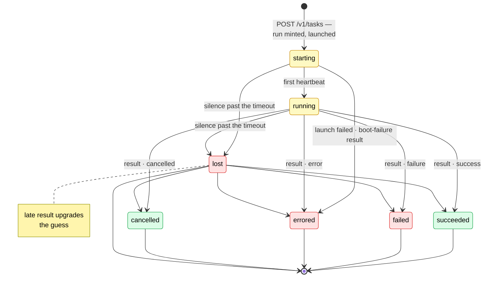
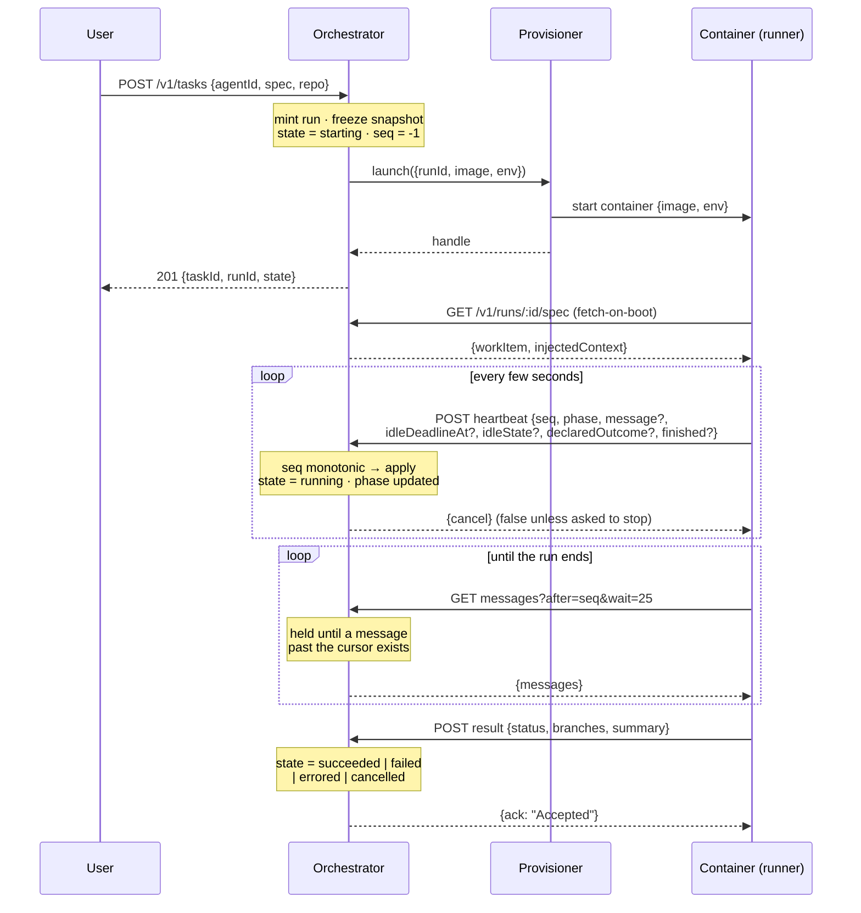
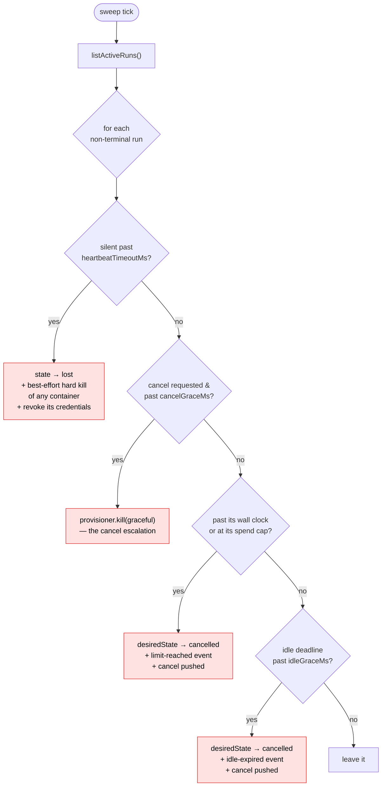

# 🔄 Run Lifecycle

A **run** is one attempt at a task, and the orchestrator's unit of tracking. This is how a run is
born, how it reports while alive, how it ends, and what happens when it goes quiet. Every transition
is a pure function in [`core/lifecycle.ts`](../src/core/lifecycle.ts) — it takes the current `Run`
and returns the next `Run` plus the events to append; persistence is the caller's job, so each
transition is trivially unit-testable and the store stays a dumb row-holder.

## 🚦 The state machine

Seven states. `starting` and `running` are live; the other five are terminal. The four terminal
states that a **result** produces map 1:1 from the runner's `Result` statuses; `lost` is the
orchestrator's _own_ verdict, so by definition no runner can ever report it.

The one edge that surprises people is **`lost → terminal`**. A terminal run never transitions again,
with this single deliberate exception: `lost` was the orchestrator's _guess_ that a silent run had
died, and if the runner's own report shows up late, that report is strictly better information and
is allowed to overwrite the guess (`applyResult` treats `lost` as not-yet-decided).

## 🛰️ A run's life, end to end

## 📥 The inbox, and the idle clock

A run's **work is fixed at birth** — the frozen work item is the whole of it — and until now nothing
was ever handed in afterward. What the outside may hand in now is a **message**, and a message can
only ever be read: a person on the run page, a chatroom's mention, a fire joining a
[response](../../automations/docs/architecture.md), or the platform's own note about a patch — what
became of it, or what the environment build it asked for came to. Every one lands in the run's inbox
(`run_messages`, one row per message, `seq` per run and monotonic) as bounded, untrusted text from a
named sender, and the runner frames it that way before the agent sees it. Nothing in a message can
widen the run's scope — no task, repo, credential or approval rides one — which is what lets the
runner's invariants stand.

A message may also carry **images** (`core/attachments.ts`): refs to attachments already stored on
this run (`run_attachments`, the bytes in the object store under `attachments/`), each claimed by
the one message that carries it. A run can start with images too — a forge thread's screenshots, a
chat mention's photo — frozen onto its work item as `attachments`. The runner fetches each one over
its own door and hands it to the agent beside the text, as untrusted as the text.

The runner **pulls** its inbox (`GET /v1/runs/:id/messages?after=<seq>&wait=<s>`): the request is
held until a message past the cursor exists or `wait` (at most 25 s) elapses, and the next pull's
`after` is the acknowledgement that stamps `deliveredAt`. A pull, and not an answer riding a
heartbeat: the beat only reports, and a pull works on every deployment shape because nothing dials
the container. On this replica a post wakes the held poll at once (`core/inbox_signal.ts`); a post
on another replica arrives on the poll's own one-second re-read.

Every run lives on an **idle clock** (`lifetime: {idleMs, attendedIdleMs}`, frozen onto the task and
the work item): the run does not finalize when the agent settles but waits, on a clock the runner
keeps, for the next message — until the agent calls its finish tool, a person finishes it from its
page, the clock runs out, or it is cancelled. A task that names no clocks gets five minutes alone
and thirty once a person has spoken; a setup task gets three hours either way, and a response the
clocks its automation names. The first `user` or `chat` message flips the run to **`attended`**
(`runs.attended`, an `attended` event, mirrored onto its response) and switches the clock to the
attended one, because "is anyone with her" is the first thing an engineer joining a response asks.
The runner advertises its clock on every heartbeat (`idleDeadlineAt`, a gauge like the phase); the
reaper backstops it, below.

A terminal run refuses messages with `409`, as it refuses heartbeats: there is nobody to read them.

Platform notes carry a structured `payload` beside their text. A `patch` payload is a cue the runner
acts on (a merge ends the line's generation: the runner fetches where it merged and the agent
rebases onto it, and the generation counts on only when the line's next change request ships); a
`released` payload ends a generation whose change request merged with nothing of the run on it, as a
missed cue does (`core/merge_release.ts`); a `finish` payload is a person finishing the run from its
page, which the runner ends at the agent's next settle (`core/finish_run.ts`); an `environment`
payload is the result of the branch build a submitted patch asked for
(`core/environment_feedback.ts`: ready, failed, superseded, or `skipped` with why — the last two
only for a setup task, which is otherwise left waiting) and is only framed and shown. Each patch is
told once; a result that settles after its run ended is recorded on the patch's `patch_builds` row
instead. The run can also ask where its builds stand at any time, through the runner's
`environment_status` tool (`GET /v1/runs/:id/environment`).

A **person's finish** is a message too (`POST /v1/tasks/:id/finish`, `core/finish_run.ts`): kind
`system`, from the person, with a `finish` payload. It is offered once the agent's last `finish` or
`report_outcome` said `success` or `no-changes` — the runner carries that outcome on every heartbeat
once said (`declaredOutcome`, kept on the run until a beat names another or clears it) — and refused
with `409` ("The agent hasn't said it's done yet") before then and while the outcome is
`in-progress` or `failed`, once the agent called its finish tool itself (`agentFinished`, below) or
the run is finalizing, for a run that is not live, and for one being cancelled. The runner never
hands it to the agent: it ends the conversation at the agent's next settle, as the agent's own
finish would, though without holding for a check verdict the run is owed (the patch's checks still
run; a hold already open ends at once, even one the agent's own finish opened before a beat said
so), so the run is not interrupted and concludes on the agent's latest outcome. Finalization
leftovers always require approval, even on `success` or `no-changes`; already recorded explicit
submissions retain their existing state. The agent may still speak after the request — a finish
asked for mid-turn waits for that turn — and if it reports `in-progress` then, the run concludes as
a failure ("ended while the agent's work was still in progress") whose finalization leftovers wait
for a person. That is intended: the agent's latest word stands. A cancel would end it `cancelled`.
The request is on the trail as `finish-requested`; who asked is the message's sender. Finish is
never offered until the runner reports an outcome, and a runner that reports one reads the `finish`
payload, so the message's text is only what the run page's inbox shows.

### ✍️ A task started without its instructions

`POST /v1/tasks` without `spec.instructions` starts a task **awaiting its prompt**: both halves of
its spec are null (the instructions' null is the flag; summaries and details say
`awaitingPrompt: true`), and its run is launched as any other. The runner boots it completely —
clones, setup, services, the browser — and then waits on its inbox without starting the agent,
reporting phase `running` with an `idleDeadlineAt` only once it is ready. The first message a person
sends (`core/prompt.ts`) **is** the task: in one store write (`claimTaskPrompt`), conditioned on the
task still having no instructions, it becomes the task's instructions (its images named in them and
frozen onto the work item, so a re-run copies them), the work item takes the same spec, and the
message is appended. Of two first messages racing, one is the prompt and the other follows it as an
ordinary message. Every other producer is refused while a task awaits (`409`), so the runner can
take the first message it reads as the prompt; a message sent while the run is still starting simply
waits in the inbox. The prompt does not mark the run attended — it is the task, not someone joining
it — but the wait for it runs on the **attended** clock (`lifetime.attendedIdleMs`, thirty minutes
by default), because the person who started the task is there writing it. A task nobody prompts ends
there, its runner reporting `cancelled` (the reaper backstops it like any idle run, and the control
plane clamps the wait's deadline to that clock). Once the prompt lands, the run is back on the
unattended clock until someone speaks to it. A message that arrives after the run ended is refused
(`409`, `terminal`), even when the run ended between the read and the claim.

A task with instructions and no title (the app and the API; every other door names its own) is
titled at once with their first line, cut at a word under 60 characters, and the background model an
admin set under Instance → Platform is asked for a better one off the request path
(`core/titles.ts`): about six words, sanitized to one line. It replaces the first-line title only
while that is still the title (`retitleTask` is a compare-and-set), so a title someone gave is never
overwritten; no model, a failure or no answer within 20 seconds keeps the first line. Both titles
reach the task list's live tail.

### 🧵 One thread, one run

A `/ryph` command — or a mention in a chat command room — starts a run on the default clocks, and
the run remembers the conversation it answers: its **origin conversation**, a forge thread (`runs`'
`origin_thread_repo_id`/`_kind`/`_ref`, denormalized off the policy-shaped `forge_scope` jsonb) or a
chat thread (`origin_chatroom_id`/`origin_thread_key`), indexed because every intake asks "is an
agent already working this thread" on every command (`findLiveRunByOrigin`). A task started from the
app **against a pull request** holds that thread the same way: every reader derives it from
`originConversationFor` (the thread a command came from, else the pull request the task targets), so
a run whose commits land on #42 holds #42 whichever door started it. The forge scope's `origin` is
the forge half only — a chat-started run has none.

That makes a second command in the same thread a decision rather than a race (the chat door's
follow-up lands as a `chat` message from the commander; the rest is the same):

- **The same agent** — the command lands in that run's inbox as a message (sender `forge`, so the
  runner's framing names the thread rather than claiming it came via the run page) and nothing new
  is provisioned. The run already holds the thread's context; a fresh container would re-derive it
  and lose whatever the first agent tried and rejected.
- **A different agent** — refused out loud, and nothing starts. Two runs on one pull request race at
  the submit sweep: the branch moves under the loser, whose push is then refused terminally by
  `merge-base --is-ancestor` while the thread still reads as a success. A refusal the commenter can
  act on beats commits that quietly never land.

Only a **live** run holds a thread. Once it concludes the next command starts a fresh one, and a run
that ends between the lookup and the post falls through to starting one too.

## 💓 Heartbeats are a gauge, not history

A heartbeat carries
`{seq, phase, message?, idleDeadlineAt?, idleState?,
declaredOutcome?, finished?}` and is answered
`{cancel}` — it reports, and the one thing it hears back is whether the run was asked to stop.
Applying one (`applyHeartbeat`) **updates the run row in place** — phase, `heartbeatSeq`,
`lastHeartbeatAt`, the idle clock — and that is nearly all it does. The rules:

- **`seq` is a monotonic guard.** A beat with `seq <= run.heartbeatSeq` is stale or reordered: it is
  still _answered_ but never _applied_, so state can never roll backwards. `seq` starts at `0` and
  rises by one per beat; a fresh run sits at `-1`.
- **The first beat flips `starting → running`** and emits a `first-heartbeat` event.
- **Only a phase _change_ becomes an event** (`phase-changed`). The beat itself is never persisted
  as history — otherwise the append-only trail would be one row per beat instead of ~10 per run.
- **A beat never names an address.** The [cancel push](cancellation.md)'s target is the
  provisioner's to derive (`Provisioner.controlUrl`), because the run is untrusted and the push is a
  request the control plane makes with the run's control token on it.
- **The idle deadline is clamped both ways**: no later than the run's frozen lifetime allows from
  this beat, and no earlier than the beat itself — unless the deadline already on record is earlier,
  which a lapsed runner that keeps beating holds on to, so the reaper still backstops it.
- **What the agent said is kept once said**, not gauged: the outcome it last declared through its
  finish or report tool (`declaredOutcome`: `in-progress`, which only the report tool takes,
  `success`, `no-changes` or `failed`; a beat that omits it keeps it, one naming another replaces
  it, and `null` clears it, which the runner sends once a message reached the agent since — it is
  acting on something new — until the agent declares one again) and that it called its finish tool
  (`finished: true`, kept as `runs.agent_finished`; the beat that first says so appends a `finished`
  event, `detail` the outcome). They are what a [person's finish](#-the-inbox-and-the-idle-clock)
  waits on and is refused by. Only the heartbeat write sets them; a whole-row `saveRun` from a copy
  read earlier never puts them back. The stored outcome is only the page's: the run concludes on the
  runner's result, which a clear never touches.
- **Liveness is judged on orchestrator receive time**, never a runner clock — clock skew stays the
  runner's problem.

A heartbeat to a **terminal** run gets `409`: the control plane already concluded this run, so the
container is a zombie. That `409` is a **diagnosis, not a command** — the runner logs it and carries
on, because an answer is not a channel. Stopping a zombie is the reaper's job.

That is the shape of the whole surface: a beat reports upward and is never answered with work.
Cancellation runs the other way — the orchestrator dials the runner's own control API, and falls
back to the reaper's SIGTERM when it can't ([cancellation](cancellation.md)).

## 🏁 The result: authoritative, and exactly once

`POST /v1/runs/:id/result` carries the runner's `RunnerResult` — the authoritative outcome. Its four
statuses map straight to terminal states:

| Runner status | Run state   | Meaning                                                                                                                                                                                                                                                     |
| ------------- | ----------- | ----------------------------------------------------------------------------------------------------------------------------------------------------------------------------------------------------------------------------------------------------------- |
| `success`     | `succeeded` | the agent delivered: a branch is on `origin`, or it declared the task needed no code changes (`branch: null`)                                                                                                                                               |
| `cancelled`   | `cancelled` | the run was told to stop; whatever was committed still shipped                                                                                                                                                                                              |
| `failure`     | `failed`    | the agent ran to the end and did not deliver — nothing shipped, it declared failure itself, or its last report said its work was still in progress, the `reason` saying so (its commits, if any, still ship, their patches waiting for a person's approval) |
| `error`       | `errored`   | the machinery around the agent broke, in phase `during`                                                                                                                                                                                                     |

`applyResult` is **idempotent**: a result lands at most once, and a re-POST of one that already
landed is a `duplicate` — re-acked `200 {ack: "Accepted"}`, never errored. That is what lets the
runner retry its report safely. The only non-duplicate re-entry is the `lost → terminal` upgrade
above.

A result can also land while the run is still `starting`: a runner that dies fetching or validating
its spec reports `error` with `during: "booting"` before its first heartbeat, taking the run
straight to `errored` without ever being `running`.

## 🧹 The reaper

Nothing above fires if a container simply **goes silent** — crashes, wedges, never comes up. That is
the reaper's job: a sweep on an interval (`RYPH_REAPER_INTERVAL_MS`, default 10 s) that walks every
non-terminal run and asks the pure planner `planSweep` what to do.

- **Liveness** is measured from `lastHeartbeatAt`, falling back to `createdAt` before the first beat
  — which also catches a container that never started heartbeating at all. Silence longer than
  `RYPH_HEARTBEAT_TIMEOUT_MS` (default 60 s; measure it at ~3–4× the beat interval) marks the run
  `lost`. A `lost` verdict also **hard-kills** whatever container may still be running, so a wedged
  runner cannot keep burning resources after the control plane gave up on it, and **concludes the
  run's credentials** — the same three best-effort revocations a reported result triggers (virtual
  model key, virtual MCP token, git virtual key). A container the sweep could not reach is exactly
  the one whose credentials may already have leaked; leaving them alive until their TTL lapsed was
  the gap this closes.
- **Cancel escalation** is the reaper's other job — see [cancellation.md](cancellation.md).
- **The idle clock's backstop.** A run ends itself when its idle clock lapses; one that is still
  beating past its advertised `idleDeadlineAt` by more than `RYPH_IDLE_GRACE_MS` (default 60 s)
  stopped keeping the clock, and the reaper turns that into a cancel request — recorded as
  `idle-expired`, pushed to the container where it advertised one, carried by the next heartbeat's
  answer either way — after which the cancel escalation above takes it. The same runner-primary,
  reaper-backstop split cancellation uses.
- **The limits.** Every run carries frozen limits (`run.limits`, core/run_limits.ts): a wall clock
  from launch and a spend cap in USD, resolved from the operator's `RYPH_RUN_MAX_*` ceiling, the
  agent's `limitPolicy` under it and the task's own override under that. A run past its wall clock,
  or at its spend cap as the model-proxy prices it (`modelAccess.spendOf`, read each tick for capped
  runs), becomes the same cancel request the idle arm produces, recorded as `limit-reached` with the
  limit and its value in `detail`. Each limit has a backstop that needs no orchestrator alive:
  Kubernetes ends the Job at `activeDeadlineSeconds`, and the proxy refuses the run's spending calls
  once it has sat past its cap for `RYPH_MODEL_SPEND_BACKSTOP_MS`. A proxy that cannot answer the
  spend read cancels nothing — the refusal bounds the run until the next tick can count again.
- **The sweep never throws.** Every enforcement is best-effort; a failed kill is warned, because the
  next sweep sees the same evidence and tries again.
