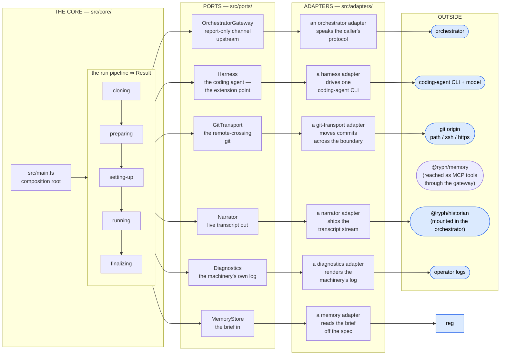
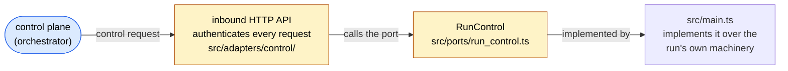

# 🏛️ Architecture

How the runner is put together:
the ports the core depends on, the run pipeline, every `Result` a run can produce,
and the env knobs that tune a deployment.
(What the runner _is_ — one work item, start to finish — is the [README](../README.md)'s opening.)

## 🔌 Ports & adapters

The runner is a small **hexagonal architecture**.
`src/core/` holds the _run pipeline_ and the _shared types_ and depends on nothing concrete —
every external effect goes through a port (`src/ports/`),
and `src/main.ts` is the composition root that binds each port to an adapter (`src/adapters/`).
Swapping an implementation is an edit to `src/main.ts` and nothing else.

Four columns, left to right:
the core, the port interfaces it depends on, the adapters that implement them,
and the outside thing each adapter reaches.
Every port here is _driven_ — the core reaching out.
The runner also has one _driving_ port, which runs the other way; it has its own diagram below.

| Port                  | What the core sees                                                   |
| --------------------- | -------------------------------------------------------------------- |
| `Harness`             | The pluggable coding agent — the extension point (see [harnesses.md](harnesses.md) for the shipped adapters) |
| `OrchestratorGateway` | Report-only channel upstream; the result reported exactly once, last. The HTTP adapter also beats a periodic liveness signal — an adapter concern the core never sees ([heartbeats](#-heartbeats)) |
| `GitTransport`        | Only the remote-crossing git: clone in, push out, and with each read in whether the base is the upstream's or a copy the origin could not refresh ([the two transports](git-flow.md#-the-two-transports)) |
| `MemoryStore`         | The memory brief in at run start — composed and frozen by the orchestrator, carried by the spec. Nothing goes out through it: what the agent learns goes back as MCP tool calls through the gateway |
| `Narrator`            | Live transcript out, best-effort. The default deployment tees the console narrator with a historian leg — both voices ride one batching emitter (`adapters/history/emitter.ts`) into the run's permanent record |
| `Diagnostics`         | The machinery's own log, total by contract. Tee'd the same way: every diag event also lands in the historian, so the record carries the machinery's story alongside the transcript |

`src/helpers/` are _owned_ utilities, not ports —
things with no external variance (local git plumbing, environment setup).
`src/schema.ts` is the ingest boundary: every JSON payload is validated before it becomes a core type.

Every port above is _driven_ — the core depends on it and reaches out through it. There is one
_driving_ port, `RunControl` (`src/ports/run_control.ts`): the runner's inbound control surface,
which the outside drives instead. It reads the same four columns, but the arrows run the other
way — the outside calls in:

The adapter (`src/adapters/control/`) translates each authenticated inbound request into the
matching `RunControl` call, and the composition root implements that call against the run's own
machinery — a `POST /cancel` becomes `requestCancel()`, which trips the one cancel signal the root
already owns ([the cancellation flow](cancellation-flow.md)).
Like every adapter it sits outside the core's fence and never reaches into the core.

The layering is machine-enforced, not left to convention.
`bun run guard` (`scripts/check_architecture.ts`, wired into CI) walks the resolved module graph
and fails the build if a fenced scope imports outside its allowance:
`src/core/` may reach only the core, ports, and helpers;
`src/helpers/` only helpers and the core
(both may also reach `@ryph/process`, which is how they run bash and git,
and the dependency-free kits `@ryph/shared` and `@ryph/sealed`);
`src/ports/` only other ports and the core —
so a port can never reach into a concrete adapter.
Adapters and the composition root are unfenced: they are the outer layer, free to bind anything.

## 📦 How work arrives: one run, one process

Work arrives as **spawn inputs, never as requests**: a runner process is born already holding
everything its single run needs — the work item and the injected context —
does that run, reports the result, and exits.
The one thing it exposes is a small **inbound control API** — an authenticated `POST /cancel`
([the cancellation flow](cancellation-flow.md)) — but that carries _no work_: it can only steer the
run already in flight, never dispatch a new one.
So the alternative shape — a long-lived process that tasks are dispatched _into_ — is still a
deliberate non-goal. The invariant is stated with one more word than it used to have: a run's
**work** is fixed at birth, and what the outside may hand in afterwards is a **message**, which
can only ever be read.

Messages are the one channel that arrives after birth. A run has an **inbox** on the
orchestrator, and the runner **pulls** it (`ports/inbox.ts`, a long poll of
`GET /v1/runs/:id/messages` — never an answer riding a heartbeat, which only reports upward, and
never a dial into the container, which no single-process deployment can make). Every message is
untrusted text from a named sender — a person on the run page, the chat room the run is bound to
(named to the agent as that room: `WorkItem.chat`), an alert, the platform — and reaches the agent only inside the platform's framing (`core/conversation.ts`): a
steer while the agent works, a new turn once it has settled. A message's images (refs on the
message; a task's on `WorkItem.attachments`) are fetched from the control plane
(`ports/attachments.ts`, `GET /v1/runs/:id/runner/attachments/:id`), saved as numbered files in a
directory of the run's own outside every clone (`core/images.ts`), named by path after the
sender's fence (a `[image N: …]` line inside it is rewritten, so only the runner's name files),
and handed to the harness by path and a note in two forms (`HarnessMessage.images`,
`HarnessInput.taskImages`): pi sends them inline only on a prompt that starts a turn and when they
fit one request together, and otherwise says they are files to open with the read tool (what each
request carries in all is held to the provider's limits by the images extension); the
transcript keeps the refs, never the bytes. The other way, an image one of the agent's tools
returns (a browser screenshot, a file pi's read tool opened) is uploaded as a run attachment
(`Attachments.upload`, `POST /v1/runs/:id/runner/attachments`) before the tool's result is
narrated, and the narrated block names it by `attachment: {id, mime}`; the pi adapter awaits each
event's uploads in its read loop (bounded per image and per event, `adapters/harness/pi_vision.ts`)
so narration keeps pi's order, and an image that was not kept is narrated without one. Whether the
run's model can see images at all is decided at boot (`piModelSeesImages`: a custom endpoint's
`vision` flag, else pi's own catalogue entry); a model that cannot gets a browser with no
screenshot tool (`/configure`'s `vision: false`) and no image in any request
(`RYPH_MODEL_TEXT_ONLY=1` for the images extension). Nothing in a message creates work:
no repo, no credential, no scope. Every run outlives the agent's settles on an idle clock (the
work item's `lifetime`: five minutes unattended and thirty once a person has spoken by default,
longer for an environment setup task, an automation's own for a response) until the agent calls
its `finish` tool, a person finishes the run from its page, the clock runs out, or the run is
cancelled; the deadline rides every heartbeat so the control plane's reaper can backstop it. A
person's finish is offered only once the agent's last `finish` or `report_outcome` said
`success` or `no-changes` (the outcome rides every heartbeat after it, as `declaredOutcome`, until
a message reaches the agent) — never while it said `in-progress`, when the page keeps Cancel on
screen — and not once the agent called `finish` itself (`finished` on every
beat after), and it reaches the runner as an inbox message carrying a `finish` payload. The
conversation never hands it to the agent: it is the agent's finish said by someone else, honoured
at the settle so a turn under way runs to its end, though unlike the agent's it never holds for a
check verdict (a hold already open ends at once, its verdict handed to nobody, even one the
agent's own finish opened when the cue was posted before the control plane heard of it; the
patch's checks still run). The run concludes on the outcome the agent declared, its branches
shipped as any finished run's are (`endedBy: "person"`, narrated as a `finished` system chunk
naming the sender). Finish is never offered until the runner reports an outcome, so the runner
that reads the cue always knows it; only a `system` message carries one. The agent waits without
blocking by asking to be woken (`wake_me`, 1–60 minutes, one pending at a time): the wake-up arrives as a
framed platform message through the same door, moves no inbox cursor, and while it is pending the
deadline — armed and reported — is never earlier than it. It runs long commands the same way
(`background_run`, `core/background.ts`): a command started in the background answers at once,
and its end — an exit or a timeout, never a stop the agent or the run asked for — is a framed
platform message through that same door (`BackgroundNoticeMessage`, carrying `background` where a
wake-up carries `wake`), with its status and the end of its output. A job is `bash -c` with the
env pi was spawned with (`HarnessIo.onAgentEnv`), spawned detached so it leads its own process
group and every ending reaches all it started; stdout and stderr share one pipe into a log file
of the run's own, outside every clone. While a job that is no service runs, the idle deadline is
never earlier than its timeout plus the kill grace (`ConversationDeps.holdUntil`). Every job still
running is stopped (TERM to its group, KILL after five seconds) at the agent's `finish` — after
which no notice reaches it and nothing new starts — and in any case once the harness returns,
before finalize commits; the same stop is a teardown disposer. Every file a job has is created
with O_EXCL and never opened by path again. A job's output is cleaned once, as it streams, before
anything reads it (`core/output_stream.ts`): escapes read by their ECMA-48 grammar and removed
whole, control, C1 and bidi characters out, a `\r` opening a line dropped, `\r\n` a break, any
other `\r` kept as a redraw. The ring keeps only a line's last redraw, so a progress bar cannot
push an error out of the agent's tail, the notice or the record's `logTail`; people's views read
a redraw as a line break. The people's view is kept apart: its last 256 KiB in memory, which a
replay sends (after a `skipped` for what is left out, the whole replay under 1.5 MiB, an ended
job getting 16 KiB), and all of it on disk, written as it streams into two 4 MiB segments used in
turn — the writes hold the job's pipe once a MiB is queued, so a slow disk slows the job rather
than growing memory. What goes up as the stored log is the segments' last 4 MiB from a line
break, byte for byte what live viewers saw; the end record's `logBytes` and `logTruncated`
describe it, and the segments are deleted once its log step is over. The raw log file (16 MiB,
the agent's own) is never read back, and stays until the run closes. A label, a command and a cwd
are cleaned as the job is minted.

Nothing here redacts the run's own credentials. Every one the agent's env holds — the MCP
gateway, loopback and browser tokens, the model virtual key, the egress proxy's userinfo — is
scoped to this run, reachable only in the cluster or the pod, and dies with the run; and the
agent, and every reader of the run, already see its bash output unredacted in the transcript.
The control plane's pattern-based redaction of stored logs and tails stays: it is run-agnostic,
and catches what has a credential's shape, like a token a repository prints.

Each job's record — started (before the agent is answered and before any live line of the job),
how it ended (before the live `exited` and the notice), then its log once the end has landed —
goes to the control plane (`BackgroundRecords`, `PUT/POST /v1/runs/:id/runner/background/...`;
logs two at a time per run, as the control plane takes them, each within 30 s of its call — past
the control plane's 15 s hold on a busy claim) and is awaited, bounded (60 s), before the run
reports; its output streams to the historian's commands room (`CommandsUplink`,
`POST /v1/runs/:id/live/commands`, `adapters/background/uplink.ts`), which every connection opens
by replaying. At most eight run at once and sixty-four in a run. All of this is only as
trustworthy as the agent: it runs in the same container as the runner, can read the run token,
and so can speak on the same routes — forge a job's record before the runner makes it, take the
upload slots so its own logs are refused, open its own commands uplink. The Commands tab is the
agent's account of its commands; the transcript's tool calls are the record.

The agent hands self-contained work to **subagents** the same way (`subagent_start`,
`core/subagents.ts`): a second pi in the same container (`SubagentHost`, `adapters/subagents/pi.ts`)
on the run's own model, proxy and key, with a fresh context, the run's layout and machine blocks and
a short framing, its mode's built-ins (`explore` reads; `work` has the run's own and shares the
checkout) and the run's gateway servers but the platform's own (`chat`, `forge`, `memory`) — never
the loopback or the browser either, so it can neither act for the run nor start subagents of its
own. A subagent works in stretches: its turn settling is the stretch's end (its last message the
answer, the process stopped), and `subagent_message` to an ended one starts a new process on the
same session (`--session-dir <tmp>/sessions --session-id sa-<n>`, always from the checkout root),
with why the last stretch ended said first when it did not answer. To a working one the message is a
steer. Which of the two is decided once per subagent, in order, and the adapter's settle refuses
steers from the tick it is seen, so none is lost and no session ever has two processes. A stop or a
stretch's wall clock (15 minutes by default, at most 60) is an RPC abort, a short wait, then a kill
of pi's group and of every group below it, read from the process table while pi is still their
ancestor (pi's bash runs each command in a session of its own); a group no process is in any more is
forgotten, so a reused group id is never killed. Each subagent writes a lane of the run's history of
its own (`Narrator.emit`'s `lane`, its own seq counter in the emitter): `subagent.start`, then per
stretch the child's transcript and `subagent.end`, a continuation opening with `subagent.resume`,
and each steer it was handed as `subagent.message`; the lifecycle rows are kept past a full buffer.
The agent waits for one by ending its turn: every stretch's end reaches it as a platform message
(`SubagentNoticeMessage`) with how it ended and its answer, capped at 32 KiB — a steer while it
works, a new turn once it has settled — but for a stretch it stopped, whose end `subagent_stop`
answers itself (with the answer, when it had answered as the stop came). A running one holds the
idle deadline to its wall clock; `finish` and the harness's return stop every one (`run_ended`). At
most four run at once (a continuation counts, its slot taken on the tick the cap is checked) and
sixteen start in a run. A continuation whose session is not on disk (its first pi died before taking
the task) starts a fresh one from the task.

A run that asked for checks (`run_checks`, or a patch it submitted, which starts a suite of its
own) is held for their verdict (`core/conversation.ts`, asking the control plane which it is
still owed through `ChecksChannel.awaiting`): at a settle while a verdict it caused is owed, the hold keeps the idle deadline open (armed and reported, as a pending
wake-up does) and the verdict arrives through the ordinary inbox poll. Once nothing is owed, one
fresh read of the inbox (the poll's wait is cut short so the read answers at once, and a read
that fails does not count) delivers whatever the platform posted. The agent's `finish` during the
hold does not end the run until then; a person's finish ends it at once, whoever's finish
opened it. The finish tool says the checks are still running, or that it could
not tell (`RunActions.checksOwed`). What the finish recorded
stands if the agent reads a verdict and stops; a later finish or report replaces it. Without a
finish, the ordinary idle clock starts over from the end of the hold. Each hold is bounded
(75 minutes). A hold that reaches its bound with verdicts still owed and no finish tells the agent
so, once, as a platform message (the checks did not report in time; finish with what it has), and
while a hold waits the run's phase reads "waiting for the checks' verdict". A hold that gives up
does so BY NAME: the control plane names each verdict owed (a suite's generation, or a request
still being read) with the run's requests owed it, and the runner records every name the last
read before the give-up returned. No later hold waits for a recorded verdict — one is recorded
when its own name is, or when every request owed it is (a request given up on while still read,
now on its suite, or that suite re-run) — whether it reports late, when it simply leaves the list,
or never. Later settles go straight to the idle clock until a new ask (another `run_checks`, or a
patch submitted); that hold waits only for the verdicts no give-up named, so a stuck check never
stretches it, and a stuck one that reports never hides it. Held again, a check that never reports
would hand the agent a late note and a paid turn at every bound until the wall clock; named, it
gets one. When what is owed cannot be read, a hold waits to its bound and records nothing new,
and only a new ask opens another. The finish tool's "still waiting" and the patch reply's note
read the same list through the same rule (`Conversation.holdsFor`).

The agent's own capabilities over its run are served on **loopback** (`adapters/loopback/mcp.ts`),
a small MCP server the harness's client dials with a per-run token: `submit_patch` ships a
repository's commits as a patch while the run goes on, `patches` says what became of them,
`wake_me` asks for a platform message later instead of a `sleep` nothing can interrupt,
`background_run`, `background_output` and `background_stop` run a long command without blocking
on it, read it and stop it, `subagent_start`, `subagent_message` and `subagent_stop` hand
work to a subagent, speak to it and stop it,
`report_outcome` says how the run stands without ending it (`in-progress` while required work
or verification remains, or a final outcome), and
`finish` says so and ends the run, on a final outcome only (`success`, `no-changes` or `failed`). Those are what finalize already was, done earlier on the
agent's say-so — a stolen token adds nothing a persuaded agent could not do. `publish_artifact`
and `fetch_artifact` (`core/artifacts.ts`) are offered only to a run whose work item says
`canPublishArtifacts`. The first reads an HTML file from inside the checkout (symlinks resolved,
then one open of a regular file and at most 2 MiB read, UTF-8) and hands it to the control plane as
a page every member of the instance can open; the second writes one of the agent's artifacts, as
published, into the checkout (a new file or a regular one already there, never through a symlink)
for the agent to edit. The control plane re-reads the agent's switch on every call
([artifacts](../../orchestrator/docs/artifacts.md)). `expose_port` is offered only when the
control plane is the local binary, which says so at `GET /v1/runs/:id/runner/previews`: it
registers a port the agent's dev server listens on (never one of the runner's own listeners), and
the runner opens one outbound WebSocket per preview to the binary, over which every browser
connection travels as a stream (`@ryph/tunnel`); the run needs no ingress.

One run per process is load-bearing; several invariants lean on it:

- **Exactly-once reporting** has an obvious owner: the process that reports is the process that exits.
- **Secrets stay outside core payloads**: private runtime configuration is per-run because the
  process is. Credentials enter only deliberately constructed child environments, keeping work
  items and results archivable verbatim and the runner's own environment free of fetched secrets.
- **SIGTERM means exactly one thing** — gracefully cancel _the_ run
  ([cancellation-flow.md](cancellation-flow.md)); there is no "drain the others first".
- **The checkout is disposable** because nothing outlives the process to want it back.

If a resident variant is ever needed (warm starts, many tasks per box), it is a second
composition root calling `run()` per task — the core and ports do not move.
It would also have to keep the environment per-identity (one resident process per agent
identity), or the secrets invariant above breaks.
Until something needs that, spawn-with-inputs is the contract, and the
[agent container](../../../images/README.md)'s one-container-one-run is its executable form.

## 🤝 The runner is a helper, not a guard

The runner, the agent, its shell and the repo's setup steps run as one uid (1994) in one
container. The agent can read the runner's environment and memory through `/proc`, the gateway
git token included; it can write the checkout's config and hooks; it can SIGKILL the runner; and
with the token it can POST a bundle to the forge's intake itself. Any check the runner makes, the
agent can skip.

So what the runner checks is a courtesy: it catches an honest mistake early, with a message the
agent can act on. The stacking check (a line whose commits include another line's), the submit
rule after a landing, the `requiresApproval` a finalize report carries, and everything the runner
reports beside a bundle (`carries`, `line`, `generation`) are the run's own word about its own
work, and are read that way. A deliberate bypass gets a messy or duplicate change request for a
person to reject, never content from outside the run's lines or a push anywhere it may not go.

What must hold is checked where the agent cannot reach:

- **Forge intake** (`forge/src/http/patches.ts`, `http/bundle_intake.ts`): the grant is live and
  not a check grant, the repo is a member of it, the bundle is under the size cap, declares exactly
  one ref, that ref is a line of the run's namespace, and its prerequisites are in the base cache.
- **Patch birth** (`orchestrator/src/core/open_patch.ts`): the line's generation is its current one
  or the next after a recorded landing, and a repo has at most `MAX_LINES_PER_REPO` lines. A birth
  once the run is finishing (a finish asked, the agent's finish, the `finalizing` phase) waits for a
  person whatever the runner reports; and the forge reads the bundle (`patch-lineage`) so one that
  holds another line's commits, or a next generation that does not hold the tip its line merged
  at, waits too.
- **Approval**: the repo's policy, the hook-file hold (`forge/src/helpers/hook_files.ts`) and the
  landing hold, before anything reaches the forge.
- **The forge's own credentials**, which only the forge holds: it pushes only to the run's own
  refs or the change request the task targets (`forge/src/helpers/submit.ts`).

The runner's own hardening is hermeticity, not a defence: a built child environment with no
inherited credential, inert checkout hooks, `GIT_NO_LAZY_FETCH` / `GIT_ALLOW_PROTOCOL` /
`GIT_NO_REPLACE_OBJECTS`, fetches by explicit URL (`helpers/git_exec.ts`, `helpers/fetch.ts`),
put-back's restore of a failed setup step's drivers, attributes and submodules, link checks
before anything is removed (`helpers/checkout.ts`), and redaction of credentials in errors and
traces. Each keeps the runner's own git working, and its logs clean, whatever a setup step or the
agent left in the checkout ([git-flow.md](git-flow.md#-what-the-runners-git-can-see-and-what-it-will-run)).
Commits are not signed: a per-run key would sit where the agent can read it, and nothing verified
it. Provenance rides the `Ryph-Run` trailer and the change request's body.

## 🔄 The run pipeline

A run moves through five phases, each narrated as progress:
**cloning → preparing → setting-up → running → finalizing**.

1. **Clone** every repo of the work item — one entry per repository, a single-repo task being
   a list of one — each into its own directory under a disposable checkout root
   (`<root>/<entry.path>`); check out each entry's ref (the starting point), create the run's
   work branch in each, capture each base SHA ([how the git flow works](git-flow.md)). One
   clone failing fails the run naming the repo: a partial checkout never starts an agent. On a
   **baked** environment the root is the image's `/ryph/work` instead, and each repo it already
   holds is adopted — fetched and moved to the entry's ref in place, warm — with a fresh clone in
   the same directory when that fails ([adopting the baked checkout](environment-setup.md#adopting-the-baked-checkout)).
   A base the origin could only serve from a copy it could not refresh (the forge gateway's
   cache during an upstream outage; [the two transports](git-flow.md#-the-two-transports)) is
   collected here as a `StaleBase`: the agent reads it under that repo's heading in the layout
   block, and the orchestrator is told once (best-effort, one-way, like progress) so the run's
   history records that it started behind the upstream.
2. **Prepare**: set the agent as the author of the checkout's commits (they are not signed),
   install the hook that stamps every commit with an `Ryph-Run: <id>` trailer,
   load the memory brief the spec carries (failure degrades the run to briefless, never fails it),
   and run the staleness check for every briefed memory with evidence — `git --literal-pathspecs
   diff --name-only <sha>..HEAD -- <paths>` in the clone the evidence names (`evidence.path`, the
   repo's directory in this checkout, resolved upstream; two clones can share history, so the
   clone is named rather than found by the commit, and a claim about a repo this checkout does
   not hold is skipped) — naming the changed ones under "may be outdated" in the prompt and
   reporting them upstream (best-effort, one-way, like progress).
   Those paths come from outside this process and are handed to git as **pathspecs**, so they are
   held to being paths from both ends: the spec schema refuses a leading `-` (an option) or `:`
   (pathspec magic — `:/` alone would match the whole repository), and `--literal-pathspecs` makes
   any magic inert in the invocation itself.
3. **Set up** the environment each repo declared, if any
   ([the repo-side contract](environment-setup.md)):
   run each repo's setup steps in its own clone, in checkout order — a failing step stops that
   repo's steps, like CI, and the run goes on (so does an invalid `setup.yml`, with no step run);
   the failed repo's checkout is put back to its base and branch (tracked and untracked changes
   discarded, a stopped rebase or merge abandoned), and the failure is reported upstream once
   (awaited) as a `setup.failed` event on the run's history and said to the agent in the machine
   block — then check every clone once for a tree setup left dirty, and put it back with a
   warning: naming the changed files (`dirty`) when every setup succeeded, naming both repos when
   a step failed in another repo; only a tree that cannot be put back is fatal (once, after all
   of them, because a later repo's setup can reach into an earlier clone). A run cancelled
   part-way through setup still reports the warnings it had. Then
   hand every repo's environment description to the harness for the agent's system prompt, each
   under its directory's heading and bounded per repo and in total. Service declarations are
   read as one union across the checkout. The config files themselves are read as regular files
   only, never through a symlink, and never past their caps (`helpers/read_bounded.ts`).
4. **Run** the harness at the checkout root, above every clone. Because the agent no longer
   starts inside a repository, the runner describes the checkout to it — every repo's directory,
   name, ref, description and **context file** (pi loads `AGENTS.md` from its working directory
   and ancestors only, never a subdirectory, so the runner carries each clone's own into the
   system prompt; `helpers/layout.ts`) — and describes the machine, in one block composed on
   every run from the environment the control plane resolved (its validated toolchain record
   included — never the copy an environment build left at `/opt/ryph-env/toolchains.json`, which
   the run user can write), and a `PATH` probe of everyday tools taken here, before the harness
   spawns (`helpers/machine.ts`;
   [the machine block](harnesses.md#-the-machine-block)). Right before the harness starts, the
   skills the control plane froze onto the run (fetched by digest while the clone ran, and
   checked in memory against that digest) and the working repos' own (read from git objects at
   each clone's base, before setup) are written to a fresh directory outside every clone, and
   removed when the harness returns: written only now, so no setup step could have rewritten
   what the harness lists ([skills](harnesses.md#-skills)). It streams a live transcript (narrated out,
   best-effort), may call the memory tools it holds like any other tool, and watches a single
   cancellation signal. The inbox is polled from here until finalize:
   each message becomes an `inbound` transcript chunk and a framed prompt for the agent, and the
   idle clock decides when the run is over (`core/conversation.ts`). The agent may ship a
   repository's commits as a patch at any point through its loopback `submit_patch` tool — the
   same move finalize makes, made early (`core/patches.ts`). A transport that cannot fetch the
   merged base or cannot take the bundle answers that call as a refusal the agent can act on,
   naming the cause and where its commits still are; the same failure at finalize fails the repo,
   since nobody is left to retry.

   A work item whose spec is null — a task started **awaiting its prompt** — waits here before the
   harness starts, with the checkout, setup, services and browser all ready (`core/prompt.ts`). It
   reports `running` only now, with an `idleDeadlineAt`, and polls its inbox on the unattended idle
   clock (`lifetime.idleMs`): the first message is the task — the control plane refuses every other
   message to such a run, and one sent while it booted is simply already there — handed to the
   harness as its instructions (with an `(attached: …)` line naming any image the text does not
   mark, as the control plane stored them) and its first line as the commit subject. The
   conversation's poll starts past it, so it never arrives a second time as a message. Nothing
   arriving by the deadline ends the run `cancelled`, the agent never started.
5. **Finalize** — the same path whether the run finished or was cancelled, per repo in checkout
   order: commit any leftovers, collect the commits since that repo's base, push its branch —
   a repo with nothing new contributes nothing (a branch it shipped mid-run still stands) — and
   build the `Result` from one `BranchOutcome` per repo that shipped, the latest branch each,
   and the agent's self-reported outcome ([the self-reported outcome](harnesses.md#-the-self-reported-outcome)).
   Each repo ships on its own: one that fails (a refused push, a clone the agent moved) is
   recorded and the loop goes on, so the run ends as an `error` naming every repo that failed
   while `branches` still lists everything that did ship — and the control plane opens patches
   from that list, each held for a person's approval whatever the repo's policy, since the run
   did not succeed.

A patch that **lands** is the end of the branch it came from: pushing more onto a merged pull request
is a refusal the forge already makes, and a second pull request from the same branch would show
the landed commits again after a squash. So a landed patch — a cue the platform posts into the
inbox — ends its **generation**, and the agent moves its own work: the runner never rewrites the
agent's branches. The rules:

- **A landing cue is a fetch, not an advance.** On a `merged` cue for the line's current
  generation, a `missed` cue with `onto`, or a `released` cue for it, the runner records the
  landed head and where the change request merged (`onto`), fetches `onto` into
  `refs/remotes/origin/<onto>` (retried once inside the gateway's grant-cache window), records
  the fetched commit (`landedTip`), and adds a note to the cue's text before the agent reads it:
  the fetched sha and the exact rebase, naming the line's branch
  (`git rebase --onto origin/<onto> <landed head> <branch>`, so it rebases that branch whatever
  HEAD is on), or how to start afresh (submit the new branch, and delete the old one only once
  that submit was accepted: a run that ends in between ships lines, never a branch nobody
  submitted); that the fetch failed and
  `update_from_base` gets it; or that `onto` could not be found at the origin, so the line can't ship again
  in this run and its work goes to a person when the run ends. The rebase says to commit or stash
  first, and, when the checkout is on another branch, that it checks the line's branch out and how
  to switch back (and the merge, that `update_from_base` merges into the branch checked out). A
  cue whose fetch outlasts a submit that already shipped the next generation says so instead.
  The control plane's text defers to this note, and says to call `update_from_base` should none
  come; a cue the runner does nothing for (another generation, a line it does not hold, a release
  of a change request it no longer works) gets a note saying so, and one it failed on a note that
  it failed. A command is spelled out only where every name in it is plain
  (`helpers/commands.ts`); otherwise the note says it in words, and every name in a code span is
  escaped (`inCode`). A failure is said redacted, on one line, cut short. Nothing else moves: no
  branch, no tree, no stopped operation.
- **The landed head is what the cue names**, and is what the agent's rebase starts past: the merged
  cue names it (`landedHead`: the newest patch of the generation that merged — in the merged head's
  history, or its change exactly the merged head's, both ways, so a head that merged only in part
  is `missed`). A `missed` cue with `onto`, or a `released` cue, lands the generation at its base.
  The landed head only moves forward: a cue for a head that holds the current one moves it there;
  any other changes nothing.
- **One submit rule after a landing.** A submit of a line whose generation landed is refused
  unless the branch holds `landedTip` (`git merge-base --is-ancestor`), with the rebase to run and
  the tip it wants: rebased, merged (`update_from_base` merges `onto` after a landing), reset and
  re-picked branches all pass. It is asked before leftovers are committed, so a refusal commits
  nothing of the tree (a resolved merge `update_from_base` left is concluded before it: the rule
  reads the branch that merge makes). Nothing is replayed, measured or carried. A branch with
  nothing past the landed head (a merge-commit landing leaves it there) has nothing to submit,
  nor one whose tree is that of `onto` or of the base it would ship from (a merge of `onto` after
  a squash, with nothing new): its change request would change nothing. Finalize asks the same.
  Each submit fetches `onto` again: a tip that no longer holds `landedTip` (a force push, a
  rewind) replaces it, and the refusal names the tip it wants. An `onto` gone from the origin is
  refused plainly. On a pass the runner ships `base..branch` as the next generation, `base` being
  where the branch meets `onto` as fetched now; only once that push went out does the generation
  count on and the line's entry move onto `onto`, so a refused submit, a failed push or nothing
  to ship leaves the rule standing. Checks ask the same question (`landedAt`): a branch that holds
  `landedTip` is filed under the next generation's name, without moving the line.
- **A landed branch renamed is a new line.** The landed branch renamed or branched off, never
  rebased, ships as a line of its own, as it stands: an agent could bypass any such check by
  posting its bundle itself, so the runner does not make one, and the person reviewing its change
  request sees what it repeats.
- **Generations are remote names only.** The next generation ships as `<branch>-2` and so on; the
  local branch is never renamed, copied or rewritten, and the shipped name is a ref made for the
  push alone.
- **A rebase the agent started is its own.** A submit while one is in progress is refused, saying
  to finish or abort it; a merge left by `update_from_base` is still concluded by the submit.
- **At finalize nobody is left to rebase.** A landed line with nothing past its landed head ships
  nothing; one that holds `landedTip` ships as a submit would; any other ships as it stands, as
  the next generation; the control plane, finding it does not hold the tip the line merged at,
  holds it with a reason a person approves only with its diff in view, and the run's
  summary says it was not rebased onto `onto`, worded to hold also where `onto` could not be
  found at the origin, so nobody could. Withholding it would lose the commits with the
  throwaway checkout. An agent that started afresh and left the old branch behind ships its work
  twice this way; the person discards the duplicate. The cue says to delete the old branch once
  the new one's submit was accepted.

Every patch also names the earlier heads of its clone whose own work it holds in full and that
did not land themselves (`BranchOutcome.carries`: all of them, newest first, at most 500), for
memory to follow a claim along. By content, never by author, date or message: merging the
earlier head in changes nothing, or each of its own commits is in the patch's history, merges
into it to nothing, or is git's own clean merge of its parents. Carries are the runner's
attestation, made in the agent's own checkout, so an agent can shape only its own run's claims.
The content rules need git 2.40 or later (`merge-tree --merge-base`); a git that cannot answer
reads as "not carried", with a warning. What the control plane does around
it, and the runner's side of that contract — landings only move forward, a fetch inside the
gateway's grant-cache window is retried once, finalize ships the branch's committed work as it
stands rather than keep it in the box (never touching a stopped rebase, merge, cherry-pick or
revert), and every run with an inbox reads it once more for patch cues before it ships
(acknowledging only what the agent saw) — is in the orchestrator's
[patch lifecycle, "Landing"](../../orchestrator/docs/patch-lifecycle.md#-landing).

Nothing memory-shaped waits to be flushed before the verdict ships: a memory the agent proposes
or votes on is an MCP tool call through the gateway, delivered while the harness runs, so the
runner holds nothing in flight on its behalf.

## 🧾 Every possible `Result`

The `Result` (`core/types.ts`) is the authoritative outcome of a run.
Two things hold for **every** status:
the verdict was reported to the orchestrator **exactly once** and the runner exits normally
(an abnormal exit means it could not even report),
and `branch !== null` **is** the "work reached `origin`" signal —
a `BranchOutcome` is built only after a successful push.

| Status         | `branch`                  | Other fields        | What it means                                                                                                                                                                   |
| -------------- | ------------------------- | ------------------- | ------------------------------------------------------------------------------------------------------------------------------------------------------------------------------- |
| ✅ `success`   | populated **or** `null`   | `summary`           | the agent delivered: the branch is on `origin` — or, with `branch: null`, it declared the task needed no code changes, so there was nothing to push                             |
| 🛑 `cancelled` | populated **or** `null`   | `summary`           | the run was told to stop; whatever was already committed still shipped — three shapes, see [what a cancel reports](cancellation-flow.md#-what-gets-reported-a-cancelled-result). Also a run awaiting its prompt that got none by its idle deadline: no branches, and a summary saying so |
| ❌ `failure`   | populated **or** `null`   | `reason`, `summary` | the **agent's** outcome: it ran to the end and did not deliver — nothing shipped, it declared failure itself, or its last report said its work was still in progress (then any commits it made still ship, on its branch) |
| 💥 `error`     | always `null`             | `reason`, `during`  | the **machinery's** outcome: something around the agent broke in phase `during` — a throw means no confirmed push                                                               |

`reportResult` is fire-and-confirm: the report is delivered, not answered,
so the upstream can never reject or redirect a run's outcome from inside the round-trip.
A reporting _failure_ is not a status at all:
if `reportResult` itself throws, no `Result` exists —
the runner exits abnormally, because a failed report cannot be reported.

Reading the fields — `reason` and `summary` differ by **author**, not by detail level:

- `summary` — the **agent's** voice: the harness's own account of the run, verbatim.
  Present whenever the harness ran — kept even on `failure`, where it delivered nothing; never on `error`.
- `reason` — the **runner's** voice: why the machinery classified the outcome as it did.
  The agent never authors it. Concretely: on `failure`, the core's diagnosis —
  `"agent reported failure"` when the agent declared it,
  `"ended on its idle clock while the agent's work was still in progress"` when the agent's last
  report was `in-progress` and the idle clock ended the conversation (`"ended while the agent's
  work was still in progress"` when it ended any other way) — with or without commits: the agent
  never claimed the delivery, so the run did not deliver — and
  `"ended on its idle clock without reporting an outcome"` when zero commits met no claim of
  completion at all (no outcome tool call) and the idle clock ended the conversation,
  `"run completed without producing any changes or declaring an outcome"` for the same silence
  ended any other way — and on `error`, the thrown
  error's message. A declared `success` with zero commits is a **success**: not every task is
  a code change, and the empty branch list already says none was made.
- `statusComment` — the **agent's** call, on any status that carries a `summary`: `"minimal"` when
  it already posted what it did in the thread the run came from, so the status comment there
  points at the run instead of repeating the summary. Absent means repeat it. The summary itself
  is unaffected ([the self-reported outcome](harnesses.md#-the-self-reported-outcome)).
- `during` — the phase the machinery broke in. One value precedes the pipeline: `"booting"` marks
  a run that died assembling its input — its spec could not be fetched from the orchestrator or
  failed validation — so no phase was ever narrated.

`failure`, `cancelled`, and a no-changes `success` all look alike on the wire with zero commits
(`branch: null`); what separates them is who initiated the end and what the agent declared
([the discriminator](cancellation-flow.md#️-cancelled-vs-failure-vs-success-zero-commits-three-meanings)).

## 💓 Heartbeats

The core narrates `Progress` only at phase boundaries, so a run parked in one phase for a long
stretch would go silent upstream — indistinguishable from a dead container.
The HTTP orchestrator adapter (`src/adapters/orchestrator/http.ts`) closes that gap:
it remembers the last-known phase from each `reportProgress` and POSTs it on a timer as a
heartbeat, so liveness is a steady gauge while `Progress` stays a narration of transitions.
The timer lives entirely in the adapter — the core and its ports know nothing about it.

- Each beat carries a **monotonic sequence number**, so the orchestrator can discard delayed or
  reordered beats and never roll its view of the run backwards. Gaps are legal: a lost beat's
  seq is simply skipped, and the next beat repairs it.
- Beats are **best-effort**, like `reportProgress`: a failed beat is warned and swallowed,
  never allowed to fail or slow the run.
- The payload carries **no wall-clock time of its own** — liveness time is the orchestrator's
  receive time, so the runner's clock is never load-bearing. The one timestamp a beat carries is
  the run's **idle deadline** (`idleDeadlineAt`: a time while the agent sits
  settled, null while it works), which the control plane's reaper backstops.
- A beat **never says where this runner listens**: the control plane finds `POST /cancel` where
  its provisioner placed the run, since an address the run reported could point it anywhere.
- **One thing in an answer steers the run.** A beat is answered with `{cancel}`, and a `true`
  there triggers the same graceful cancel the inbound control API does — once, however many beats
  keep saying so. Everything else the gateway does still only reports upward. Two channels rather
  than one because the inbound API requires _dialing_ this container, which no single-process
  deployment can do and a networked one cannot always do; the outbound beat always gets through.
- Two things the agent said ride every beat once said, since the run page acts on them: the
  outcome it last declared through `finish` or `report_outcome` (`declaredOutcome`), and that it
  called `finish` (`finished: true`). A person may finish the run from its page only between the
  two, and only while the outcome is `success` or `no-changes`: never while it is `in-progress`
  or `failed`. Every message that reaches the agent afterwards (a person's, a room's, an alert, a verdict,
  a wake-up, a background notice; settled or mid-turn) clears the outcome, `declaredOutcome:
  null` on every beat from then on, until the agent declares one again: it is acting on something
  new, and a finish on its old word would end that work. The clear is the page's alone; the run
  still concludes on the outcome the agent last declared. `finished` is never cleared. A control
  plane that predates `in-progress` answers `400` to a beat carrying it, and the outcome rides
  every beat, so in a rolling deploy the run would go unheard — no cancel reaching it, then
  reaped as lost. The first such refusal makes the runner send `null` in its place for the rest
  of the run (and beat again at once): the agent has not said it is done, which is all that
  control plane can read in it, and it offers no person's finish.
- Every report beats immediately, so the orchestrator's view is fresh rather than up to a full
  interval stale: one made while a beat is in flight is owed one follow-up beat as soon as it
  settles, which carries the newest of everything reported meanwhile. A timer tick behind a slow
  beat is skipped.

The launch environment contains `RYPH_ORCHESTRATOR_URL`, `RYPH_RUN_ID` and a single-use
`RYPH_BOOTSTRAP_TOKEN` (plus the non-secret egress proxy address when configured). On boot the
runner POSTs to `/v1/runs/:id/bootstrap`. An atomic database deletion redeems the token once,
returning the run, control, git and egress credentials; an unused token expires five minutes
past the startup grace (`RYPH_STARTUP_GRACE_MS`, so 15 minutes by default). The response is not
cached. Network errors and 5xx are retried up to eight times, the pause doubling from a second to
thirty; a 4xx never is. An answer lost after the token was spent comes back 401 on the retry, and
the run fails closed: it cannot report without the bearer it never received, so the reaper's
startup grace concludes it.
The runner retains credentials in memory, not `process.env`, so its original and current process
environments contain no usable long-lived bearer. No provisioner-specific or kernel mechanism
is involved. With no orchestrator wiring the noop gateway stands in as before.

The in-memory run bearer drives **fetch-on-boot**: when no `--work-item` flag
is given, the composition root fetches the run's spec (`GET /v1/runs/:id/spec` — the frozen work
item plus injected context) and validates it through the same ingest boundary as the files. A spec
that cannot be fetched or validated is a startup failure (exit 2), reported upstream as an error
`Result` with `during: "booting"` when the report can land. The skills section is the exception:
it is read on its own, and one this runner refuses leaves the run without skills rather than
stopping it (see [harnesses.md](harnesses.md#-skills)).

The same handshake has a second half: `GET /v1/runs/:id/credentials` answers the env the harness
needs to call its model backend — typically a run-scoped virtual key plus the model-proxy address,
in the provider's own variable names — and the composition root retains it in private runtime
configuration. The harness adapter supplies it explicitly in the child's spawn environment;
these keys are never exported into the runner's environment. The core carries lookup names,
not raw credentials.
`{env: {}}` is the normal answer for a run that calls no models, a `404` (an orchestrator
predating the endpoint) is tolerated as the same, and any other failure is a boot failure like a
spec that would not fetch — a run that cannot obtain the credentials it needs dies before doing
work, not keyless and opaquely mid-harness.

The answer has an optional second half, `mcp`, for a run whose agent has a tool policy: one
virtual token for the [MCP gateway](../../mcp-gateway/README.md) and the gateway's per-run URL for
each server in scope (`{ token, servers: [{ slug, name, url }] }`). It is the one credential the
composition root does **not** export under a harness-visible name: the token is parked in
private runtime configuration as `RYPH_MCP_TOKEN` — brand-scoped, so the child-env scrub hides
it from repo-authored setup steps — and only the server list plus that lookup name
travel on as `RunCtx.tools` → `HarnessInput.tools`. The harness adapter reads the token back at
spawn and hands it to its CLI under the CLI-facing name its config references
([pi](harnesses.md#-tools-through-the-mcp-gateway): `MCP_GATEWAY_TOKEN`, spawn env only). The core
forwards `tools` untouched and never dials an MCP server.

`tools` always carries one more entry the credentials fetch did not deliver: the runner's own
tool server on loopback (`tools.loopback`), with its per-run token parked as
`RYPH_LOOPBACK_TOKEN` under the same scrub and handed to the CLI as `MCP_LOOPBACK_TOKEN`. So a run
with no tool policy still loads the extension — for `submit_patch`, `checkout_change_request`,
`update_from_base`, `patches`, `environment_status`, `run_checks`, `check_status`, `check_log`,
`wake_me`, `background_run`, `background_output`, `background_stop`, `subagent_start`,
`subagent_message`, `subagent_stop`, `publish_artifact` and
`fetch_artifact` (where the run may publish artifacts), `report_outcome` and `finish`.

`update_from_base` catches a repo's branch up with the branch its work merges into: the entry's
`targetRef` (a change request's base, which the gateway refreshes beside `ref` on every
advertisement, so a clone holds it as `origin/<target>`), or `ref` itself for a run that started
from its own base; after a landing, the branch the change request merged into, which puts the
branch on what merged as a rebase would. It always merges and never rebases — the branch may be
somebody's change request — and a conflict is left in progress for the agent; the next
`submit_patch` concludes it. A rebase the agent started is its own to finish: a submit over one is
refused. One still conflicted when the run ends is left exactly as it stands, and so is anything
else stopped at the end. The rule at finalize has exactly two exceptions, concluded with git's own
commit as mid-run, what is left in the tree then committed after it: a merge whose conflicts the
agent resolved and staged, and a single-step cherry-pick or revert (no sequence behind it) likewise
resolved; should git refuse either commit, it is left as it stands like any other stop.
Every other stopped operation — a rebase or `git am`, conflicted or resolved; a merge still
conflicted; a cherry-pick or revert sequence, or one still conflicted; a bisect; any unmerged
index entry; a HEAD off the run's branch — is never aborted, reset, staged, unstaged, continued or
concluded. The branch ref, holding what was committed to it so far (a rebase or a stopped merge
never moves it; `git am` and a pick or revert sequence commit onto it as they go), ships as it
stands, by the landing rules above when a patch of the repository landed meanwhile. Nothing
uncommitted ships, the unfinished operation included, and the run's summary says so whatever the
ship came to — even when nothing new shipped at all.
A run with nothing of its own yet simply moves its branch and base to the new tip.

Two more clients share the runner surface for a run that can be spoken to, both under the run
token: the inbox (`GET /v1/runs/:id/messages?after=<seq>&wait=<s>`, a long poll whose `after` is
the acknowledgement of everything before it) and the patch reporter
(`POST /v1/runs/:id/patches`, the one call that has to answer — the patch's id and birth state,
which the agent is told). A report that cannot land is not a patch that did not ship: the bundle
is durable, and the terminal result names the branch again. A third reads, on every run: the agent's
`environment_status` tool asks `GET /v1/runs/:id/environment` where the environment builds of its
patches stand, and hands the control plane's text to the agent verbatim — the build's own output
already fenced there. The same results arrive in the inbox as `system` messages whose `payload`
is `kind: "environment"`; the runner frames them like any message and acts on none of them (a
`patch` payload moves the run's bookkeeping, and a `finish` payload ends the conversation at the
next settle, owed check verdicts or not).
A payload kind the runner does not know reads as none, so a control plane a version ahead cannot
wedge the inbox; the message still arrives by its text.

When the spec says the platform runs checks (`checks.enabled`), `run_checks` uploads a repo's
committed tip through the same `GitTransport.push` a patch ships by — the bundle, not a patch:
nothing is committed and nothing counts as shipped — then asks `POST /v1/runs/:id/checks` for a
suite on that head, branch and base, naming the `checks` to run when the agent picked some
(lowercased); `check_status` reads `GET /v1/runs/:id/checks`, naming each connected repo's
checked-out head (`?at=`, at most 8), so a run reviewing a change request sees the checks its
pushes got; with `commit` (any revision the checkout resolves, or a full SHA it does not have) it
asks about that one commit alone. Both hand the control plane's text on verbatim, each check's
output already fenced there, and results also arrive as `system` messages with no payload.
`check_log` fetches one check's whole stored log (`GET /v1/runs/:id/checks/:suite/log`, at most
16 MiB) into a directory of the run's own outside every clone, under a fresh name built only from
the platform's ids, and answers the path for the agent to read with its shell; the directory goes
with the images when the harness is done, and nothing is saved after. A run that may not open
patches is told checks are on too: it gets `check_status` and `check_log` and one line about
them, never `run_checks` (refused before anything is uploaded) or the block below. `GET /v1/runs/:id/checks?awaiting=1` answers
`owed`, which verdicts the run is still owed (`{id, requests}` each), which only the runner reads:
it is what holds a settle (above). `GET /v1/runs/:id/checks/declared` answers `declared`, each repo's setup
steps and checks as its base declares them, and `unread`, the repos whose checks file could not
be read (`*` when the platform does not know which); a repo with no checks file is in neither.
The platform reads those files through the forge, so the runner asks as the run starts, lets
the clone and setup go on meanwhile, and waits for the answer only as the harness starts (20
seconds from the ask at most); no answer is not known for any repo, never a failed run. What the
agent is told follows the answer, per repo rather than per deployment. Where a repo declares
checks, the prompt carries one block: each such repo's checks by name and command, then how to
run them (through `run_checks`, all of them at once and one by name only while fixing it, never
by running their commands by hand; all of them before a patch; a check broken outside the change
is named in the patch's description, never weakened) and that a finish waits for their results. A repo in `unread` gets one cautious
line naming it, after the block when there is one: if it has a `.ryph/checks.yml`, it has
checks, and how to run them. With no answer at all the line names no repo. Where no repo
declares any and none is unread, the prompt says nothing about checks, `finish` and
`submit_patch` read as they do without them, and the loopback leaves `run_checks`,
`check_status` and `check_log` out of its listing (a call to any still answers). The loopback follows the
prompt through `RunCtx.onChecksTold`, settled before the harness starts. Without
`checks.enabled` in the spec the tools say nothing runs checks, upload nothing, and the prompt
does not mention them.

## 🎛️ Env knobs

The `RUNNER_*` knobs tune a local deployment; the `RYPH_LOG_*` pair are the shared
`@ryph/logger` knobs; the remaining `RYPH_*` variables are part of the container contract
the orchestrator injects per run.

| Variable                | Effect                                                                          |
| ----------------------- | ------------------------------------------------------------------------------- |
| `RYPH_LOG_LEVEL`        | Log floor, `debug`…`critical` (default `debug`); `warn` drops the play-by-play, leaving only swallowed-failure warnings |
| `RYPH_LOG_FORMAT`       | `json`, `text`, or `colorful`; defaults to colorful on a terminal, JSON otherwise |
| `RUNNER_KEEP_TEMP=1`    | Skips temp cleanup so a failed run's checkout can be inspected                 |
| `RUNNER_CHECKOUT_ROOT`   | Where the temp checkout is created (defaults to the OS temp dir)               |
| `RUNNER_CHECKOUT_PREFIX` | Folder-name prefix for checkouts (default `runner-checkout-`)                 |
| `RUNNER_WORK_ROOT`      | Where a baked environment image keeps its checkouts, when not at `/ryph/work`; a run whose spec says `baked` adopts them there instead of cloning into a temp dir |
| `RUNNER_HEARTBEAT_INTERVAL_MS` | Beat cadence when an orchestrator is wired (default `10000`; must sit well under the orchestrator's liveness timeout) |
| `RUNNER_PI_BIN`         | The pi executable when not the harness layer's `/opt/ryph/bin/pi` (a checkout driving a pi on PATH: `pi`) |
| `RUNNER_PI_MCP_EXTENSION` | Where the pi adapter finds the ryph MCP extension when not at the harness layer's `/opt/ryph/pi-mcp/index.ts` (a checkout: `packages/pi-mcp/index.ts`); the images extension is the `images.ts` beside it |
| `RUNNER_HARNESS_MANIFEST` | The harness layer's manifest when not at `/opt/ryph/harness.json`; a run whose harness kind it does not list is refused at boot. Absent (a runner from a checkout) means no check |
| `RYPH_MCP_TOKEN`        | Private runtime lookup name, not an exported variable: holds the virtual MCP token for the harness adapter alone |
| `RYPH_CONTROL_TOKEN`    | Not read from the environment: delivered by the bootstrap exchange, authenticates the inbound control API; absent ⇒ no inbound API opens |
| `RYPH_PORT`             | Port the inbound control API binds when a control token is set (default `8080`)  |
| `RYPH_ORCHESTRATOR_URL` | The orchestrator's base URL for the bootstrap exchange, the spec fetch and upstream reporting; set together with the bootstrap token, or neither |
| `RYPH_BOOTSTRAP_TOKEN` | Single-use launch bearer exchanged for in-memory credentials before any work starts |
| `RYPH_RUN_TOKEN`        | Not read from the environment: delivered by the bootstrap exchange, sent on every orchestrator request — a run speaks only for itself |
| `RYPH_RUN_ID`           | The run to fetch the spec for on boot; with URL and bootstrap token set, replaces `--work-item` |
