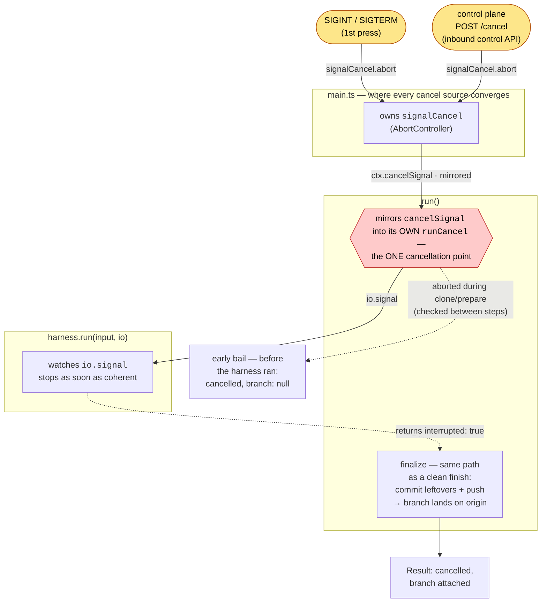

# 🪂 Cancellation Flow

## 📝 The one-paragraph version

Cancellation is **graceful by design**:
when a run is asked to stop, the harness halts at a coherent point,
and **whatever it already left in the tree is committed and pushed** —
the branch lands on `origin` and the `Result` reports `cancelled` with that branch attached.
Nothing the agent did evaporates.
The **core honors a single cancel input** — an `AbortSignal` it watches.
**Two sources** can trip it — a local **OS signal** and the control plane's authenticated **`POST /cancel`** —
but they converge in `main.ts`, _before_ the core: both abort one `AbortController` (`signalCancel`),
whose signal `run()` receives as its `cancelSignal`.
Because every source collapses into that one signal at the composition root,
the cause is erased at the convergence point:
everything that makes the cancel graceful — stopping at a coherent point, committing, pushing,
labelling the `Result` — runs identically no matter who asked.
The orchestrator gateway is **report-only** and takes no part in cancellation:
a caller that wants a stop hits the control endpoint, which trips the same signal a local kill does.
Graceful cancel is thus a property of the **core**:
an invariant enforced in one place that holds for every source, present or future.

## 🔀 The two sources of a cancel

There is exactly **one** thing that stops a run —
an `AbortSignal` the harness watches — but two paths reach it,
and both converge in `main.ts` before the core ever sees them.
They exist because they cover different **reachability** situations:

| Source                     | Kind          | Trips when                                | Latency                      | Funnelled by                                   |
| -------------------------- | ------------- | ----------------------------------------- | ---------------------------- | ---------------------------------------------- |
| OS signal (`SIGINT`/`SIGTERM`) | local     | Ctrl-C, or `docker stop`                  | **immediate** — event-driven | `main.ts` → `signalCancel`                     |
| `POST /cancel`             | control plane | the orchestrator hits the inbound API     | **immediate** — on request   | `adapters/control/` → `main.ts` → `signalCancel` |

Key insight: **both sources are event-driven, and they differ only in reach.**
Neither polls: each aborts the instant it fires, whether or not the harness is talking —
so a **silent** harness (one producing no output) is just as cancellable as a chatty one.
A local OS signal needs no network — it works even when nothing can reach the container.
The control endpoint is the reverse: it works when the orchestrator can reach the container
but has no OS-signal channel to it — and when a graceful stop is ignored or too slow,
the provisioner's SIGTERM (then SIGKILL) is the backstop behind it.
Wiring one does not disable the other;
at the core's API, `cancelSignal` is optional (omit it ⇒ the run has no cancel source at all),
though the real runner always wires it.

## 🪜 The layers, top to bottom

Cancellation threads through four layers.
Each one only knows about the layer directly below it —
`main` knows nothing of the harness, the harness knows nothing of who asked it to stop.
Both abort **sources** (rounded nodes) collapse into `main.ts`'s single `signalCancel`,
which `run()` mirrors into its `runCancel`, so the harness only ever sees one `io.signal`.
Solid arrows carry the abort **down** the call stack;
the dashed arrow carries the `interrupted` verdict back **up**.

### 🎣 1. `main.ts` — where the cancel sources converge

`main` owns a process-level `AbortController` called `signalCancel`,
whose `.signal` is handed to `run()` as `cancelSignal`.
**Every** cancel source feeds this one controller, so `run()` never learns which fired.

**OS signals.** `main` registers listeners for `SIGINT` (Ctrl-C) and `SIGTERM` (`docker stop`);
both are treated identically. The two-signal protocol lives here:

- **First signal → graceful cancel.** It calls `signalCancel.abort()`.
  That is _all_ it does — the core takes over, the harness stops at a coherent point, committed work ships,
  a `cancelled` `Result` is reported,
  and the process exits **normally** so the `finally` cleans up the temp checkout as usual.
- **Second signal → force exit.** For when the graceful path is stuck or too slow:
  it runs `dispose()` directly and exits `130`.

The listeners are registered **before** the checkout temp dir is created,
so a kill landing during setup still triggers cleanup.
Only `SIGKILL` escapes — it can't be caught, and the temp dir is left for the OS to reclaim.

**The inbound control API.** When the bootstrap exchange delivered a control token (`RYPH_CONTROL_TOKEN`),
`main` also stands up a small HTTP server (`adapters/control/`) whose one route — an authenticated
`POST /cancel` — drives the `RunControl` port. `main` implements that port by calling
`signalCancel.abort()`, the _same_ controller the signals abort.
A control-plane stop and a local kill are therefore indistinguishable downstream.
With no control token (a local CLI run) no server is opened, and the OS signals are the only source.
When the endpoint is unreachable or ignored, the provisioner's `SIGTERM` — then `SIGKILL` — is the backstop.

### 🎯 2. `run()` — the single cancellation point

`execute()` (in `core/run.ts`) mints the run's own `AbortController`, `runCancel`, first thing —
before the clone and every phase after it.
Its one source is `ctx.cancelSignal`: `run` mirrors it into `runCancel` —
aborting immediately if it's already aborted, otherwise forwarding the first `abort` event through once.
Every source has already collapsed into that one signal up in `main.ts`,
so the core neither knows nor cares who asked.

Only `runCancel.signal` is passed down to the harness as `io.signal`.
The harness never sees a signal or the control plane — just one abort.

Because the wiring happens before the clone, a cancel is honored even before the harness exists.
The pre-`running` steps (clone, brief load) can't be interrupted mid-flight —
that would mean threading the signal into the git transport —
so `execute()` checks the signal between them and bails out early with a `cancelled` `Result`
(`branch: null`, empty summary: nothing ran, so there is nothing to summarize or ship).
The repo's own [setup steps](environment-setup.md) are the exception: they can run long,
so they take `runCancel.signal` directly — an abort kills the step in flight, skips the rest,
and the run bails out on the same early-`cancelled` path.

### 🤝 3. `harness.run()` — stopping coherently

The harness contract (`ports/harness.ts`) states:
**on signal abort, stop as soon as coherent and return `{ interrupted: true }`.**
"Coherent" is the harness's call — it stops at a point where the tree is in a sane state, not mid-write.
A harness may bound its own wait for coherence: the pi adapter aborts graceful-then-forceful,
killing the agent after a grace period if it hasn't settled — and still returns `{ interrupted: true }`.
It works **only** inside `checkoutDir` and never touches git remotes;
committing leftovers and pushing is the core's job.

### 🚢 4. finalize — committed work still ships

Back in `execute()`, the finalize phase runs **the same on cancel as on a clean finish**:

- if the tree has changes, commit them (`commitAll`);
- compute `commits = commitsSince(baseSha)`;
- if there are commits, `push` each line to its `<branchNamespace>/<line>` branch and build a `BranchOutcome`.

The only thing `interrupted` changes is the **status label** on the returned `Result`, not whether work ships.
This is the whole point of graceful cancel — the push path is identical.

## 📤 What gets reported: a `cancelled` Result

The contract first: **a cancel is still a fully-reported, normal exit.**
Like every other outcome, the `Result` (`core/types.ts`) is handed to
`orchestrator.reportResult()` exactly once, last, after teardown —
see `core/run.ts` for the exactly-once reporting envelope.

Everything that varies between cancelled runs lives in two fields:

- **`branch` — did any work ship?**
  A `BranchOutcome` is built only after a successful push,
  so `branch !== null` **is** the "it's on `origin`" signal.
  `null` means there were no commits to push.
  Both are normal outcomes for a cancel — nothing the agent committed evaporates either way.
- **`summary` — the harness's own account.**
  A harness that was started reports where it stopped, cancel or not.
  When the cancel lands **before** `running` (the early bail during clone/prepare),
  the harness never started — so the summary is empty by construction:
  nothing ran, nothing to summarize.

Those two questions compose into the three shapes a `cancelled` `Result` can take:

| Work pushed? | Harness ran? | `Result`                                             | The story                                                             |
| ------------ | ------------ | ---------------------------------------------------- | --------------------------------------------------------------------- |
| yes          | yes          | `{ status: 'cancelled', branch: {…}, summary }`      | interrupted mid-run with work in the tree — the branch is on `origin` |
| no           | yes          | `{ status: 'cancelled', branch: null, summary }`     | interrupted before any change existed — nothing to ship               |
| no           | no           | `{ status: 'cancelled', branch: null, summary: '' }` | tripped during clone/prepare — the run bails between steps            |

(The fourth combination — work pushed but the harness never ran — cannot happen:
before `running`, nothing has touched the tree, so there is nothing to commit.)

### ⚖️ `cancelled` vs `failure` vs `success`: zero commits, three meanings

A **completed** run that produced nothing is a `failure`
(`"ended on its idle clock without reporting an outcome"` when the idle clock ended it,
`"run completed without producing any changes or declaring an outcome"` otherwise), never a
`cancelled` — unless the agent declared it was done, with a `success` or `no-changes`
[outcome tool](harnesses.md#-the-self-reported-outcome),
which makes it a `success`: not every task is a code change.
All three can end with zero commits and `branch: null`;
what separates cancelled from the rest is `interrupted`, a boolean on the `HarnessOutcome`
the harness returns (`ports/harness.ts`) — its answer to "were you stopped, or did you finish?":

- `interrupted: true` — the run **was told to stop** → `cancelled`,
  and any self-report is ignored: an interrupted run's claims are half-finished;
- `interrupted: false` — the run **ran to the end**: `success` if it claimed completion
  (`success` or `no-changes`, through the outcome tools), otherwise it **delivered nothing** → `failure`.
  A last report of `in-progress` claims nothing: the run ended unfinished, a `failure` whose reason
  says so (`"ended on its idle clock while the agent's work was still in progress"`, or `"ended
  while the agent's work was still in progress"` when anything else ended it), its commits still
  shipped.

That is why, once a run's agent said it was done, its page offers Finish in Cancel's place
(Cancel moves into the overflow menu): a finish is no cancel. While the agent says its work is
`in-progress` there is no Finish, and Cancel stays on screen. It arrives as an inbox message and ends the conversation at
the agent's next settle, as the agent's own `finish` would (though without waiting on a check
verdict) (see [architecture](architecture.md)), so the run is not interrupted and concludes on the
agent's latest outcome. Finalization leftovers always require approval, even on `success` or
`no-changes`; already recorded explicit submissions retain their existing state. A finish asked
for mid-turn waits for that turn, and if the agent reports `in-progress` in it, the run concludes
as a `failure` (`"ended while the agent's work was still in progress"`) whose finalization leftovers
wait for a person. That is intended: the agent's latest word stands, and a person's finish never
claims a delivery the agent took back.

The flag is **core-internal** and never travels on the `Result`:
finalize consumes it to pick the status label, and that label is all a consumer ever sees —
by the time a `cancelled` arrives, the flag has already been erased into the status itself.
(The same erasure as the two cancel sources collapsing into one abort:
the `Result` states what happened, never the mechanism that made it happen.)

The early bail is the one case that never consults the flag:
the harness never started, so there is no outcome to read,
and `execute()` reports `cancelled` directly.

## 🕊️ Why graceful, not abrupt

A run represents real agent work.
Killing it abruptly would throw away commits the agent already made for no benefit —
the branch name is already chosen, the checkout already has the changes,
and pushing them costs one more git operation.
So the design pushes whatever exists and labels it `cancelled`,
leaving the decision of what to do with a partial branch to the caller (GC it, inspect it, open a draft PR).
The cost is that a graceful stop is not instantaneous: it waits for the harness to reach a coherent point.
The **second** signal in `main.ts` is the escape hatch when that wait is unacceptable.
