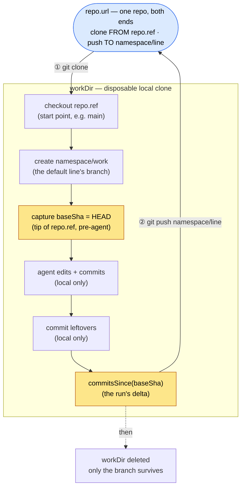

# 🌿 Git Flow

## 📝 The one-paragraph version

A run happens in a **disposable checkout root** on disk (`checkoutRoot`), holding one local
clone per repo of the work item at `<root>/<entry.path>` — the story below is told for one of
them, and repeats for each. The runner clones the repo into its directory, checks out a
**starting point** (`repo.ref`),
lets the agent edit and commit **locally**,
then **sends those commits out** as a **fresh branch** under the run's namespace
(`<branchNamespace>/<line>`, see [lines](#-lines-several-change-requests-from-one-repo)) —
never onto the branch it started from.
_How_ they leave is the transport's business (see
[the two transports](#-the-two-transports)): the direct transport `git push`es them to the
remote; the gateway transport emits a **`git bundle`** and hands it to the forge gateway's
intake — the run's git credential is read-only there, and the bundle is the durable artifact.
Then the runner deletes `workDir`. The branch that left is the only thing that survives.

## 🧭 The four coordinates

Two of these are _git coordinates_ (logical: which repo, which branch/commit).
Two are _physical_ (a folder on disk, and the remote git talks to).

| Thing        | Kind     | Role                                                         | Example                                     | Defined                      |
| ------------ | -------- | ------------------------------------------------------------ | ------------------------------------------- | ---------------------------- |
| `repo.url`   | logical  | the repo to read; becomes the remote named `origin` on clone | `git@github.com:acme/app.git` or `/srv/app` | `core/types.ts` (`RepoEntry`) |
| `repo.ref`   | logical  | **source** — the point to check out and start _from_         | `main`, `v1.2.0`, a SHA                     | `core/types.ts` (`RepoRef`)  |
| `branchNamespace` | logical  | **destination** — the namespace every branch of the run's work is pushed _under_, per repo (one name across the run): `<namespace>/<line>` | `runner/ada/wi-7f3a` → `runner/ada/wi-7f3a/work` | `core/types.ts` (`RepoEntry`) |
| `path`       | physical | the directory under the checkout root the clone lives in     | `api`                                       | `core/types.ts` (`RepoEntry`) |
| `workDir`    | physical | the clone: `<checkoutRoot>/<path>`, disposable                | a temp dir                                  | `main.ts`, `core/run.ts`     |

Key insight: **`repo.ref` and `branchNamespace` are opposite ends of the run.**
`ref` is where you _read from_; the namespace is where you _write to_.
They're two fields precisely because you almost never want to write straight back onto the branch you started from
(that would be committing to `main`).
See the `WorkItem` field docs in `core/types.ts` for the source/destination framing.

## 🌐 Local vs remote

There are **two repositories**, always — but only one is guaranteed to be on _the runner_:

1. **The source repo** at `repo.url` — what you clone _from_.
   Its location varies: a remote server (SSH/HTTPS forge) or a local path.
   In the remote case it is **not on this disk** at all.
2. **`workDir`** — the _clone_. A full, independent repo with its own `.git`.
   **Always local**, on the runner.

`git clone repo.url` copies the repo into `workDir` **and records `repo.url` as the remote named `origin`.**
So from then on, `origin` **is** `repo.url`:

- **`commit`** writes to `workDir`'s own `.git`. The commit exists _only_ in `workDir`.
  The source repo knows nothing about it yet.
- **`push`** copies those commits _from_ `workDir` _to_ `origin` (i.e. `repo.url`), landing them as `<branchNamespace>/<line>`.

Even when `repo.url` is a **local filesystem path**, commit and push are still distinct:
commit is local to `workDir`; push is the one moment work leaves `workDir` and reaches the source repo.
The only thing a path origin changes is the _transport_ —
git copies objects between two folders on the same disk instead of talking over SSH/HTTPS.
The runner doesn't know or care which; see the header of `adapters/git/cli.ts`.

In the code this split is a hard line:
only `clone` (or `adopt`, its in-place twin for a checkout an environment image baked) and `push`
sit behind the `GitTransport` port — the sole seam that touches `origin`.
Every local operation (branch, commit, inspect) is a plain helper, not a port.

## 🚚 The two transports

The `GitTransport` port has two adapters, chosen by the composition root — the core never
learns which (this is the "an alternate backend slots in behind this interface" claim,
made good):

| | `adapters/git/cli.ts` (direct) | `adapters/git/gateway.ts` (forge gateway) |
| --- | --- | --- |
| **When** | no gateway env — a hand-run work item (`--context`) and the tests; never a run the control plane launched, which `main.ts` refuses without the gateway pair | `RYPH_GIT_ORIGIN` + `RYPH_GIT_TOKEN` delivered (the bootstrap exchange always carries both) |
| **`clone`** | straight from `repo.url` | from the gateway's per-run URL, authenticated by an **origin-scoped extra header** riding the subprocess env — never the URL, so `.git/config` stays credential-free |
| **`push`** | `git push origin refs/heads/<branch>:refs/heads/<branch>` | `git bundle create <baseSha>..refs/heads/<branch>` + POST to the gateway's intake. The **named branch, never `HEAD`** — the bundle's header must declare the run's output ref, because that self-description is what the gateway validates |
| **can the agent push?** | only where `repo.url` takes an anonymous push: the transport carries no credential | **nowhere** — the credential is read-only and the gateway has no receive path |
| **is the base fresh?** | always: a plain origin serves what it holds, and nothing caches between it and the clone | asked of the gateway after every `clone`, `adopt` and `fetchBase` (`GET …/v1/git/<run>/<member>/base?ref=`), because the wire has no channel for it. A base the forge could only serve from a copy it could not refresh comes back `{ kind: "stale", since }` on the `Checkout`, and `fetchBase` refuses it outright: a tip that may be behind the upstream is no base to build on. After a fetch the answer's `commit` is held to the fetched `origin/<ref>` too, because the gateway's entry is shared and another run's refresh between the fetch and the question can clear the mark and move the branch: a mismatch fetches once more, and a second mismatch refuses with "`<ref>` moved at the origin while it was being read; try again". `clone` and `adopt` read the mark alone. A gateway that cannot answer (a forge without the route, an unreachable one) reads as fresh, said in a `git.freshness_unknown` warn |

The gateway transport records `baseSha` at clone time and bundles exactly
`baseSha..<branch>`: the run's delta, a few hundred bytes for a typical change,
self-describing enough for the gateway to validate against an untrusted container.

## 🧵 Lines: several change requests from one repo

A **line** is one independent stream of work in one repo of a run: its own branch, its own
generations, its own change request (`@ryph/shared/lines`, `core/patches.ts`). Every clone starts on
the default line's branch, `<namespace>/work`; a run that never names another ships exactly that.

- The agent starts another line with plain git — `git switch -c fix-login origin/main` — and
  ships it with `ryph__submit_patch` naming the branch (or with the checkout on it). The local
  branch maps to a line: the run's own `<namespace>/<line>` is `<line>`, any other name its
  slug (`Fix_Login` → `fix-login`). Two branches that map to one line, a ninth line
  (`MAX_LINES_PER_REPO`; only lines that shipped count, `work` included once it ships), a
  branch holding another line's own commits (stacked lines are a later feature), and a branch
  whose name git would not give one (`check-ref-format --branch`, no leading dash) are refused
  with a message. Every git argument naming a branch is a `refs/heads/` name or sits past
  `--end-of-options`.
- A line ships as `<namespace>/<line>`, later generations as `…-<n>`. A branch the agent named
  keeps its name; the shipped name is a ref the runner makes for the push alone and removes
  after, because a bundle declares the ref it was cut from and the intake takes only a line's
  own name.
- A new line's base is where its branch leaves the repo's target as the clone last fetched it
  (`merge-base <branch> origin/<target>`). The target is the default line's as the control plane
  now has it: where a merged or released change request moved it (`landing.onto`), even before
  the default line's next submit catches its own entry up.
- The tree is one per clone, so only the line the checkout is on has its leftovers committed or
  a merge `update_from_base` left concluded. Another line ships its committed branch as it stands.
- After a line's change request merges the runner fetches where it merged as `origin/<onto>` and
  tells the agent, which rebases (or merges, or starts afresh); the line's next submit is refused
  until its branch holds the fetched tip, and the line moves to its next generation only once that
  submit's push went out. A new branch that holds the landed branch's work but is not on the
  fetched tip (renamed or branched off, never rebased) is a new line, and ships as it stands. The runner
  never rewrites a branch: at finalize a landed line nobody rebased ships as it stands, as the
  next generation, held for a person with a reason; if the agent started afresh and left the old
  branch, its work goes out twice and the person discards the duplicate. When in doubt, it ships.
  An `onto` gone from the origin stops the line shipping mid-run; finalize sends it held.
- At finalize, a line whose head is, or holds, another line's own head is not shipped (it would
  put that line's work up for review twice, and on the very same head the control plane refuses
  the patch at birth), nor one that holds another line's own commits short of its head (it merged
  that line in and was not submitted after), and the run's summary says so. Two lines that each
  hold the other's work go first come, first shipped. A line's own work never counts what its
  target already holds, nor what merged of the other line: a line that ran `update_from_base`
  after another line's pull request merged holds that line's commits through the merge, and is
  not stacked.
- A line keeps the branch it first shipped from. Deleting or renaming that branch is the agent's
  housekeeping, never a failed run: at finalize the line ships nothing more, its last patch
  stands, and the summary says the branch was gone and anything committed to it after that patch
  did not ship. A renamed branch submitted (or checked, or
  caught up) under its new name is refused, naming the old name to put back, since a new line
  would ship the same work twice.
- Patch cues name `(path, line)`: a merge of one line moves that line alone.
- Finalize ships the default line plus every line a submit shipped, the checked-out one first —
  never every local branch.
- A fork pull request's head (`isForkHead`) ships its default line only: it delivers onto that
  pull request or nowhere. `ryph__submit_patch` refuses any other branch there before any git
  work, finalize ships `work` alone, and neither the layout nor the patch instruction tells such
  a run about lines.

## 🔄 The lifecycle, start to finish

## 🔒 What the runner's git can see, and what it will run

The runner is a helper, not a guard. It runs as the agent's uid in the agent's container: the
agent can read the runner's environment and memory through `/proc` (the gateway token included),
write the checkout's config and hooks, kill the runner, and POST a bundle to intake itself. So
nothing below defends against the agent. What has to hold is checked where the agent cannot reach:
at the forge's intake, at approval, and by the forge credentials only the forge holds
([architecture.md](architecture.md#-the-runner-is-a-helper-not-a-guard)).

What these are for is a runner whose own git behaves the same whatever the repo's `setup.yml` steps
and the agent left in the checkout, `.git/config` and `.git/hooks` included. Every git subprocess
in the runner goes through `helpers/git_exec.ts`:

- **The child environment is built, never inherited.** `clearEnv` plus a named allowlist (`PATH`,
  `TMPDIR`, the locale), `HOME=/dev/null`, git's own hermetic settings and the credential seam.
  Hermetic and cheap: no personal config, no keychain or `~/.netrc` credential, and no prompt that
  would hang an unattended run.
- **Checkout hooks are inert, and nothing is signed.** `core.hooksPath` points at a runner-owned
  directory outside the checkout on every invocation, so a `pre-commit` / `commit-msg` /
  `pre-push` in `.git/hooks` cannot fail or hang finalize's commit. The run-traceability trailer
  keeps working because `installRunTrailer` writes its `commit-msg` hook into that directory too,
  and into `.git/hooks` as well, which is what the harness's own commits (plain git, not ours)
  read. `core.fsmonitor`, `commit.gpgsign`, `tag.gpgsign`, `push.gpgsign` and
  `merge.verifySignatures` are pinned off the same way: the runner signs nothing, and a `gpg.program`
  in the checkout's config never runs under it.
- **Fetches name the URL, never `origin`.** The landing cue's fetch, `update_from_base`'s and a
  change request's (`helpers/fetch.ts`) run
  `git fetch -- <repo URL> +refs/heads/<ref>:refs/remotes/origin/<ref>` and read the answer from
  `origin/<ref>`, not `FETCH_HEAD`, so two fetches in flight never read each other's. A fetch by
  URL reads none of `remote.origin.url`, `.uploadpack` or `.fetch`, and the proxy keys the URL
  matches (`http.proxy`, `http.<url>.proxy`, `remote.<url>.proxy`) are pinned empty. Two keys `-c`
  cannot undo still rewrite where it goes: `url.<base>.insteadOf` and `remote.<url>.url`. Through
  the gateway a fetch sent elsewhere lands on a commit the gateway's answer does not name, and is
  refused as having moved.
- **`GIT_NO_LAZY_FETCH`, `GIT_ALLOW_PROTOCOL`, `GIT_NO_REPLACE_OBJECTS`.** No hang on a partial
  clone's missing object, no ssh keys offered, objects read as stored.
- **Errors and traces are redacted.** Logs leave the box, so a credentialed URL or an
  `Authorization` header never reaches them.

## 🧾 What survives, reported back: `BranchOutcome`

The pushed branch is the only thing that outlives `workDir`,
and the run's `Result` carries a receipt of it — `BranchOutcome` (`core/types.ts`).
It's how the caller learns what landed on `origin` without touching the repo.

| Field        | In this doc's terms                                                                                                                                                              |
| ------------ | -------------------------------------------------------------------------------------------------------------------------------------------------------------------------------- |
| `line`       | which line of the repo this is (see [lines](#-lines-several-change-requests-from-one-repo)): `work` unless the agent submitted another branch |
| `generation` | which generation of the line this is: `1` on `<namespace>/<line>` itself, `n` on `<namespace>/<line>-<n>` once a patch of the previous generation landed and the agent's branch was on the merged tip |
| `name`       | the **destination** branch it pushed to — the handle the caller uses to find / GC / PR it                                                                                  |
| `headSha` | the tip commit the branch points at — the exact end state on `origin`                           |
| `commits` | every commit added **on top of `repo.ref`** — the delta from the start point, oldest-first      |
| `carries` | the heads this clone shipped earlier whose own work this branch holds in full and that did not land themselves, newest first, at most 500 — by content, never by author, date or message (see [architecture](architecture.md)); memory follows a claim along these edges to the patch that lands it |

Each entry is a `CommitInfo { sha, subject }` — hash + first message line,
enough to show what the agent did without re-cloning.

**The tie-back:** `commits` is exactly the gap between our two logical coordinates.
The runner captures `baseSha` right after checking out `repo.ref`,
then computes `commits = commitsSince(baseSha)` at the end (`core/run.ts`) —
so it's literally "what the run did to get from `repo.ref` to the branch it shipped."

A `BranchOutcome` exists **only when the transport's `push` succeeded** — it's built on that
one path, once per repo and line. So there's no separate "did it ship?" flag: on the `Result`,
`branches` lists one outcome per line whose branch durably left the box — pushed to `origin`,
or accepted and stored by the gateway, depending on the transport — each naming its
`connectedRepoId` and `path`; "nothing shipped" (no changes needed or delivered, or an error
before/at push) is an empty list, and an error between two pushes still lists the first, because a bundle the
gateway already holds is real work.

## 🗑️ Why `workDir` is a throwaway temp dir

A run is disposable: clone, work, push, discard.
`workDir` is minted as a temp directory in `main.ts`
and registered for guaranteed cleanup on any exit — success, failure, or kill.
Nothing about the run survives on the runner **except** the branch that got pushed to the remote.
Two per-deployment env knobs tune where/how it's created:

- `RUNNER_CHECKOUT_ROOT` — where the temp dir is created (e.g. point it at a mounted scratch volume).
  Blank falls back to the OS temp dir.
- `RUNNER_CHECKOUT_PREFIX` — the folder-name prefix, so these dirs are recognizable on disk.
