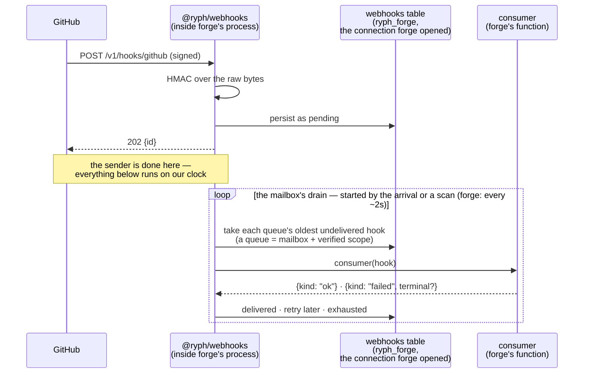
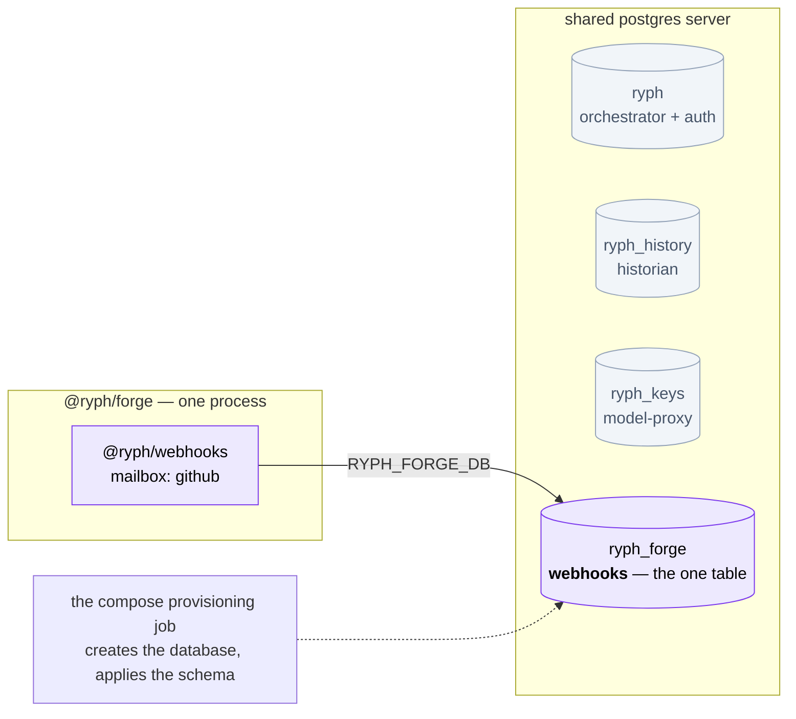
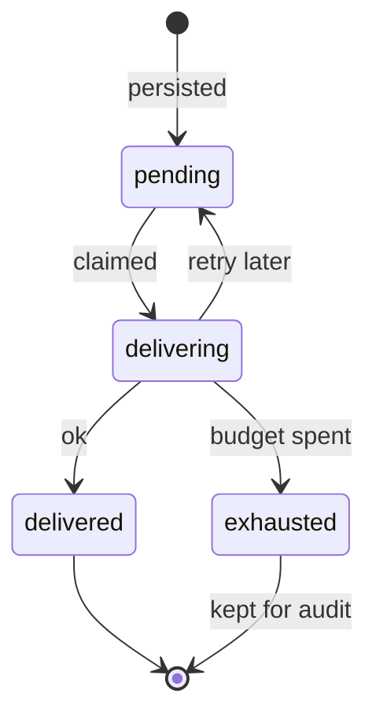

# @ryph/webhooks — architecture

A library for receiving webhooks — the HTTP requests a third party sends us when something happens
on their side. It is not a service of its own: a package that has webhooks to receive mounts this
one inside its own process, behind its own HTTP server. It does four things and nothing else:

1. **verifies the sender** — an HMAC-SHA256 signature over the raw request bytes, or a secret in a header (shared, or derived per scope)
2. **persists the request as it arrived** — full body, and every header but the ones a credential rides on
3. **answers `202` before anything else runs**
4. **hands it to the package that asked for it**, later, oldest first

It never reads a payload. Parsing one, and everything a webhook then triggers, belongs to the
package that asked for it.

## The mailbox

A **mailbox** is one URL that accepts webhooks from one sender, together with the rule for verifying
them and the function that handles them. A package rents one mailbox per sender it hears from, so a
package fed by two services rents two. In the code a mailbox is a `WebhookRegistration`, and what
`register()` creates; "mailbox" and "registration" mean the same thing throughout. Each process that
mounts `@ryph/webhooks` runs its own mailroom, holding only the mailboxes rented in that process.

Mailboxes are rented rather than owned: the registry is in memory, so one exists only while the
process that registered it is running. Registering one takes three things:

| You supply        | What it is                                                                     |
| ----------------- | ------------------------------------------------------------------------------ |
| **an id**         | slug-shaped, and it is the URL: `POST /v1/hooks/<id>`                          |
| **a verify rule** | how a request proves its sender — one of four kinds, below |
| **a consumer**    | the registrant's function, called once per persisted request                   |

The four verify rules:

| Kind | What the sender proves | Used by |
| --- | --- | --- |
| `hmac-sha256` | `header` holds `prefix + hex(HMAC-SHA256(secret, rawBody))`. The header may carry **several** signatures separated by commas or spaces; any one matching passes, each compared in constant time, hex case-insensitive. | GitHub (`x-hub-signature-256`, `sha256=`), Grafana, Sentry, PagerDuty (`v1=…,v1=…` while it rotates a secret) |
| `secret-header` | `header` holds `prefix + secret` verbatim (`prefix` defaults to `""`). A password, not a signature: it says nothing about the body's integrity, so it is for senders that can set a header but cannot sign. | Alertmanager (`authorization: Bearer …`), Grafana IRM, Opsgenie, Datadog, the Radicle bridge |
| `derived-secret-header` | `header` holds `hex(HMAC-SHA256(master, label + scope))`, where `scope` is the one `scopeParam` query value of the URL (1–20 digits). With `generationParam` set, the URL must also carry exactly one generation of 1–10 digits in that parameter, and the header must be `hex(HMAC-SHA256(master, label + scope + ":" + generation))`. A token vouches for one scope only, so a leaked one forges nothing for another; the verified scope becomes the row's `scope` (and its queue, see below) and the `x-ryph-verified-scope` header, the generation the `x-ryph-verified-generation` header. | GitLab (`x-gitlab-token`, `?project=<id>&generation=<n>`) |
| `standard-webhooks` | The [Standard Webhooks](https://www.standardwebhooks.com) scheme: `webhook-signature` holds space-separated `v1,<base64>` parts, each HMAC-SHA256 over `${webhook-id}.${webhook-timestamp}.${rawBody}` keyed with the base64-decoded secret (after an optional `whsec_`). Any part matching passes, and `webhook-timestamp` must be within **5 minutes** of the door's clock either way, so a captured request cannot be replayed later. | Svix and senders built on it — incident.io |

Whether the secret was minted by the registrant or pasted from the sender's settings is no concern
of this module's: it holds whatever secret it was registered with, in memory only.

The generation of a `derived-secret-header` token is how one scope's token is rotated without
rotating the master, which would re-key every scope at once. It travels in the URL so the door
needs no state: it holds the master and nothing else, no table of scopes or of current generations.
That also means the door cannot know which generation is **current** — a token minted for
generation 1 still verifies after the registrant has handed out generation 2, because the HMAC only
proves the token was minted for that (scope, generation) pair. Retiring a generation is the
registrant's call, and it can make it at the door: a registration's `admitScope(scope, generation)`
is asked after verification and before anything is stored, and a `false` is answered `403` with no
row written (a throw, `503`). Its consumer can also read `x-ryph-verified-generation` off the row and
refuse one older than the generation it last issued for that scope, for a rotation that came after
the row was stored. `deriveScopedSecret` takes the generation as an
optional fourth argument, so the page that shows a person their token derives it exactly as the
door checks it.

A registration may also cap its intake with a **rate limit** — at most N verified requests per
rolling window, anything more answered `429` and never persisted. With `per: "scope"` each verified
scope spends a window of its own, so one scope's sender floods only its own budget. With
`over: "drop"` a request over it is answered `202` instead, and still never persisted: for a sender
like GitLab, which never retries and counts every 4xx toward switching the hook off, a 429 would
lose the deliveries under budget too. `lane(headers)` splits each budget by the kind of delivery —
GitLab's comments apart from its merge request and push events — so one kind's flood never drops
another; the sender wrote those headers, so it maps them to a small fixed set, never to a budget
per value. `onOverLimit(scope, generation, lane)` tells the registrant of each one, refused or
dropped, since no row is left behind. And it may set
`retainTerminalMs`: each tick then deletes its `delivered` and `exhausted` rows that much after
their last update, a bounded batch per tick. Mailboxes can be handed back
with `unregister()`, and a registrant can mint a hook of its own with `enqueue()` — persisted and
delivered exactly like an ingested one, minus the door: no verification, no rate limit, no HTTP.

The whole flow, end to end:



A persisted request is a **hook**. Mailbox and hook are the whole domain — a mailbox is what a
package rents, and a hook is what arrives in it. Only hooks are stored: the `webhooks` table holds
one row per hook, and a mailbox leaves nothing behind but its id, copied onto every row as
`registration_id`.

## Who runs `@ryph/webhooks`

The package the webhooks are addressed to — its **registrant**, meaning the package that mounts
this library and rents mailboxes in it. `@ryph/webhooks` has no `main.ts` and listens on no port:
it is a library, mounted inside a process that already serves HTTP.

It has to be that way. A mailbox needs two things that cannot cross a process boundary:

- **the secret**, without which a signature cannot be verified
- **the consumer**, which exists only inside the registrant's process

One central webhook service would have to hold every other package's secrets — in a table or handed
over the network — and reach every consumer over a network hop.

So `@ryph/forge` holds the GitHub App's webhook secret, mounts `@ryph/webhooks`, and rents the
`github` mailbox. Any other package with webhooks to receive mounts it the same way, with its own
mailboxes and its own secrets.

Five rules hold, no matter how many packages mount it:

- **It brings the table; the registrant brings the database.** There are two ways to hand one over.
  `makeWebhooksDb(url)` opens a connection of its own to the database at that URL and closes it on
  shutdown; `scopeWebhooksDb(cluster)` takes a `DbCluster` — one open connection that several
  packages' tables share — and returns a handle over it, whose `close` is a no-op because the
  cluster's owner does the closing. Which one to call is not a preference: a store must never be
  opened twice. Two PGlite instances on one data directory both open, then silently stop seeing
  each other's writes, so a process that already holds a connection must scope it rather than open
  a second. Forge holds none, so it opens one, pointed at `RYPH_FORGE_DB` — the
  `ryph_forge` database in compose.
- **A process only ever handles its own hooks.** A scan — one read of which queues are due — picks
  up rows belonging to the mailboxes that process registered, and no others. Two processes that
  both mount `@ryph/webhooks` have their own registries, their own ticks and their own ingestion
  URLs.
- **A webhooks table belongs to one registrant.** A mailbox id has to be unique in two places, and
  both of them are the registrant's own: the in-memory registry, and the table its rows land in.
  So two registrants may each rent a `github` mailbox — different URL, different secret, different
  consumer, different table, nothing shared. What they must not do is write into one another's
  table: a row carries only its `registration_id`, so two processes drawing on the same table under
  the same id would hand each other's hooks to the wrong consumer, and nothing would report it.
- **One scan serves every mailbox in the process, but each mailbox drains on its own, and keeps its
  own queue — one per verified scope, for a `derived-secret-header` mailbox.** Hooks in a queue
  are delivered in the order they arrived, a queue stuck on a failing hook never holds up another,
  and a mailbox whose consumer hangs never holds up another mailbox.
- **Nothing secret is written down.** The registry lives in memory, so every registrant registers
  its mailboxes again on each boot.

In the composed deployment that comes out as one small database with one table in it, sitting
beside the databases every other package owns:



The separate database is the same reasoning as every sibling beside it: these rows are hostile
internet input with full bodies in them, and one credential should not open both them and the
orchestrator's tables. Forge has no other tables of its own, so `ryph_forge` holds exactly one.

## Mounting `@ryph/webhooks`

Five steps, as `@ryph/forge`'s `main.ts` does them, trimmed:

```ts
// 1. Give the mailroom somewhere to write. Forge has no database of its own, so it opens one;
//    a registrant that already has a cluster passes scopeWebhooksDb(cluster) instead.
const webhooksDb = await makeWebhooksDb(env("RYPH_FORGE_DB"));

// 2. setup() builds the mailroom and starts nothing.
const lock = await webhooksDb.lockSession({ selfHealing: true }); // for this key alone
const webhooks = setup({
  store: drizzleHookStore(webhooksDb.db),
  diag,
  now: () => new Date(),
  onIngested: () => kick(), // optional: scan now for a hook its idle mailbox would otherwise wait for
  // optional, for several replicas: only the one holding the lock delivers
  leader: async () => await lock.held(KEY) || await lock.tryLock(KEY),
});

// 3. Mount its routes in forge's own server. @ryph/webhooks opens no port, so until this
//    line the ingestion URL does not exist and nothing can arrive.
const handler = makeHandler({ /* forge's own routes */ }, [
  ...livenessRoutes(webhooks, diag), // ahead of the host's /healthz: ticks that keep wedging restart the pod
  ...health.routes,
  ...webhooks.routes,
]);

// 4. Rent a mailbox — once per sender, at boot.
webhooks.register({
  id: "github", // → POST /v1/hooks/github
  verification: {
    kind: "hmac-sha256",
    header: "x-hub-signature-256",
    prefix: "sha256=",
    secret: webhookSecret,
  },
  consumer: githubWebhookConsumer({ sink, diag }),
});

// 5. Run tick() on a timer. The scan is what hands hooks to the drains; without it a hook waiting
//    out a retry clock never leaves the table.
const kick = coalescingTick(() => webhooks.tick(), onError);
setInterval(kick, intEnv("RYPH_WEBHOOKS_SWEEP_INTERVAL_MS", 2_000));
```

`setup()` returns, besides `unregister`, `purge` and `enqueue` (below):

| It returns   | What it is                                                                                                                                        |
| ------------ | ------------------------------------------------------------------------------------------------------------------------------------------------- |
| `routes`     | route objects to spread into the host's router. One route, `POST /v1/hooks/:registrationId`, serves every mailbox — the id in the path selects it |
| `register()` | rents a mailbox. Boot-time wiring, so a duplicate or non-slug id is a programming error and throws                                                |
| `tick()`     | one scan: every due queue handed to its mailbox's drain, which delivers on after it returns, then a bounded prune. What a host's timer runs. Never runs past `TICK_STALL_MS` (a minute): one still running is abandoned, with a `webhooks.tick_abandoned` warning |
| `sweep()`    | `tick()`, then waits until no mailbox is draining — for tests and one-shot callers, never a timer: one hung mailbox would hold every scan    |
| `stalled()`  | why the mailroom is wedged — the last `MAX_ABANDONED_TICKS` (3) ticks all abandoned — or null. `livenessRoutes` turns it into the host's `/healthz` |

Call `setup()` **once per process**, and `register()` on it as many times as there are senders.
A second `setup()` in the same process is the one mistake here that reports nothing: its routes
match the same pattern, the router takes whichever it reaches first, and every mailbox registered
on the other instance answers `404` as if it had never been rented.

The timer belongs to the caller on purpose. `@ryph/webhooks` never starts one, because only the
mounting process knows how it is deployed — how often it wants to tick, and whether it runs alone
or as several copies of itself sharing the same table.

Forge's tick is a fair example of what that means in practice. Three guards, each for a different
problem:

- **`coalescingTick`** (exported), so scans never overlap. A kick that lands while one runs is
  not dropped: any number of them make exactly one more scan right after it. A scan never waits on
  a delivery — the drains it starts run on after it — so a mailbox that is slow, or hangs, never
  holds the next scan, nor any other mailbox's hooks.
- **`leader`, a Postgres advisory lock held from scan to scan.** Forge can run as several replicas.
  Every replica takes deliveries at the door; only the one holding the lock scans and drains, and
  keeps it until its database session ends. Correctness never rested on it — a claim is a
  conditional `UPDATE`, so two drains can never take the same hook — but what a consumer holds per
  process does: GitLab's budget of API calls (`hookBudget` in the forge) is the deployment's only
  because one process spends it. No delivery starts on a "you lead" answer older than
  `LEADER_FRESH_MS` (250 ms): a drain asks again before its next delivery once the last answer is
  that old, so a process that loses the lock starts nothing new past that bound, and only what it
  has in flight finishes — for that moment two processes' deliveries overlap, at most
  `MAX_CONCURRENT_DRAINS` per mailbox each. Every check is raced against
  `LEADER_CHECK_TIMEOUT_MS` (5 s): one that does not answer is "not leading" and a
  `webhooks.leader_check_timed_out` warning, never a scan that waits for good. The lock lives on a
  self-healing session of its own (`LockSessionOptions.selfHealing` in `@ryph/db`): every call
  answers within 3 s however its connection died, the next opens a fresh connection, and that one
  ends the backend the old one left — so a database restart, a failover or a partition moves the
  lock on rather than wedging the replica that held it. That backend is named by its pid, its
  start and a random `application_name` its connection gave it: a session-mode PgBouncer takes a
  given-up server connection back, resets it with DISCARD ALL and lends it, same pid and start, to
  the next client, whose session must not be the one ended. A partitioned backend is otherwise ended
  by the server's TCP keepalive, set on that connection to notice a dead peer in about 25 s rather
  than the server default of two hours — set once connected, not in the startup packet, which a
  session-mode PgBouncer refuses outright (the leader would never connect, and nothing would be
  delivered). Each connection gets it from the session's first call on it, so one the server
  closes is given up like one that failed, never left to the driver's own silent reconnect, which
  would come back without it and under the old backend's name. Its calls go one at a time, each
  still answering within the deadline from when it was made: two at once, the driver queued the
  second and, on a close, dialled again behind the give-up — a backend in an ended client that
  nothing would close. Giving a connection up drops every lock on it, which is why the session
  holds this one key and nothing else. A lock taken per tick and released at its end no longer
  works: the drains outlive the tick, and another replica's next tick would start the same drains
  beside them.
- **`onIngested`**, called when a hook lands in a mailbox with no drain running: the host's kick,
  which scans at once, so a fresh hook is delivered in milliseconds rather than at the next tick. A
  hook that lands while its mailbox drains is not announced — it goes straight into that drain's
  line. The timer is then left to catch what no arrival here announces: a failed hook whose retry
  wait has run out, anything a crash abandoned half-delivered, and a hook another replica took in.

## Ingestion: verify, persist, answer 202

One route serves every mailbox — `POST /v1/hooks/:registrationId`, the id in the path choosing
which. A request passes these gates in order, and the first one it fails is the answer the sender
gets:

| The request must…                                              | If it doesn't                                                        |
| -------------------------------------------------------------- | -------------------------------------------------------------------- |
| name a mailbox this process has registered                     | `404` — the same answer as a wrong path, so a prober learns nothing  |
| stay under that mailbox's size cap (2 MB by default)           | `413` — checked while reading, so an oversize body is never buffered |
| pass the mailbox's verify rule (one of the four kinds above)   | `401` — missing, wrong and (for `standard-webhooks`) stale answer alike, compared in constant time |
| name a scope the registrant still takes, if it set `admitScope` | `403` — refused and never persisted; `503` when the registrant's answer threw |
| fit inside the mailbox's rate limit, if it set one (per scope, with `per: "scope"`) | `429` — refused and never persisted (`202` and dropped, with `over: "drop"`); the registrant hears via `onRateLimited` and `onOverLimit` |

Clear all five and the request is stored as `pending`, full body and its headers, and the sender
gets `202 {id}`.

The stored headers are the request's **minus the credential**: the header the mailbox verified
against, plus `authorization`, `proxy-authorization`, a cookie, `webhook-signature` and anything
spelled `x-hub-signature*`, are dropped before the insert (`src/helpers/headers.ts`). So are
`x-ryph-verified-scope` and `x-ryph-verified-generation` when the sender sends them: those names
belong to the door, which writes them onto a `derived-secret-header` row after verifying, and a
consumer trusting them must be reading what the door wrote. For a `secret-header`
mailbox that header IS the secret, verbatim, and these rows have no retention sweep behind them —
so a mailroom that wrote it down would be a place the credential accumulates, one row per event.
Nothing is lost: verification has already happened by then, and no consumer reads those headers.

Size is checked before the verify rule on purpose: the cap is there to protect memory on a route
anyone on the internet can reach, so it cannot wait on work that needs the whole body in hand.
The rate limit is checked after it, also on purpose: only a holder of the secret can spend the
budget, so a stranger hammering the URL collects `401`s and consumes nothing.

The `202` goes out **before any consumer runs**. The sender's clock never includes our processing
time, which matters because GitHub does not retry a delivery that timed out.

## Delivering: one at a time, oldest first

A hook moves through four states:



`pending` is waiting its turn, and a set retry clock is what makes it wait longer. `delivering`
means a sweep has claimed the hook and the consumer is running. Every claim carries a **lease**, a
deadline on that one delivery, so a process dying mid-delivery cannot strand a hook: the lease runs
out and the next sweep puts it back in the queue. `delivered` and `exhausted` are both final; a
hook exhausts when the retry budget runs out, or when the consumer reports the failure is
permanent. Exhausted rows stay in the table for audit — for good, or until the mailbox's
`retainTerminalMs` passes, when the sweep deletes them with its delivered ones. A queue's head is
read off a partial index of live rows in `seq` order (`webhooks_live_by_queue`), so a queue's
delivered past never costs the lookup anything.

A **queue** is a mailbox's hooks of one verified scope — the row's `scope`, which only a
`derived-secret-header` door sets (the GitLab project the token was derived for). Every other row has
a null scope, and all of a mailbox's null-scope rows are one queue, so a mailbox without scopes has
exactly one queue, as it always did. One GitLab mailbox serves every connected project, and a single
queue for all of them let one project's retrying hook hold every other project's behind it for the
whole backoff ladder — the best part of an hour. Order matters within a project and means nothing
across projects, so the queue is cut exactly there; and since the scope is the one the door
verified, a sender cannot pick a queue it holds no credential for.

A sweep only ever considers the **head** of each queue — the oldest hook not yet finished. One
delivery is in flight per queue, and a head waiting out a retry clock blocks everything behind it
in its queue, and nothing in any other:

```
mailbox "github"   ──▶ delivered oldest first

  seq 12   delivered
  seq 13   retrying   ◀── the head; its retry clock is still running,
  seq 14   waiting        so 14 and 15 cannot move
  seq 15   waiting
```

`seq` is arrival order, assigned by the table on insert; it is the only thing the queue sorts by.

Once the head runs out of retries it becomes `exhausted`, and the queue steps over it:

```
mailbox "github"

  seq 12   delivered
  seq 13   exhausted  ─── stepped over; the row stays, for audit
  seq 14   retrying   ◀── the head now
  seq 15   waiting
```

Three mechanics carry all of that. A sweep claims the head with a conditional `UPDATE … RETURNING`
(`saveHookIfState`), so two sweeps can never take the same hook — that, and not any lock, is what
makes several replicas safe. An expired lease returns a hook whose deliverer died. Retries back off
exponentially: 10s, doubling to a 15min ceiling, 10 attempts, which a mailbox may override when it
registers.

Two properties are worth stating outright:

1. **Strict FIFO per mailbox and verified scope.** Delivering hook N+1 before N of the same queue
   would reorder them, and ordered delivery is the promise here for senders whose webhooks carry
   state. Nothing is promised across queues: they drain side by side.

   **Each mailbox drains on its own** (`drains` in `core/sweeper.ts`): its own passes, its own
   line of queues, its own eight drains (`MAX_CONCURRENT_DRAINS`). No slot, pass or read is shared
   between mailboxes, so nothing one mailbox's consumer does — GitLab hanging, hundreds of its
   projects each running a read to its timeout — delays another's hook by a millisecond. Shared
   passes were tried first: a drain kept free per mailbox, a pass woken by arrivals, a cap on that
   waking — each closed one hole and left another, until a GitHub push waited out a GitLab pass of
   minutes the moment the cap was reached. The isolation is structural now.

   **A scan finds the work** (`tick()`): one read of which queues are due across every mailbox —
   their keys, never their rows, so an idle scan over N mailboxes is one statement, and a scan
   during a long pass costs a key per queue rather than a body of up to 2 MB. Each mailbox is handed
   its queues: an idle one starts a pass, a draining one takes those it does not hold yet into its
   line. A head's row is read when its queue's turn starts, and only then. A hook this process
   takes in joins its mailbox's line directly, with no read at all; one landing in an idle mailbox
   kicks a scan (`onIngested`).

   Within a mailbox the queues take **turns**: a queue delivers at most 16 hooks (`SWEEP_TURN`)
   before it goes to the back of the line, so one scope a token holder keeps full holds another's
   fresh head for one turn of each queue ahead of it, never for the pass. A pass keeps going while
   deliveries succeed, so a backlog clears in one pass rather than one hook per tick, and ends when
   its line is empty or at 1,000 deliveries (`MAX_DELIVERIES_PER_PASS`); the next starts after the
   last queue this one reached, wrapping round, so a pass that runs out before the end of a long
   line leaves the rest first in line next time. Started from the top every time, the queues sorting
   first took every pass and those sorting last were never reached.

   A consumer should still answer fast. One whose calls spend a budget (GitLab's API calls, shared by
   every project) says so BEFORE the claim: the drain asks the registration's `admitDelivery(hook)`
   of a due head, and a `wait` leaves it untouched — `pending`, its attempts as they were, nothing
   written — and its queue rests: it is offered again by the first scan a second after the refusal
   (`REFUSAL_REST_MS`). A scan follows every hook landing in an idle mailbox, and each refused head
   asked costs its row read, so without the rest a busy GitHub mailbox had GitLab's refused heads
   read whole hundreds of times a minute. A `go` may carry a ticket (what the registrant set aside
   for the delivery), handed to the consumer and released once the delivery is over, whatever
   became of it, a lost claim included. Waiting on a budget is not a failed delivery: counted as
   one, it let a flood of other queues, each within its own rate limit, keep the budget empty until
   a waiting hook's retries ran out. And since nothing is written, the attempt count stays the fence
   it is — rolling attempts back after a refusal would let a stale claim match a row that cycled
   meanwhile. Nor is a `wait` one of the pass's 1,000 deliveries: only a claim or a reclaim counts.

   The due-queue read costs a few index probes per queue (a loose index scan over
   `webhooks_live_by_queue`), never a walk over the live rows, and it names only queues whose head
   is **due**: a head waiting out a retry clock or held under a live lease blocks its queue anyway.
   A consumer outage over many queues costs a scan one read and each queue's turn its head's row.

   One honest limit on that order: `seq` is drawn when a row is inserted and becomes visible when
   it commits, and those are not the same instant. Two requests landing together can commit out of
   order, and a sweep running between the two commits hands over the later one first. The window is
   one insert wide, and hooks that arrive apart are never affected.

2. **`exhausted` is final and gets skipped.** Holding the queue until a human intervenes would let
   one bad request silence a mailbox forever. Skipping takes no code of its own: `getHeadHook`
   never returns a finished row, so an exhausted hook simply stops being the head. The row stays
   for audit, and `retryHook` — exported for a host that wants to re-queue one — puts it back in
   its original place in line.

A consumer answers `{kind: "ok"}` (optionally with a confirmed `dedupeKey`, below) or
`{kind: "failed", message, terminal}`. `terminal: true` — an
unparseable payload, for instance — exhausts the hook immediately rather than burning ten attempts
on a foregone conclusion. A consumer that throws counts as a retryable failure: a crash says
nothing about whether the request itself is deliverable.

A mailbox may also name what a hook is ABOUT (`dedupeKey(hook)`), for a sender whose hooks can
be rung again for the same thing — a GitLab note, which any token holder can replay. The sweep
asks it once it has claimed a hook, before the consumer, and a hook whose key a DELIVERED hook of
the same queue carries is delivered on the spot without the consumer: a replay costs one indexed
read (`webhooks_delivered_by_key`) instead of whatever the consumer would spend on it.

That function reads the untrusted body, so it only LOOKS UP. What a delivered hook is written down
under is the consumer's word: its ok carries `dedupeKey` once it confirmed, somewhere the sender
cannot write, that the thing exists (GitLab said that note is in that project). Were the body's
key written down, a sender could ring first with the name of something not yet there — GitLab's
note ids are global and sequential — and have the real one dropped as a duplicate when it came.
A failed or exhausted hook writes nothing, nor does one dropped as a duplicate, and a key counts
only while its row is retained. What the key means stays the registrant's: the mailroom only
compares strings.

## What it deliberately does not do

| It does not…                            | Why                                                                                                                                     | Where that happens instead                                         |
| --------------------------------------- | --------------------------------------------------------------------------------------------------------------------------------------- | ------------------------------------------------------------------ |
| persist the mailbox list, or any secret | secrets at rest are a liability, and each registrant already holds its own                                                              | the registrant, in memory, re-registering on boot                  |
| recognise a duplicate delivery          | recognising one means understanding the payload — GitHub's delivery id, for instance — and that understanding lives with the registrant (`dedupeKey` is the registrant's answer, only compared here) | the orchestrator, which dedupes forge events by `deliveryId`       |
| forward over HTTP                       | a consumer is a function in the same process: no loopback hop, no second surface to authenticate                                        | an adapter with the same function signature, if one is ever wanted |

Nothing is deleted unless its registrant asks. A `delivered` row has done its job; an `exhausted`
one is kept so a human can see what failed. Both keep the full raw body, because that
is what the signature was checked over. A registration's `retainTerminalMs` is the one retention
window: each tick deletes that mailbox's terminal rows older than it, a bounded batch at a time
(`pruneTerminalHooks`), so a mailbox anyone holding a credential can fill does not grow forever.
The forge's GitLab mailbox keeps them a week; a registration without one keeps them for good, and
its table only grows.

A request for an id nobody currently rents is refused at the door, with the same 404 as a wrong
path. What survives is what already got in: a hook persisted while its mailbox was registered stays
put if that mailbox is later gone, because the sweep drains registered mailboxes only. So a restart
or a config change loses nothing that already arrived — it just waits for the mailbox to come
back.

## What breaks, and what happens then

| If…                                | Then…                                                                                                                                                                           |
| ---------------------------------- | ------------------------------------------------------------------------------------------------------------------------------------------------------------------------------- |
| the sender cannot reach us         | nothing arrives and nothing piles up                                                                                                                                            |
| our ingestion is down              | those deliveries are **lost** — GitHub does not retry on its own. Answering before processing keeps that window as small as it can be; every webhook receiver has this exposure |
| a consumer is down, failing or hung | requests **pile up** in the table and drain once it recovers. Each queue stalls at its own head; other mailboxes, and other scopes of the same one, are unaffected — a hung consumer holds only its own mailbox's drains |
| the scan timer stops               | the same picture — nothing is lost; only arrivals into an idle mailbox's kick still deliver, and the rest drains when the ticks resume                                        |
| the leader's lock connection dies  | its next check answers "not held" within the lock session's deadline, a fresh connection takes the lock back (or another replica does), and delivery resumes within a scan or two |
| the network to the database partitions | every store call the sweep makes gives up at `STORE_DEADLINE_MS` (10 s) and every leadership check at its own timeout, so ticks end with warnings and liveness stays green — a restart would only take the forge's git traffic, which needs no database, down too. The leader's old backend is ended by the next connection once the network is back, or by the server's keepalive within about 25 s if this replica never gets back. A write that gave up may still land: claims are fenced, so the lease runs out and the hook is reclaimed |
| a tick wedges on something no timeout covers, or is that slow | it is abandoned after `TICK_STALL_MS` with a `webhooks.tick_abandoned` warning, and the host's next tick scans afresh. Only `MAX_ABANDONED_TICKS` in a row make `stalled()` say so, the host's `/healthz` answer 503 (`livenessRoutes`), and — on Kubernetes, the one mode whose probe acts on it — the pod restart, releasing the lock with its connection |
| a delivering process dies mid-hook | its lease expires and the next sweep returns the hook to the queue, in its original place                                                                                       |
